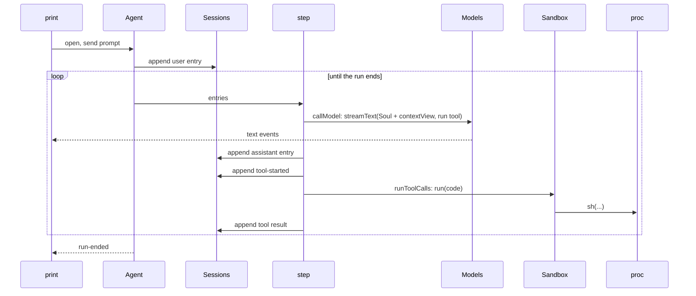

# Slice 4a: a working agent

Status: archived. Built and confirmed live 2026-10-13; its lasting decisions are in [architecture.md](../architecture.md#core-ideas) (Agent loop as built).

## Prep: split `src/cli/main.ts`

`main.ts` holds the login and logout commands and the wiring. Print mode would make it three concepts in one file, so the commands move out first, with no change in behavior.

## Files

```text
src/cli/main.ts            wiring only: layers, root command
src/cli/login.ts           tau login, tau logout (moved)
src/cli/print.ts           tau -p: read the prompt, print events, set the exit code
src/core/agent.ts          Agent service: one runner per session; send, subscribe
src/core/step.ts           one step: read entries, try operations in order, append
src/core/operations.ts     interruptStartedCalls, runToolCalls, callModel, stopAtTurnLimit
src/core/reply.ts          model stream parts -> assistant entry (Prompt.fromResponseParts)
src/core/base-prompt.ts    Soul, rewritten for one `run` tool
src/core/run-tool.ts       the `run` tool: description, functions, result text
src/sandbox/sandbox.ts     codemode runtime with limits; read, write, replace
src/proc/command.ts        run one shell command; kill its process group on interrupt
src/session/entry.ts       + tool-started entry; assistant entries can be interrupted
src/session/context-view.ts + tool-history repair; leaves out interrupted replies
src/host/settings.ts       + `model: "route/model"`, `maxTurns`, `timeouts`
src/ai/catalog.ts          + parseModelRef("route/model"), split at the first slash
tests/agent-loop.test.ts
```

## Types at the boundaries

```ts
// core: the one client interface (print mode now, the TUI at step 6)
type Command = { type: "prompt"; text: string } | { type: "cancel" }
type AgentEvent =
  | { type: "text"; delta: string }
  | { type: "tool-started"; callId: string; summary: string }   // first line of the script
  | { type: "tool-ended"; callId: string; isFailure: boolean }
  | { type: "run-ended"; reason: "answered" | "cancelled" | "failed" | "turn-limit"; error?: string }
interface Agent {
  open(session: SessionId | undefined, directory, model: ModelRef): Effect<SessionId>
  send(session: SessionId, command: Command): Effect<void>
  events(session: SessionId): Stream<AgentEvent>
}

// core: an operation looks at the entries and either acts or passes
type Operation = (entries: Entry[]) => Option<Effect<EntryBody[], RunError>>

// session: new entry and field
type EntryBody = ... | { type: "tool-started"; callId: string }
type AssistantEntry = { ...; interrupted: boolean }   // text kept for the user, left out of model calls

// sandbox
interface Sandbox { run(code: string, functions: Functions): Effect<RunResult> }   // codemode Result, trimmed

// proc
runCommand(command: string, cwd: string): Effect<{ exitCode; output }>   // output capped, head and tail
```

## Call path



## Logic

```text
step(session):
  entries = sessions.entries(session, 0)
  for operation in [interruptStartedCalls, runToolCalls, stopAtTurnLimit, callModel]:
    if operation applies to entries: append its entries; return continuing
  return answered

interruptStartedCalls applies when a call has tool-started and no result (a crash):
  append an "Interrupted before it finished." result; never run it again

runToolCalls applies when the last assistant entry has calls without tool-started:
  for each call: append tool-started; sandbox.run(call.code); append tool result

stopAtTurnLimit applies only when maxTurns is set and this run has made that many replies: run ends with turn-limit

callModel applies when the last entry is a user entry or a tool result:
  stream = model.streamText(system: Soul + run description, prompt: contextView(entries),
                            toolkit: run, disableToolCallResolution)
  publish each text delta; collect parts; append toAssistantEntry(parts)

cancel: interrupt the step
  a reply in progress: append its text so far, interrupted
  each open call: "Interrupted by the user." result
  run ends with cancelled

contextView repairs tool history before converting:
  each tool result moves right after its call
  a call with no result gets an error result (a cancel, a crash, a branch cut)
  a result with no call is dropped
  an interrupted reply is left out
```

- **Session ID is the conversation ID** for `Models.languageModel`. Opening a session starts `Catalog.refreshIfStale` in the background.
- **Timeouts at two levels**, each with a default in `~/.tau/settings.json` (`timeouts.run`, `timeouts.shell`) that the model can override per call:
  - a whole `run` call: optional `timeoutSeconds` on the tool, default 10 minutes, no upper limit; passed to codemode's per-run `limits.timeoutMs`. On timeout everything still running stops and the result says so, with the logs so far.
  - one `sh` call: `sh({ command, timeoutSeconds })`, default 2 minutes, as in OpenCode. On timeout `proc` kills the process group and the call throws with the output so far, so the script can catch it.
  - The `run` timeout always wins; the tool description says so.
- **Output per `run` call** is cut at 50 KB (head and tail), as Pi does.
- **No turn limit by default.** Long runs are normal; the model ends a run with its final answer. `maxTurns` in `~/.tau/settings.json` sets a limit for users who want one.

## Tests: where behavior is injected

`core` gets its model from `Models`. Production passes the real layer; tests pass a `Models` layer whose `languageModel` returns `LanguageModel.make` with scripted replies. Everything else is real: SQLite in a temp directory, codemode, `sh`. When the HTTP fake provider is built, these tests move to it and the scripted model is deleted ([deferred.md](../deferred.md)).

| Test (`tests/agent-loop.test.ts`) | Proves |
| --- | --- |
| Reply with a `run` call, then an answer | The script runs `sh` in the session directory; the second model call holds the result; the run ends answered |
| Rebuild the agent after every step | Nothing lives between steps except entries |
| A tool-started entry with no result, then rebuild | The call gets an interrupted result and the script does not run again |
| A `sh` call past its timeout, inside a script that catches it | The child is killed; the script sees the error and the output so far |
| Cancel while `sh` runs `sleep` | The child is killed; the call gets an interrupted result; the session can continue |
| Cancel while the reply streams | The text so far is saved, interrupted, and left out of the next model call |
| A branch cut between a call and its result | The context view adds an error result |
| A model that keeps calling tools, with `maxTurns` set | The run ends at the turn limit; without the setting it keeps going |
| Continue a session by ID | The next model call holds the earlier runs |
| Print mode with `TestConsole` | Answer on stdout, tool lines and the session ID on stderr, exit codes |

## Not in 4a

Instructions, retries and usage-limit messages (4b); script edits, write queues, `checks` (4c); usage on assistant entries (step 5, for compaction).

## As built

- **Tests** (`tests/agent-loop.test.ts`, `tests/sessions.test.ts`): a `run` call and its result, a shell timeout the script catches, a started call never run again, cancelling a command (the process is gone, the session continues), cancelling a reply (its text saved, left out of later model calls), the turn limit, continuing a session in a new agent, and a branch cut between a call and its result.
- **Not built as planned:** "rebuild the agent after every step" became two tests that rebuild from saved entries: the crash test and the continue test. There is no command yet that resumes a run without a new prompt, so nothing else can restart mid-run. Print mode has no in-process test: it builds the real model layers from the settings file, so a test would need the HTTP fake provider. The live run covers it for now.
- **Catalog refresh** runs from print mode, not from `Agent.open`, so the agent needs no catalog and tests need none.
- **A prompt sent during a run** waits for the run to end. Steering comes with the TUI.
