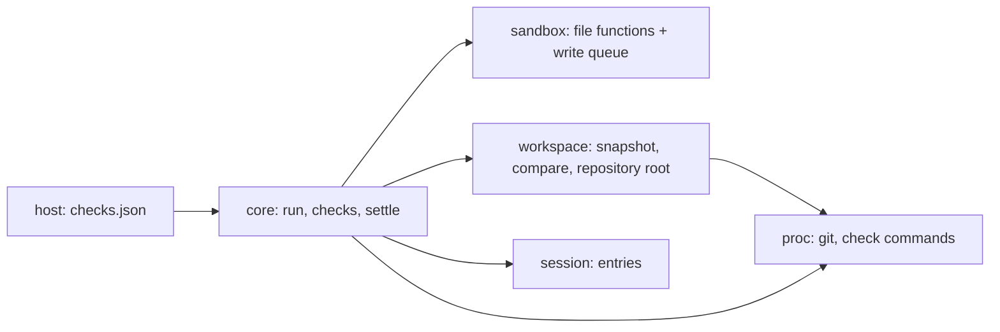
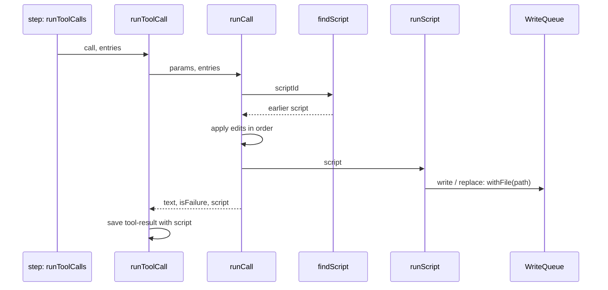

# Slice 4c: script tools

Status: archived. Built and checked live 2026-10-13; lasting decisions in [architecture.md](../architecture.md#core-ideas) (Script tools as built); slice 4d's architecture is in [work/agent-loop-4d.md](../work/agent-loop-4d.md).

**What the user gets:** when a `run` script fails, the model fixes it with a few small edits instead of sending the whole script again. Two edits to one file in the same script can no longer overwrite each other. Projects define checks (formatters, lint, type checks, tests): fixers run silently after the model changes matching files, and the model calls `checks` when it is done. If it skips them, or changes files after, Tau runs them before the run ends and sends the failures back.

## Today

| Piece | Where | How it works now |
| --- | --- | --- |
| `run` tool | `src/core/internal/run-tool/` | takes `code`; a failed script returns its error and nothing else |
| File functions | `src/sandbox/Sandbox.ts` | `read`, `write`, `replace`; `replace` reads, changes and writes with no lock, so two `replace` calls on one file in a `Promise.all` can lose one edit |
| Tool calls | `src/core/internal/loop/run-tool-calls.ts` | one call at a time; the result entry saves `files`, the paths the file functions touched (used to load subfolder `AGENTS.md`) |
| Step | `src/core/internal/loop/step.ts` | operations in order: interrupt started calls, run tool calls, turn limit, call the model; none applies means the run answered |
| Git | `src/core/internal/instructions/folders.ts` | finds the repository root through `proc` |
| `workspace` layer | `.fallowrc.jsonc`, `architecture.md` | declared as a leaf that may import nothing; no code yet |

## Systems



| System | Change |
| --- | --- |
| `sandbox` | changed: `write` and `replace` wait their turn per file |
| `workspace` | added: snapshot of the working tree and the files changed between two snapshots; takes over finding the repository root from `folders.ts` |
| `core` | changed: `run` takes edits to an earlier script; new `checks` tool; fixers after each `run` call; a new step operation, *settle checks*, before the run ends |
| `session` | changed: the tool result saves the files a call changed and the edited script; a new `checks` entry |
| `host` | changed: reads the project's `.tau/checks.json` |

## Patterns

| Choice | Beat | Tradeoff |
| --- | --- | --- |
| Script edits resolved from saved entries | Tau's `eval` extension: an in-memory store of the last 8 scripts | survives a restart and fits the re-entrant step; the result entry stores the edited script |
| One lock per real file path: Effect `RcMap` of `Semaphore.make(1)`, freed when idle | Pi's per-path promise chain (`file-mutation-queue.ts`); OpenCode's `KeyedMutex` | the same idea, built from Effect modules Tau already uses; not a lock against `sh` or other processes |
| Compare snapshots before and after each `run` call | OpenCode formats only files its own tools write; Codex's `TurnDiffTracker` sees only `apply_patch` | catches changes made through `sh`, at the cost of one `git status` per call |
| Settle checks as a step operation | Silent Command Runner's end-of-run hook | state comes from entries, so it is re-entrant and testable like the other operations |

## Agreed (round 1)

| # | Question | Agreed |
| --- | --- | --- |
| 1 | One slice or two | **Two.** 4c: script edits and the write queue (no new system). 4d: `workspace` and checks. Each ends with checks and a live run |
| 2 | Script ID | **The entry number of the failed result**, such as `Script ID: 41`, shown only on failure. Any `run` script still in context can be edited. Each edit's `old` text must appear once, as `replace` requires |
| 3 | Scope of the write queue | **`write` and `replace`, per process,** keyed by real path, so two sessions in one process share it. `read` does not wait |
| 4 | Snapshot shape | **A: `git status` plus a hash of each changed and untracked file** (`Bun.hash`; files over 2 MB compare size and change time). B, OpenCode's shadow git repository with a tree per call, also gives diffs and undo; it waits until undo is planned. `workspace`'s interface (`snapshot`, `changed(before, after)`) stays the same for B |
| 5 | Outside a git repository | **No change detection:** fixers do not run, `checks` runs every check, and settle runs them once at the end of a run with any `run` call |
| 6 | `workspace` may import `proc` | **Yes** (permission given). It needs git. Changes `.fallowrc.jsonc` and the layer table in `architecture.md` |
| 7 | Where checks are defined | **The project's `.tau/checks.json`,** with a schema like Silent Command Runner's, one list per kind of check. `settings.json` stays for Tau's own settings, not the repository's. A cloned repository's file runs commands without asking, so round 4 (isolation and trust) adds a trust prompt |
| 8 | How the model calls checks | **A second tool, `checks`,** with no parameters, shown only when checks exist. Not a script function, so its result is its own entry |
| 9 | `{files}` in a command | **Replaced with `"$@"`; the paths are passed as arguments to `sh -c`,** so no path is ever quoted or pasted into the command |

Check entry shape, carried over from Silent Command Runner: `name`, `command`, `details`, `include` and `exclude` globs (`Bun.Glob`), `cwd`, `env`, `timeoutSeconds`; the kind (`fix`, `check`, `final`) is the list the entry is in. Designed in slice 4d's code round.

## Round 2: code plan for slice 4c (agreed)

### Files

```text
src/sandbox/
  Sandbox.ts        changed: Edit schema and replaceUnique(text, edit), shared by replace and script edits;
                    fileFunctions takes the write queue; write and replace run inside queue.withFile
  WriteQueue.ts     new: one lock per real file path, made once per Agent
src/session/
  Entry.ts          changed: tool-result gains optional `script`, the code that ran
  ContextView.ts    changed: a failed result with a script gets a last line "Script ID: <entry number>"
src/core/internal/
  run-tool/run-tool.ts       changed: RunParameters gains scriptId and edits; runCall resolves the script first
  loop/tool-history.ts       changed: findScript(entries, id); summary names the edited script
  loop/run-tool-calls.ts     changed: passes the entries to runCall, saves `script`
  runner/runner.ts           changed: passes services.writeQueue to scriptFunctions
src/core/Agent.ts            changed: makes the write queue in its layer, beside the runners RcMap
```

### Types

```ts
// sandbox/Sandbox.ts
const Edit = Schema.Struct({ old: Schema.String, new: Schema.String }); // replace's input reuses it
const replaceUnique: (text: string, edit: Edit) => Result<string, TextNotUnique>;
const fileFunctions: (directory: string, touched: Touched, queue: WriteQueue) => Functions<FileSystem>;

// sandbox/WriteQueue.ts
type WriteQueue = {
  readonly withFile: <A, E, R>(path: string, effect: Effect<A, E, R>) => Effect<A, E | PlatformError, R>;
};
const makeWriteQueue: Effect<WriteQueue, never, Scope | FileSystem>; // RcMap.make + Semaphore.make(1)

// core/internal/run-tool/run-tool.ts: one flat object, exactly one of `code` or `scriptId` + `edits`
const RunParameters = Schema.Struct({
  code: Schema.optional(Schema.String),
  scriptId: Schema.optional(Schema.Int),
  edits: Schema.optional(Schema.NonEmptyArray(Edit)),
  timeoutSeconds: Schema.optional(Seconds),
});
type RunResult = ScriptResult & { readonly script?: string };
const runCall: <R>(params: Json, entries: readonly Entry[], functions: Functions<R>, timeouts: Timeouts)
  => Effect<RunResult, never, R>;

// session/Entry.ts: ToolResultEntry gains
script: Schema.optional(Schema.String)
```

### Call path



### Logic

```text
runCall(params, entries)
  decode params; on failure: failed result, no script
  if code and no scriptId: script = code
  if scriptId and edits and no code:
    earlier = findScript(entries, scriptId)
    none: failed "There is no script <id>.", no script
    for each edit, in order: text = replaceUnique(text, edit)
      fails: failed "Edit <n>: the text to replace appears <count> times, not once.", no script
  otherwise: failed "Pass code, or scriptId with edits.", no script
  result = runScript(script); return result with script

findScript(entries, id)
  entry numbered id, a tool-result named run with a script: its script

contextView: failed result with a script
  text + "\n\nScript ID: <its entry number>"

withFile(path, effect)
  key = realPath(path), else realPath(parent) + name, else path
  scoped: semaphore = RcMap.get(locks, key); semaphore.withPermit(effect)
```

A failed edit has no script, so it gets no new ID and the model edits the same script again. An edited script that fails gets its own ID; both stay editable. Saved result text never contains the ID, so the cached start of each request does not change.

### Injection

No new seam. Tests use the real runner, sandbox and SQLite through `tests/support/agent-harness.ts`, with the scripted model the agent loop tests already use.

### Tests

| File | Case |
| --- | --- |
| `tests/core/script-edits.test.ts` (new) | a failed script's result ends with `Script ID: <n>`; an edit call runs the fixed script and saves it; an edit whose text appears twice fails and names the edit; an unknown ID fails; an ID still works after the agent restarts on the same database |
| `tests/core/write-queue.test.ts` (new) | two `replace` calls on one file in `Promise.all` keep both edits; the same through a symlinked folder |

### Replaces

`replaceOnce`'s counting moves into `replaceUnique`. `summary` reads `code` or names the edited script. Nothing is deleted.

### Agreed (round 2)

| # | Question | Agreed | Reason |
| --- | --- | --- | --- |
| 1 | Parameter shape | **One object with optional fields**, checked in `runCall` | a union becomes `anyOf` at the root of the schema, and Anthropic and OpenAI require the root to be an object |
| 2 | Where `Script ID` comes from | **Added by the context view from the entry number** | the number is known only after the save; the saved text stays as the script printed it |
| 3 | Which results save `script` | **Every `run` result** | one lookup path; the cost is a second copy of each script in `sessions.db` |
| 4 | How file functions get the queue | **An argument, from the runner's services** | matches how the runner already hands services down; an Effect service would add it to every script's requirements |

### Fixes from the live check (agreed)

The first live model matrix run failed 4 of 12 models. The user agreed to these fixes, and the second run passed all 12.

| # | Problem | Fix | Reason |
| --- | --- | --- | --- |
| 1 | A `run` call that failed the parameter schema ended the run, because Effect checks tool parameters while it reads the reply | **`run` is a dynamic tool with a JSON schema; only `runCall` checks the parameters**, so a wrong call comes back as a failed result | the model can fix a call only if it sees what was wrong; OpenCode does the same |
| 2 | OpenAI's strict mode made every optional field required, so models filled in `scriptId` with new code | **Strict mode is off for `run`** | optional fields stay optional on every route; OpenCode sends `strict: false` too |
| 3 | Gemini sent an empty reply after a tool result, and Tau took it as the answer | **A reply with no text and no tool call fails as invalid output, which is retried** | an empty reply never finishes the work |

## Checked in the references

- OpenCode: `packages/core/src/snapshot.ts` and `git.ts` (shadow repository: `diff-files` and `ls-files --others --exclude-standard`, then `update-index` and `write-tree`, 2 MB cap on untracked files); `effect/keyed-mutex.ts`; `formatter.ts`.
- Pi: `packages/durable/src/tools/file-mutation-queue.ts` (key by canonical path, so a symlinked folder shares one queue).
- Codex: `core/src/turn_diff_tracker.rs`; `git-utils/src/fsmonitor.rs` (a repository's `core.fsmonitor` setting can name a program that `git status` runs; for round 4).
- Tau's earlier extensions: `eval` (script IDs and edits) and Silent Command Runner (check modes, settings, stale results).
- Dependencies: Effect `RcMap`, `Semaphore` (`PartitionedSemaphore` shares one pool, so it does not fit); Bun `Glob`, `Bun.hash`.
