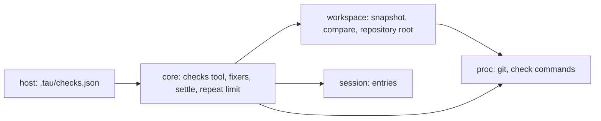
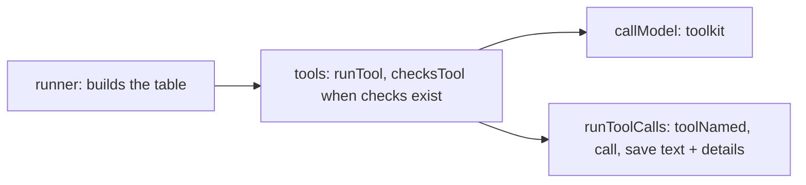
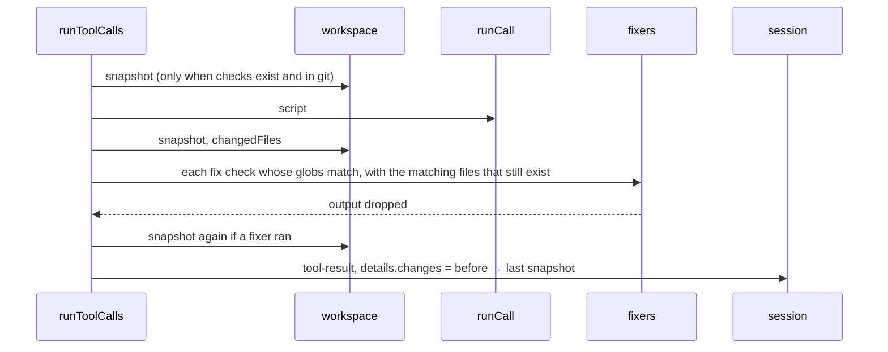

# Slice 4d: checks and change detection

Status: archived. Built 2026-10-13; lasting decisions in [architecture.md](../architecture.md#core-ideas) (Checks as built); its live checks are in [live-checks.md](../live-checks.md).

**What the user gets:** projects define checks (formatters, lint, type checks, tests). Fixers run silently after the model changes matching files, and the model calls `checks` when it is done. If it skips them, or changes files after, Tau runs them before the run ends and sends the failures back. A model that sends the same failing call again and again ends its run instead of looping.

## Today

| Piece | Where | How it works now |
| --- | --- | --- |
| `workspace` layer | `.fallowrc.jsonc`, `architecture.md` | declared as a leaf that may import nothing; no code yet |
| Repository root | `src/core/internal/instructions/folders.ts` | found through `proc` |
| Tool calls | `src/core/internal/loop/run-tool-calls.ts` | one call at a time; the result entry saves `files` and `script` |
| Step | `src/core/internal/loop/step.ts` | operations in order: interrupt started calls, run tool calls, turn limit, call the model |
| Run end reasons | `src/core/internal/loop/run-context.ts` | `answered`, `turn-limit`, `output-limit`, `cancelled`, `failed` |
| Repeated calls | nowhere | in the live model matrix, DeepSeek on one backend sent 229 empty `run` calls in a row |

## Systems



| System | Change |
| --- | --- |
| `workspace` | added: snapshot of the working tree and the files changed between two snapshots; takes over finding the repository root from `folders.ts` |
| `core` | changed: new `checks` tool; fixers after each `run` call; two new step operations, *settle checks* before the run ends and *repeat limit* after tool calls |
| `session` | changed: the tool result saves the files a call changed; a new `checks` entry |
| `host` | changed: reads the project's `.tau/checks.json` |

## Patterns

| Choice | Beat | Tradeoff |
| --- | --- | --- |
| Compare snapshots before and after each `run` call | OpenCode formats only files its own tools write; Codex's `TurnDiffTracker` sees only `apply_patch` | catches changes made through `sh`, at the cost of one `git status` per call |
| Settle checks as a step operation | Silent Command Runner's end-of-run hook | state comes from entries, so it is re-entrant and testable like the other operations |
| Repeat limit as a step operation that reads the last tool results | Goose's `RepetitionInspector` (counts identical consecutive calls); OpenCode's `doom_loop` permission (asks the user after 3) | no memory between steps; print mode has nobody to ask, so the run ends |

## Agreed (slice 4c, round 1)

| # | Question | Agreed |
| --- | --- | --- |
| 1 | Snapshot shape | **A: `git status` plus a hash of each changed and untracked file** (`Bun.hash`; files over 2 MB compare size and change time). B, OpenCode's shadow git repository with a tree per call, also gives diffs and undo; it waits until undo is planned. `workspace`'s interface (`snapshot`, `changed(before, after)`) stays the same for B |
| 2 | Outside a git repository | **No change detection:** fixers do not run, `checks` runs every check, and settle runs them once at the end of a run with any `run` call |
| 3 | `workspace` may import `proc` | **Yes** (permission given). It needs git. Changes `.fallowrc.jsonc` and the layer table in `architecture.md` |
| 4 | Where checks are defined | **The project's `.tau/checks.json`,** with a schema like Silent Command Runner's, one list per kind of check. `settings.json` stays for Tau's own settings. A cloned repository's file runs commands without asking, so SDK round 4 (isolation and trust) adds a trust prompt |
| 5 | How the model calls checks | **A second tool, `checks`,** with no parameters, shown only when checks exist. Not a script function, so its result is its own entry |
| 6 | `{files}` in a command | **Replaced with `"$@"`; the paths are passed as arguments to `sh -c`,** so no path is ever quoted or pasted into the command |
| 7 | Limit repeated failing calls | **Yes** (2026-10-13), in this slice |

Check entry shape, carried over from Silent Command Runner: `name`, `command`, `details`, `include` and `exclude` globs (`Bun.Glob`), `cwd`, `env`, `timeoutSeconds`; the kind (`fix`, `check`, `commit`) is the list the entry is in. Designed in the code round.

## Agreed (round 1)

```text
step operations, in order
  interrupt started calls
  run tool calls
  repeat limit        new: the last N tool results are the same failed call → run ends
  turn limit
  settle checks       new: files changed since the last checks → run checks, send failures back
  call the model
```

| # | Question | Agreed | Reason |
| --- | --- | --- | --- |
| 1 | What counts as a repeat | **The same tool name and parameters, failed, in consecutive calls** | a call that succeeds, or that changes its parameters, may be making progress; Goose counts identical consecutive calls too |
| 2 | How many repeats end the run | **3** | OpenCode's `doom_loop` uses 3; a model fixing its call changes the parameters, so 3 identical failures means it is stuck |
| 3 | What happens at the limit | **The run ends with a new reason, `repeated-call`, naming the call;** no warning to the model first | DeepSeek's 229 calls each got a failed result that said what was wrong, and that did not stop it |
| 4 | How many times settle sends check failures back before the run ends | **3, then the run ends with `checks-failed`** | stops a model that cannot fix a check from looping, and still gives it room to try |

## Round 2: code plan (agreed)

### Files

```text
src/proc/Command.ts            changed: runCommand takes a ShellCommand (command, directory, args, env);
                               new runProgram(program, args, directory, timeout): no shell; output over
                               10 MB fails with OutputTooLarge instead of being cut
src/workspace/                 new layer (may import proc)
  Repository.ts                repositoryRoot(directory), moved from core's folders.ts
  Snapshot.ts                  snapshot(root), changedFiles(before, after)
src/session/
  Entry.ts                     tool-result's `files` and `script` move into `details`, tagged by tool;
                               new `checks` entry (settle)
  Sessions.ts                  migration 4 moves `files` and `script` of saved tool results into `details`
  ContextView.ts               reads `details`; a `checks` entry with failures becomes a user message;
                               a passing one is left out
src/core/internal/
  tools/model-tool.ts          new: ModelTool, the tool table: the toolkit for the model, and the tool a call names
  run-tool/run-tool.ts         changed: runTool(...) is a ModelTool; it tracks touched files and, with
                               checks, wraps the script in change detection and fixers
  checks/checks-file.ts        new: reads and checks .tau/checks.json once per run
  checks/run-checks.ts         new: which checks match which files; runs them; CheckReport
  checks/changes.ts            new: snapshot before, snapshot after, fixers; gives Changes
  checks/checks-tool.ts        new: checksTool(...) is a ModelTool
  loop/run-tool-calls.ts       changed: finds the call's tool in the table; saves its text and details
  loop/repeat-limit.ts         new operation
  loop/settle-checks.ts        new operation
  loop/step.ts                 changed: the two operations in order
  loop/run-context.ts          changed: `tools` replaces `functions` and `timeouts`;
                               `checks: Option<ProjectChecks>`; new end reasons
  loop/call-model.ts           changed: the toolkit comes from the tool table
  loop/tool-history.ts         changed: findScript reads `details`; needsReply counts a failed `checks` entry
  instructions/sources.ts      changed: reads touched files from `details`
  runner/runner.ts             changed: loads checks with the skills; builds the tool table
src/core/Client.ts             changed: run-ended gains repeated-call and checks-failed; new checks-started and checks-ended events
src/cli/internal/print.ts      changed: a message for each new end reason
docs/guide/project-checks.md   new
```

### Types

```ts
// proc
type ShellCommand = { command: string; directory: string; args: readonly string[]; env: Record<string, string> };
runCommand: (shell: ShellCommand, timeout: Duration) => Effect<CommandResult, CommandTimedOut | PlatformError, Spawner>;
runProgram: (program: string, args: readonly string[], directory: string, timeout: Duration)
  => Effect<CommandResult, CommandTimedOut | PlatformError, Spawner>;

// workspace: paths relative to the root
type Snapshot = ReadonlyMap<string, string>; // path → "hash:<n>" | "size:<bytes>:<mtime>" | "missing"
repositoryRoot: (directory: string) => Effect<Option<string>, never, Spawner | FileSystem>;
snapshot: (root: string) => Effect<Snapshot, SnapshotFailed, Spawner | FileSystem>;
changedFiles: (before: Snapshot, after: Snapshot) => readonly string[]; // pure

// session: what a result saves depends on its tool, so `details` is tagged by tool. Results Tau
// makes itself (interrupted, unknown tool) have none.
Changes = Union[{ type: "files"; paths: string[] }, { type: "unknown" }]; // unknown: outside git, or the snapshot failed
CheckReport = { passed: string[]; failed: { name: string; output: string }[] };
ToolDetails = Union[
  { tool: "run"; script?: string; files: string[]; changes?: Changes },  // changes only when checks exist
  { tool: "checks"; report: CheckReport },
];
ToolResultEntry = { type: "tool-result"; callId; name; result; isFailure; details?: ToolDetails };
ChecksEntry = { type: "checks"; report: CheckReport };

// core: the tool table. Built-ins use it now; extension tools use it at build step 7
type ModelTool<R> = {
  readonly definition: Tool.Any;                  // name, description, parameters, as the model sees them
  readonly call: (call: ToolCall, entries: readonly Entry[]) => Effect<ToolOutcome, never, R>;
};
type ToolOutcome = { text: string; isFailure: boolean; details: ToolDetails | undefined };
toolkit: (tools: readonly ModelTool<R>[]) => Toolkit;   // for callModel
toolNamed: (tools, name) => Option<ModelTool<R>>;      // none: a failed result naming the tools there are

type Check = { name; command; details?; include: Glob[]; exclude: Glob[]; cwd: string; env; timeout: Duration };
type ProjectChecks = { root: string; detection: "git" | "none"; fix: Check[]; check: Check[] };
Outcome end += { reason: "repeated-call"; call: string } | { reason: "checks-failed"; failed: string[] };
```

`.tau/checks.json`, JSONC, at the repository root (the session directory outside git):

```jsonc
{
  "fix": [{ "name": "Formatting", "command": "oxfmt --write {files}", "include": ["src/**/*.ts"] }],
  "check": [{ "name": "Type checking", "command": "tsc --noEmit", "include": ["src/**/*.ts"] }],
  "commit": [{ "name": "Tests", "command": "bun test" }],
}
```

### Call path



Inside `runTool`'s call, when checks exist:



### Logic

```text
pendingChanges(entries)        // since the run's prompt and after the latest report
  run results after the latest tool-result with a report or checks entry
  any change "unknown" → every check; else the union of their paths

checks tool                    // runs the checks matching files changed since the prompt
  none match: "No checks apply to the changes in this run."
  else run each, in order; result lists passed names and each failure's output; save with report

repeatLimit                    // after run tool calls, only when the model answers next
  results since the prompt, in call order; the last 3 failed, same name, same params (structural)
  → end repeated-call with the call's summary

settleChecks                   // only when the model has answered (needsReply false)
  due = checks matching pendingChanges; none → pass
  emit checks-started; report = run due; emit checks-ended; save checks entry
  passed → continue (next step: nothing pending → answered)
  failed and 3 failed checks entries already since the prompt → end checks-failed
  failed → continue (the failed entry needs a reply, so the model is called)

{files}                        // replaced with "$@"; paths go to `sh -c <command> sh <paths…>`
```

### Injection

No new seam. Tests use real git in temp folders, real `sh` commands in `checks.json` (such as `printf` and `exit 1`), and the scripted model in `tests/support/agent-harness.ts`.

### Tests

| File | Case |
| --- | --- |
| `tests/workspace/snapshot.test.ts` | changed, untracked, deleted and reverted files; a change made through `sh`; no repository root outside git |
| `tests/core/checks.test.ts` | a fixer changes a matching file and its output stays out of the result; `checks` only when checks exist; the checks tool reports passes and failures; settle sends failures back, then answers once they pass; an always-failing check ends the run with `checks-failed` after 3 send-backs; outside git, settle runs every check once |
| `tests/core/repeat-limit.test.ts` | 3 identical failed calls end the run with `repeated-call`; changed params or a success in between do not |
| `tests/session/entry-formats.test.ts` (new) | entries saved in each earlier format, kept as fixtures in `tests/session/fixtures/`, load after the migrations; a run result saved before 4d can still be edited by script ID and still loads subfolder agents files |

Saved formats change through a migration, never through decoding code that accepts old shapes: the code standard rules out compatibility paths, and a migration runs once. Each format change adds a fixture.

### Replaces

`RunContext.functions` and `timeouts` (the run tool holds them); the `call.name === "run"` branch and the "The only tool is run." text in `run-tool-calls.ts`; `runToolkit`; `folders.ts`'s own `git rev-parse`.

### Agreed (round 2)

| # | Question | Agreed | Reason |
| --- | --- | --- | --- |
| 1 | Who reads `.tau/checks.json` | **`core`, once per run, beside the skills** (replaces round 1's `host`) | it is a project file found from the session directory, like project skills and instruction files, which `core` already reads; `host` reads only `~/.tau` |
| 2 | Which folder | **The repository root only** | one file per project; per-folder files would need merge rules nobody has asked for |
| 4 | A `checks.json` that does not parse | **The run fails with the file, the problem and how to fix it** | checks that silently stop running are worse than a clear stop |
| 5 | What the `checks` tool runs | **The checks matching files changed since the prompt** | as in Silent Command Runner; checks for untouched files cost time and tell the model nothing |
| 6 | Snapshots when the project has no checks | **None** | change detection serves only checks today; it saves two `git status` calls per `run` call |
| 7 | Kinds of check | **Three lists: `fix` (run after edits, silently), `check` (the model runs them through the `checks` tool before its final message; Tau runs them itself at the end of the run if it did not), `commit` (run before a commit).** No `final` kind; the user adds one if a need appears | the user's answer, 2026-10-13 |
| 8 | `commit` before Tau has a commit command | **The file accepts the `commit` list now; nothing runs it until the commit command is rebuilt** | the file format is settled once, and no code runs commands nothing asks for |
| 9 | When Tau has to run the checks itself | **A nudge reminds the model to call `checks` itself next time**, once nudges exist. Until then, the failure message sent back says so | the model should learn the habit, not lean on the safety net |
| 10 | How the user sees Tau running checks itself | **`core` sends events when it starts and finishes the checks; the TUI shows them in its own widget (step 6). Print mode adds nothing** | print mode is not the main use; the TUI is Tau's own, so it can show internal work however it likes. Matches how background tasks report status events |
