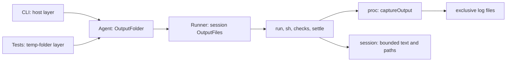

# Slice 4e: code plan

Status: archived. Built 2026-10-13; lasting decisions in [architecture.md](../architecture.md#core-ideas) (Output limits as built); its live checks are in [live-checks.md](../live-checks.md).

**Shape:** one bounded capture implementation for shell streams and finite script text. `core` owns the folder contract and model-facing notes; `host` supplies the production folder. Save the rendered check report as well as its structured pass/fail list, so combined failures stay bounded on replay.

## Files and replacement

```text
src/core/OutputFolder.ts                    new: injected root directory contract
src/host/OutputFolder.ts                    new: layer using node:os tmpdir()/tau
src/proc/Output.ts                         new: byte/line budgets, capture state and spill writer
src/proc/Command.ts                        replace shell collect/capped; keep runProgram's bound
src/core/internal/output/output-files.ts   new: session paths and finite-text capture/rendering
src/core/Agent.ts                          capture OutputFolder and Crypto services
src/core/internal/runner/runner.ts          provide per-session output service
src/core/internal/tools/model-tool.ts      add that service to Platform
src/core/internal/run-tool/run-tool.ts     supply sh paths; cut run result; details.output
src/core/internal/checks/run-checks.ts      supply paths; retain per-check file metadata
src/core/internal/checks/checks-tool.ts     use saved bounded report text and details.output
src/core/internal/loop/settle-checks.ts     use the same report builder as the checks tool
src/core/internal/checks/check-report.ts   new: render and cap combined check report
src/sandbox/Sandbox.ts                     raise codemode's bound; expose its truncation status
src/session/{Entry,CheckReport,Sessions}.ts output metadata, saved report text, migration 5
src/core/internal/instructions/sources.ts  internal shell query through bounded runProgram
src/cli/main.ts                           provide production output-folder layer
tests/support/{agent-harness,git}.ts       isolated output folder and shell paths
docs/guide/print-mode.md                   limits, file location and retained-script caveat
docs/guide/project-checks.md               bounded check reports and file links
```

Moving the internal repository query to `runProgram("sh", ...)` avoids giving an instruction-file scan model-output files. Existing `changes.ts` fixers use `runChecks`, so they inherit bounded capture without exposing their output.

## Boundaries

```ts
// New core service contract; host implements it with Layer.succeed.
type OutputFolderService = { readonly directory: string };

// Per-session core service; UUID suffixes prevent collisions across resumed runs.
type OutputFilesService = {
  readonly next: (label: "sh" | "run" | "check" | "checks") => Effect.Effect<string, OutputUnavailable>;
};

// Proc's result carries data, not model-facing instructions.
type CapturedOutput =
  | { readonly type: "whole"; readonly text: string }
  | { readonly type: "cut"; readonly start: string; readonly end: string;
      readonly path: string; readonly bytes: number; readonly lines: number };
type OutputCapture = {
  readonly accept: (chunk: Uint8Array) => Effect.Effect<void, PlatformError.PlatformError>;
  readonly result: Effect.Effect<CapturedOutput>;
};
declare function captureOutput(path: string): Effect.Effect<
  OutputCapture, PlatformError.PlatformError, FileSystem.FileSystem | Scope.Scope
>;

// ShellCommand gains required outputPath; runProgram keeps its string output.
type ShellResult = { readonly exitCode: number; readonly output: CapturedOutput };
// New ShellTimedOut carries CapturedOutput; core renders it before toolError.
// runProgram retains CommandTimedOut with string output.
// Model-visible tools.sh still returns { exitCode: number; output: string }.

// Additions to saved data. CheckReport.text is required after migration 5.
type SavedOutput = { readonly output?: string }; // RunDetails and ChecksDetails
type FailedCheck = { readonly name: string; readonly output: string; readonly file?: string };
type SavedCheckReport = {
  readonly passed: readonly string[]; readonly failed: readonly FailedCheck[];
  readonly text: string; readonly output?: string;
};
// ScriptResult gains truncation metadata so notes can say "retained output".
```

Migration 5 renders existing reports with exactly today's name order, whitespace and trimming. `checkReportText` then reads saved `text`; remove its dynamic formatting. Do not recut old entries or add a compatibility branch. Structured failures still drive settlement; paths are metadata, never reopened during replay.

## Call path and injection



`Agent` captures `Crypto.Crypto` with the other services; the runner supplies `OutputFiles` beside FileSystem and ChildProcessSpawner. Allocate a fresh path for every shell invocation, including parallel calls. Labels never contain untrusted check names or path separators.

## Capture logic

```text
memory: retain everything until either limit is crossed
  count UTF-8 bytes and logical lines across chunk boundaries
  crossing: open outputPath exclusively, write retained prefix and current chunk
spilling: write each chunk before accepting the next (backpressure, no write queue)
  keep bounded start and rolling end; count the whole stream
finish or timeout: close writer; return preview, counts and path
interruption: close writer and process group; any file contains only output received
```

| Detail | Proposed implementation |
| --- | --- |
| Budgets | `50 * 1024` UTF-8 bytes or 2,000 lines; half each for start/end. Short cut note and existing Script ID are additional framing |
| Edge cases | Whole output at the exact limits; count a final unterminated line; never split a UTF-8 character; cut an oversized single line by bytes |
| Storage | Canonical temp root; private Tau/session directories; reject pre-existing linked folders. `FileSystem.open` with `wx`, `0600`, `noFollow`; scoped handle and `writeAll`, never reopen for append |
| Failure | Spill failure stops the command and reports the storage error; never claim a complete file exists. Timeout includes the bounded preview and its path |
| Script | Codemode `maxOutputBytes = 10 * 1024 * 1024`; capture its rendered retained text using the same implementation; save resulting path in `details.output` |
| Checks | Cap each command; feed names and bounded previews with full-log links through capture one at a time, rather than joining an unbounded report. Its file is the combined report, not a duplicate of each full command log |
| Replay | Both checks tool and automatic settlement save the same report text. Outer cut preserves links through the combined-report file; branching copies paths, not log files |

## Reuse and verification

| Capability | Reference/API read |
| --- | --- |
| Services/injection | Effect service and layer examples; `Context.Service`, `Layer.succeed`, existing `Agent`/runner provisioning |
| Capture/lifecycle | Effect `Stream.runForEach`, `Stream.decodeText`, `Effect.timeoutOption`, FileSystem `open`/`writeAll`/`realPath`/`stat`; keep existing process-group cleanup |
| Unique paths | Effect `Crypto.randomUUIDv4`; existing session UUID generation |
| Production folder | Node 24.21.0 `doc/api/os.md`: `tmpdir()` honors TMPDIR and supplies the OS default |
| Interpreter limit | Codemode 2.0.27 README: `limits.maxOutputBytes` and result `truncated`; no output stream is exposed |

**Implemented script-output fix:** the version-pinned codemode patch bounds console capture and preflights formatting during execution. Its final `boundOutput` still cuts logs and value together to 10 MB. An oversized log entry is discarded whole; a large return value keeps its start. Other script allocations and oversized returned-value formatting remain unbounded; see [agent-loop-4e-memory.md](agent-loop-4e-memory.md).

Effect stream consumers do not provide Tau's start/end preview plus spill transition; that is the new domain-specific code. Reuse it for finite output rather than adding a second truncator.

| Focused tests | Prove |
| --- | --- |
| `tests/proc/output.test.ts` (new) | byte/line boundaries, UTF-8 split chunks, long line, full file content, `0600`, existing links refused, bounded retained state |
| `tests/proc/command.test.ts` (new) | `yes` with short timeout, spill finalized, process group stopped, nonzero exit, simultaneous stdout/stderr |
| `tests/core/output-limits.test.ts` (new) | run over cap, multiple/parallel sh calls, script past interpreter bound, saved text/path, disk error, reopen and branch |
| `tests/core/checks.test.ts` | checks tool and automatic settlement: individual and combined caps; noisy fixers remain silent |
| `tests/session/entry-formats.test.ts` | version 4 reports migrate with byte-identical model text |

Use real temp directories and the existing scripted-model harness; no live model calls. Add shell, script and combined-check cases to `docs/plan/live-checks.md` for the TUI-era checks. Finish implementation with the repository `checks` tool.
