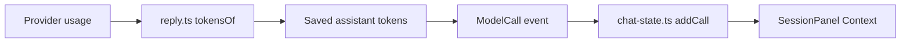

# Sidebar cache hit percentage

Status: built 2026-10-15; lasting decisions are in `docs/plan/cache-hit.md`.

Approved correction: remove the context-usage percentage (`34%`); keep the context token counts, bar and cache-hit percentage.

## Existing path



`src/core/internal/loop/reply.ts` already saves input, output, cacheRead and cacheWrite. `src/core/Client.ts` exposes those tokens through `ModelCall`. History replay emits the same event through `src/core/internal/runner/history-events.ts`. The TUI reducer currently keeps only context totals and cost.

## Measurement recommendation

Use the latest completed model call, matching the Context section and Pi’s footer.

```text
cache hit % = 100 × call.tokens.cacheRead / call.tokens.input
```

Tau input already includes cache reads and writes: `effect/ai/Response.Usage.inputTokens.total` (reference index: effect 4.0.3; API `node_modules/effect/src/ai/Response.ts`). Do not add them again. Output tokens never enter the denominator.

| Case | Proposed line |
| --- | --- |
| Before first call | Cache hit: — |
| Input missing/zero or cacheRead missing | Cache hit: unavailable |
| Explicit zero cacheRead with positive input | Cache hit: 0.0% |
| Partial hit | Cache hit: 85.7% |
| Full hit | Cache hit: 100.0% |
| Call in progress | Keep previous completed call’s value |
| Reopened session | Replay saved calls; show latest available value |

Alternative: session-wide cacheRead / input totals. It measures cumulative reuse but hides a recent cache miss; defer unless requested. A cache hit here means the share of input tokens reused, not the percentage of requests that hit a cache.

## Reference findings

| Reference | Behavior |
| --- | --- |
| Pi `packages/coding-agent/src/modes/interactive/components/footer.ts` | Latest assistant call: cacheRead / (input + cacheRead + cacheWrite), one decimal, `CH` label; gated on session cache activity. Pi input excludes cached tokens. |
| Pi `packages/coding-agent/src/modes/interactive/interactive-mode.ts` | Session information also shows a cumulative cached-token percentage. |
| OpenCode `packages/tui/src/feature-plugins/sidebar/context.tsx` | Sidebar shows context tokens, context percentage and cost; no cache-hit percentage there. |

## Mockup: whole Session panel

Same contents when docked or in a drawer. Hidden sidebar draws nothing. Each cache state above replaces only the cache line below. Other sections use representative populated values; their existing empty/error states remain as implemented.

```text
BEFORE                                      AFTER
┌ Session ──────────────────────────────┐    ┌ Session ──────────────────────────────┐
│ Context                               │    │ Context                               │
│ 43k / 128k  ███████░░░░░░░░░░░░░  34%  │    │ 43k / 128k  ███████░░░░░░░░░░░░░       │
│                                       │    │ Cache hit: 85.7%                      │
│ Cost                                  │    │                                       │
│ $0.04                                 │    │ Cost                                  │
│                                       │    │ $0.04                                 │
│ Processes                             │    │                                       │
│ ● bun test --watch         running     │    │ Processes                             │
│                                       │    │ ● bun test --watch         running     │
│ References                            │    │                                       │
│ pi                                    │    │ References                            │
│                                       │    │ pi                                    │
│ Compaction                            │    │                                       │
│ Notes cover entries 1–86               │    │ Compaction                            │
│ Compacted 1 time                      │    │ Notes cover entries 1–86               │
│                                       │    │ Compacted 1 time                      │
└───────────────────────────────────────┘    └───────────────────────────────────────┘
```

## Implementation scope after approval

| Area | Proposed change |
| --- | --- |
| `src/tui/internal/chat-state.ts` | Expand `Usage` with latest-call cached-input share (`number \| undefined`); `addCall` replaces that value on every call, including unknown values. Reuse existing event reducer. |
| `src/tui/internal/SessionPanel.tsx` | Replace the one-line Context array with context and cache lines, muted like existing section values. |
| `tests/tui/chat.test.ts` | Cover token denominator, zero, missing counts, successive calls and history replay. |
| TUI rendering tests | Verify approved labels and sidebar states through the existing rendering test path. |
| `docs/guide/` | Update the existing sidebar documentation with latest-call semantics and unavailable reporting. |

No new subsystem, dependency, persistence field or core event is needed.
