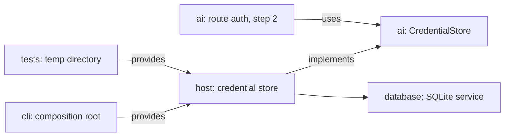

# Build step 1: SQLite service and credential store

Status: archived. Built in step 1; its lasting decisions are in [architecture.md](../architecture.md#ai-layer) (Credential store) and [architecture.md](../architecture.md#core-ideas) (SQLite).

## What it gives

Tau can save an API key or OAuth tokens per provider in `~/.tau/credentials.db` and refresh OAuth tokens safely when several `tau` processes run at once. Nothing is user-visible yet; the AI layer (step 2) is the first caller. The SQLite service built here is reused by sessions in step 3.

## What exists

`src/` is empty. The references solved the same problem two ways:

| Reference | Storage | Concurrent refresh |
| --- | --- | --- |
| Pi | `auth.json` | `proper-lockfile`: a lock directory, stale after 30 s |
| OpenCode | its SQLite database | database transactions |

Tau follows the SQLite route: the operating system releases SQLite's lock when a process dies, so there is no stale-lock logic.

## Shape



- `ai` defines what a credential is and what it needs from storage; `host` implements storage on the `database` layer. `ai` stays a leaf.
- **Refresh is passed in, locking stays in `host`.** `ai` hands `update` a function that refreshes the tokens. `host` opens a write transaction, re-reads the entry, and calls the function only if the stored tokens are still the ones that expired.
- **A database is a scoped value, not a service.** Credentials and sessions open separate files, so each owning layer opens its own. Tests use the same code on a temporary directory.
- The home directory is a layer parameter. `cli` passes the user's home; tests pass a temporary directory.

## Types

```ts
// src/database/database.ts
type SqlValue = string | number | null;
class DatabaseError { path: string; cause: unknown;
  reason: "unopenable" | "migrationFailed" | "busyTimeout" | "queryFailed" }
interface Transaction { run(sql: string, params: readonly SqlValue[]): Effect<void, DatabaseError> }
interface Database {
  query<A>(sql: string, params: readonly SqlValue[], row: Schema.Decoder<A>): Effect<readonly A[], DatabaseError>;
  // Writes happen only inside a transaction, so fibers sharing the connection cannot interleave.
  writeTransaction<A, E, R>(body: (transaction: Transaction) => Effect<A, E, R>): Effect<A, E | DatabaseError, R>;
}
// Migration n (1-based) runs once, when the file's user_version is below n.
declare function openDatabase(path: string, migrations: readonly string[]):
  Effect<Database, DatabaseError, Scope | FileSystem>;

// src/ai/credential.ts (Schema.TaggedStruct cases)
type ProviderId = string & Brand<"ProviderId">;
type Credential =
  | { _tag: "ApiKey"; key: Redacted<string> }
  | { _tag: "OAuthTokens"; access: Redacted<string>; refresh: Redacted<string>; expiresAt: DateTime.Utc };
interface CredentialStore {
  read(provider: ProviderId): Effect<Option<Credential>, CredentialStoreError>;
  save(provider: ProviderId, credential: Credential): Effect<void, CredentialStoreError>;
  remove(provider: ProviderId): Effect<void, CredentialStoreError>;
  // Runs `refresh` inside a write transaction, unless another process already replaced `stale`.
  // None when the credential was removed meanwhile, so a logout is never undone.
  update<E>(provider: ProviderId, stale: Credential,
    refresh: (stale: Credential) => Effect<Credential, E>): Effect<Option<Credential>, E | CredentialStoreError>;
}

// src/host/credential-store.ts
declare function credentialStoreLayer(tauDirectory: string):
  Layer<CredentialStore, CredentialStoreError, FileSystem>;
```

## Flows

```text
openDatabase(path, migrations)                      (in a scope; closed when the scope closes)
  create the parent directory with mode 0700
  open with bun:sqlite; set mode 0600 before the first write   (WAL files inherit it)
  journal mode WAL; busy timeout 0                  (a nonzero timeout blocks the event loop)
  apply migrations newer than PRAGMA user_version, one transaction each

writeTransaction(body)
  BEGIN IMMEDIATE; on SQLITE_BUSY retry with backoff, give up after 30 s with busyTimeout
  run body
  COMMIT on success; ROLLBACK on failure or interruption

update(provider, stale, refresh)
  writeTransaction
    stored <- read entry
    if stored differs from stale: return stored     (another process refreshed)
    fresh <- refresh(stale)
    write fresh
    return fresh
```

`bun:sqlite`'s `db.transaction()` wraps synchronous functions only, so it cannot span the refresh HTTP call; the explicit `BEGIN IMMEDIATE` statement can.

## Files

```text
src/database/database.ts     openDatabase, Database, DatabaseError, Migration.
src/ai/credential.ts         Credential schema, ProviderId, CredentialStore service, CredentialStoreError.
src/host/credential-store.ts CredentialStore layer on ~/.tau/credentials.db: read, save, remove, update.
tests/credentials.test.ts    Save/read/remove, contended update, rollback on interruption, file modes.
```

## Tests

Real temporary directories, real SQLite files, no sleeps.

| Case | How |
| --- | --- |
| Contended update | Two store layers on one file. A's `refresh` waits on a `Deferred`; B's `update` starts, then A completes. B returns A's tokens and never calls its own `refresh`. |
| Rollback on interruption | Interrupt A inside `refresh`; B's `update` then acquires the transaction and the stored entry is unchanged. |
| File modes | The directory is `0700`; the database and its WAL files are `0600`. |
| Migrations | Reopening an existing file applies only newer migrations. |

## Check and dependency changes (agreed)

| Change | Where |
| --- | --- |
| New `database` zone; `session`, `host` and `cli` may import it | `.fallowrc.jsonc` |
| `bun:sqlite` allowed in `database` instead of `session` | `tools/fallow/imports.jsonc`, its integration test |
| `tests` may import every `src/` layer | `.fallowrc.jsonc` |
| Remove `ignoreDependencies: ["effect"]` | `.fallowrc.jsonc` |
| Add `@effect/platform-bun` 4.0.3 for `FileSystem`, with a reference entry; a dev dependency until `cli` provides its layers | `package.json`, `docs/reference/sources.json` |
| Split tests: `test:rules` (lint rules) after runs; `test:checks` (check-infrastructure flow) in `beforeCommit` | `mise.toml`, `.pi/tau/settings.json` |
| Agent-run `test` task runs `bun test --parallel --timeout 1000`; before-commit test tasks have no 1-second limit | `mise.toml` |
