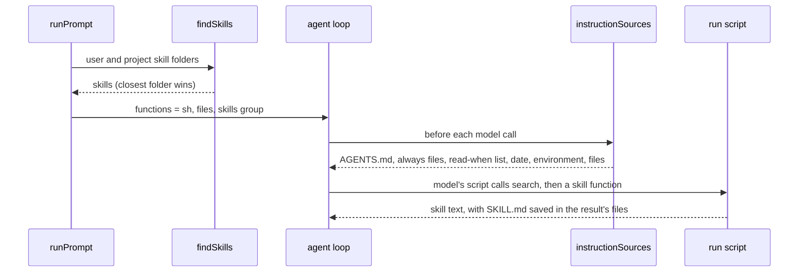

# Instruction files and skills

Status: archived. Built 2026-10-13; its lasting decisions are in [architecture.md](../architecture.md#core-ideas) (Agent loop as built, Instruction files and skills).

**What the user gets:** instruction files, Markdown files that are either always in the system prompt or listed with a "read when" line, so `AGENTS.md` can hold only what applies everywhere or be turned off. Skills that follow the [Agent Skills standard](https://agentskills.io/specification), so skills written for Claude Code, OpenCode or Pi work in Tau unchanged. The model sees the skills it uses most and finds the rest by search.

## Agreed (round 1)

| Decision | Agreed |
| --- | --- |
| Shape | instruction files are new *instruction sources* (`src/core/internal/instructions/`): Tau reads each source before every model call, puts the first reading in the system prompt and later changes in the chat as notes. The system prompt is built once and never rewritten; everything after it is appended, until compaction writes a new one |
| Skill format | Agent Skills fields (`name` matching its folder, `description`; optional `license`, `compatibility`, `metadata`, `allowed-tools`); Claude Code's common extra fields such as `disable-model-invocation`; Tau-only settings under `metadata` with a `tau/` prefix; code blocks (`` !`cmd` ``, `ts run`) are body additions |
| Instruction file format | Markdown with YAML front matter; the file name is the name; the front matter holds `always: true` or `read-when` |
| Scope now | instruction files in full; skills' format, loader, search and model use. User invocation (`/skill-name`) waits for the TUI (build step 6); code blocks wait for SDK round 4 |
| Skill list | without a decision model: a list ranked by use (frequent and recent first; with no history, project skills before user skills, then by name), capped by characters, ranked once per session, ending with how many more skills `search` can find. User-only skills are never listed. When the classifier exists, its per-prompt suggestions take over and use counts become one of its signals |
| Skill search | each skill is a function in a `skills` group inside `run` (the model's one tool, which runs a script through `@opencode/codemode`), hidden from `run`'s description and found by the interpreter's built-in `search(...)`; calling it returns the skill and records that it is loaded; plain `read` also works |
| Nudges | not in this step; designed at build step 6, or with the loop guard if that comes first |

```text
~/.agents/AGENTS.md                today          <project folder>/AGENTS.md        today
~/.agents/skills/<name>/SKILL.md   new            <project folder>/.agents/skills/<name>/SKILL.md
~/.tau/AGENTS.md                   today          <project folder>/.tau/instructions/<name>.md
~/.tau/instructions/<name>.md      new            <project folder>/.tau/skills/<name>/SKILL.md
~/.tau/skills/<name>/SKILL.md      new
```

A project folder is the repository root and each folder down to the session directory (outside git, only the session directory). Never `.claude/`. On a name clash the folder closest to the session directory wins.

## Round 2: code-level plan

```text
src/core/
├── UserInstructions.ts              changed: user files, folders and the AGENTS.md switch
└── internal/
    ├── instructions/
    │   ├── folders.ts               new: project folders from the repository root down (moved out of sources.ts)
    │   ├── front-matter.ts          new: split YAML front matter from the body and check it with a Schema
    │   ├── instruction-files.ts     new: find instruction files; the "always" and "read when" sources
    │   └── sources.ts               changed: adds instruction-file sources; obeys the AGENTS.md switch
    ├── skills/skills.ts             new: find, check and rank skills; one script function per skill
    ├── run-tool/run-tool.ts         changed: adds the skills group; description hides it and names search
    └── runner/runner.ts             changed: finds skills once per run
src/host/UserInstructions.ts         changed: user folders; reads the setting from Settings
src/core/SkillUses.ts                new: service that records skill uses and gives the ranking
src/session/SkillUses.ts             new: skillUsesLayer, a table in sessions.db
src/host/Settings.ts                 changed: "agentsFiles": false in settings.json
src/sandbox/Sandbox.ts               changed: Functions<R> becomes codemode's nested Tools<R>
docs/guide/                          write-instruction-files.md, add-skills.md (new); write-agents-md.md, settings.md (changed)
```

### Types at the boundaries

```ts
// core/UserInstructions.ts: what the user set up, given by host
class UserInstructions {
  readonly agentsFiles: boolean; // false: no AGENTS.md is read, the user's or the project's
  readonly files: readonly string[]; // ~/.agents/AGENTS.md, ~/.tau/AGENTS.md
  readonly instructionFolders: readonly string[]; // ~/.tau/instructions
  readonly skillFolders: readonly string[]; // ~/.agents/skills, ~/.tau/skills
}

// instructions/front-matter.ts (Bun.YAML.parse, then Schema.decodeUnknownEffect)
readFrontMatter<S>(schema: S, text: string): Effect<{ header: S["Type"]; body: string }, FrontMatterInvalid>;

// instructions/instruction-files.ts
type InstructionFile = { name: string; path: string; when: { type: "always" } | { type: "read-when"; situation: string } };
findInstructionFiles(folders: readonly string[]): Effect<readonly InstructionFile[], never, FileSystem>;

// skills/skills.ts
type Skill = { name: string; description: string; path: string; folder: string };
findSkills(folders: readonly string[]): Effect<readonly Skill[], never, FileSystem>;
skillFunctions(skills: readonly Skill[], touched: Touched): Namespace<FileSystem>;
```

### Call path



### Logic

```text
instructionSources(where, entries)
  folders = projectFolders(directory)                       // moved from sources.ts
  agents = if agentsFiles: user files + AGENTS.md per folder + saved + touched, else saved only (read as removed)
  files = findInstructionFiles(user instruction folders + .tau/instructions per folder)
  always = each "always" file + saved instructions:<path> keys    // a file that stops being "always" reads as removed
  return agents sources, always sources, read-when list source, date, environment, files

findSkills(folders)                                         // the standard's client guide
  for each <folder>/<name>/SKILL.md, most shared folder first
    bad YAML or no description        -> log warning, skip
    name not matching folder or rules -> log warning, load
    disable-model-invocation: true    -> skip (user-only, step 6)
    a later folder replaces a skill of the same name

skill list source (tau/skills)
  first reading: rank skills by use, keep those that fit the character cap
    + "N more skills are not listed; find them with search(...)"
  later readings: keep the saved order; add or drop only skills that appeared or disappeared

skill function (no input)
  touched(SKILL.md path)                                    // saved in the tool result's files
  return "Skill folder: <folder>" + body without front matter

run description
  every function outside the skills group, as today
  + fixed line: skills hold instructions for particular tasks; find them with search(...) (searchSignature)
```

| New source key | First reading | Change note |
| --- | --- | --- |
| `instructions:<path>` | `Instructions from <path>:` and the body | as `AGENTS.md` |
| `tau/instruction-files` | "Read an instruction file when its situation applies:" and `name (path): read-when` per file | the whole new list |
| `tau/skills` | the ranked, capped list and the count of unlisted skills | skills added or removed |

### What moves or is replaced

- `repositoryRoot`, `realPath`, `levelsBelow`, `foldersFromRoot` move from `sources.ts` to `folders.ts`, shared by instruction files and skills.
- `savedAgentsFiles` becomes `savedPaths(entries, prefix)`, used for `agents:` and `instructions:` keys.
- `RunServices.userInstructions` (a file list) becomes the `UserInstructions` value.
- `Functions<R>` (a flat record) becomes codemode's `Tools<R>`, which allows groups (`Namespace.make`).
- This repository's `AGENTS.md` standards table can become instruction files; that is a later change the user approves (`AGENTS.md` rule).

### Where behavior is injected

| | Production | Tests |
| --- | --- | --- |
| User folders and switch | `userInstructionsLayer` from `TauHome` (`~/.tau`) and `Settings` | the same layer on a temp `TauHome` with a temp `settings.json` |
| Project files | real repository | temp git repository |
| Model | user's route | scripted model in `tests/core/agent-loop.test.ts` |

Tests: an "always" file in the system prompt; a "read when" list and its change note; `agentsFiles: false`; a closer folder winning; invalid front matter skipped with a warning; a scripted model calling `search` then a skill, with `SKILL.md` in the result's files; `run`'s description unchanged when a skill is added; the list ranked by use, capped, with the unlisted count, and kept in order within a session. `readFrontMatter` gets a table test.

## Agreed (round 2)

| Decision | Agreed |
| --- | --- |
| AGENTS.md switch | `"agentsFiles": false` in `~/.tau/settings.json` turns off every `AGENTS.md`, the user's and the project's |
| Skill checks | the standard's [client guide](https://agentskills.io/client-implementation/adding-skills-support): skip a skill with bad YAML or no description; load one whose name breaks the rules, with a warning |
| Skill call result | the skill's folder path, then the body without front matter, so the model reaches files the skill names, such as `scripts/fill.py` |
| Ranking scope | uses from all of the user's sessions, with uses in the current project counting more |
| Use counts | a small table in `sessions.db`, written when a skill function runs. `src/core/SkillUses.ts` declares the service (`record`, `ranking`); `src/session/` implements it as `skillUsesLayer`, because the session layer owns `sessions.db` and core may not import `database` |

## Changes made while building

- The instruction file key is `read-when`, not `description` (agreed 2026-10-13): the value names the situation in which to read the file, and `description` stays the skills' key from the standard.

- `SkillUses` is declared in `src/session/SkillUses.ts`, not `src/core/`, because the session layer may not import core. `Sessions.layer` provides both `Sessions` and `SkillUses` from one database open, so the `sessions.db` migrations run on one connection.
- `readFrontMatter` has no table test of its own, because tests may not import core internals. The front matter cases run as a table inside the first test in `tests/core/instruction-files.test.ts`.
- The scripted-model tests share a harness in `tests/support/agent-harness.ts`.
