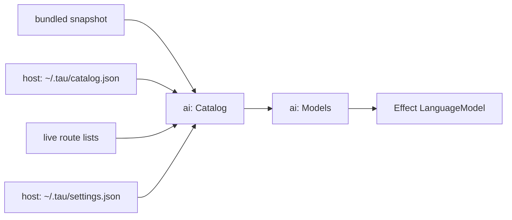
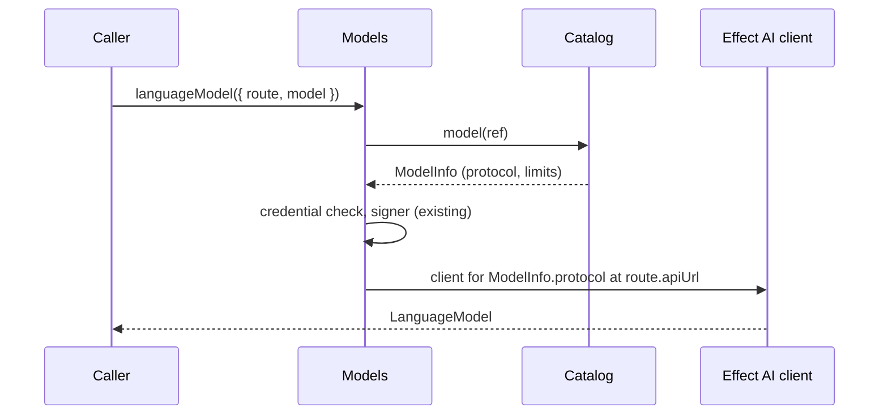

# Build step 2, round 3: model catalog, settings file, OpenCode Go

Status: archived. Round 3 of step 2 was built and confirmed live (2026-10-12); its lasting decisions are in [architecture.md](../architecture.md#ai-layer).

After round 3, Tau knows each model's context window, output limit, prices and abilities, including models released after the Tau build. OpenCode Go works, though its models use three different wire protocols. You can add your own routes, such as a local Ollama server, in `~/.tau/settings.json`. The Claude subscription sends the current Claude Code version without a Tau release.

## What exists

| Piece | Today (`src/ai/`) |
| --- | --- |
| Routes | `routes.ts`: five built-in routes. Each has **one** `client` (`anthropic`, `openai`, `openrouter`), an API URL, an auth kind and a decision API. |
| Models | `models.ts`: `Models.languageModel({ route, model })` checks the credential and returns Effect's `LanguageModel`. It knows nothing about the model itself. |
| Claude Code version | `claude-code.ts`: pinned at `2.1.296`. |
| Settings | None. `host` has only the credential store and `host-id`. |

## Shape



- **Adds a `Catalog` service in `ai`.** It answers "which models does this route have, and what is each one like?" `Models` asks it which protocol and limits apply before building a `LanguageModel`.
- **Adds a settings reader in `host`.** It reads `~/.tau/settings.json`, which may contain comments (`Bun.JSONC.parse`), and checks it with an Effect `Schema`. Round 3 reads only `routes`. Later settings join the same file.
- **Adds a catalog cache in `host`.** `ai` defines the interface and `host` implements it, as with credentials. The cache is a JSON file written by atomic rename, so two Tau processes never leave a torn file. It is disposable, so it doesn't need SQLite.
- **Changes `Route.client` to the route's default protocol.** A catalog entry can name a different protocol for one model. OpenCode Go needs this.
- **Deletes:** the pinned Claude Code version (replaced by the lookup, with the version at build time kept as the floor), and the Fallow ignore for `@effect/ai-openai-compat` (now used).

## Where model facts come from

Later sources win, field by field:

| # | Source | Gives | When |
| --- | --- | --- | --- |
| 1 | Snapshot of models.dev, bundled in the binary | Everything for Tau's catalog providers: `anthropic`, `openai`, `openrouter`, `opencode-go` | Build time; `mise run catalog` refreshes it |
| 2 | Cached refresh of models.dev | Same, newer | In the background, at most once a day; never blocks a request |
| 3 | Live route lists | Which models a subscription allows, and its real context window | When the user logs in or opens the model list |
| 4 | Your settings | Your own routes and models, and corrections | On start |

- **Trimmed snapshot.** models.dev's `api.json` is 5.6 MB for 228 providers. Tau's four providers come to about 317 KB, so only those are bundled and cached.
- **Subscription routes borrow the API catalog.** `anthropic` (Claude subscription) uses models.dev's `anthropic` entries. `chatgpt` and `codex` use `openai` entries, filtered to what the route lists live. The Codex backend's own `/models` reports a 272k context window for most models (500k for `gpt-6.1-sol`), against 1.05M on the API, so the live list's limits override the catalog's.
- **The Claude Code version check rides along.** It runs in the same daily refresh (`registry.npmjs.org/@anthropic-ai/claude-code/latest`, now `2.1.296`), is stored in the same cache, and the bundled version is the floor.

## Decisions and the alternatives they beat

| Decision | Beat | Tradeoff |
| --- | --- | --- |
| Bundled snapshot + background refresh + cache (already agreed in [architecture.md](../architecture.md)) | Pi: a catalog generated at release time only | New models appear without a release, at the cost of one background job and a cache file. |
| Refresh once a day | OpenCode: every 5 minutes | models.dev changes a few times a week, so polling every 5 minutes buys almost nothing. |
| Sources merge as ordered overlays | OpenCode: plugins transform the model list in a pipeline | Easier to read. The SDK's `models` area can add a transform hook at the same place later. |
| Protocol per model, from the catalog (OpenCode Go: 23 models on Chat Completions, 7 on Responses, 6 on Messages, all at one URL) | Three OpenCode Go routes, one per protocol | One route and one key for one subscription. The model, not the route, picks the protocol, as models.dev's `provider.npm` field already does. |
| User routes only in `~/.tau/settings.json` for now | Routes in project `.tau/settings.json` too | A cloned repository could point a route at its own server and receive your key. Project routes wait for SDK round 4 (isolation and trust). |
| Plan routes keep API prices, labelled as plan usage (Pi's way) | OpenCode: $0 on plan routes | Shows how fast a plan is being used. The label comes from the route's auth kind. |

Systems studied (learning only): OpenCode `packages/core/src/models-dev.ts` (snapshot, key-value cache, 5-minute refresh, digest to skip unchanged bodies) and `plugin/provider/openai.ts` (hides models the ChatGPT plan doesn't allow, sets their cost to zero). Pi `packages/ai/scripts/generate-models.ts` (generated at release from models.dev and OpenRouter, hand-written Codex list with 272k limits, API prices kept) and `~/.pi/agent/models.json` (user overrides).

## Code-level plan

### Files

```text
src/ai/
  catalog.ts             new: Catalog service; merges the four sources; daily background refresh
  models-dev.ts          new: Schema for the models.dev fields Tau reads; converts entries to ModelInfo
  live-models.ts         new: reads the Codex backend's /models and the ChatGPT app's /v1/models
  catalog-snapshot.json  new, generated: trimmed models.dev and the Claude Code version floor
  routes.ts              changed: client -> protocol (the default); catalogProvider, liveList; opencode-go route
  models.ts              changed: asks Catalog for the model's protocol; adds the Chat Completions client
  claude-code.ts         changed: version comes from Catalog instead of a constant
src/host/
  settings.ts            new: reads ~/.tau/settings.json (JSONC) into user routes
  catalog-cache.ts       new: ~/.tau/catalog.json, written by atomic rename
src/cli/main.ts          changed: tau login also lists user routes that take a key
tools/catalog-snapshot.ts  new: `mise run catalog` rewrites catalog-snapshot.json
tests/catalog.test.ts    new
.fallowrc.jsonc          changed: drop the @effect/ai-openai-compat ignore (now used)
```

### Types at the boundaries

```ts
type Protocol = "anthropic" | "openaiResponses" | "openaiChat" | "openrouter";

type Price = { input: number; output: number; cacheRead: number; cacheWrite: number }; // USD per million tokens

type ModelInfo = {
  id: string;
  name: string;
  protocol: Protocol;
  contextWindow: number;
  maxOutput: number;
  price: Price | undefined;
  longContextPrice: { above: number; price: Price } | undefined;
  supports: { tools: boolean; structuredOutput: boolean; reasoning: boolean; images: boolean };
};

type Route = {
  // existing: id, provider, apiUrl, auth, decisions
  protocol: Protocol;                     // was `client`; the default when an entry names none
  catalogProvider: string | undefined;    // models.dev provider whose entries this route uses
  liveList: "codexModels" | "openaiModels" | undefined;
};
type RouteAuth = /* existing kinds */ | { kind: "none" };   // a local server with no key

class Catalog extends Context.Service<{
  models: (route: RouteId) => Effect<ReadonlyArray<ModelInfo>, UnknownRoute>;
  model: (ref: ModelRef) => Effect<ModelInfo, UnknownRoute | UnknownModel>;
  claudeCodeVersion: Effect<string>;
}> {}

// ai defines, host implements (as with CredentialStore)
class CatalogCache extends Context.Service<{
  read: Effect<Option<CachedCatalog>, CatalogCacheError>;
  write: (catalog: CachedCatalog) => Effect<void, CatalogCacheError>;
}> {}
type CachedCatalog = { fetchedAt: DateTime; modelsDev: unknown; claudeCodeVersion: string; live: Record<RouteId, unknown> };

// host
const readSettings: (tauDirectory: string) => Effect<Settings, SettingsInvalid, FileSystem>;
type Settings = { routes: ReadonlyArray<Route>; corrections: Record<RouteId, Record<string, Partial<ModelInfo>>> };
```

`~/.tau/settings.json`, as a user writes it:

```jsonc
{
  "routes": {
    // a new route
    "ollama": {
      "protocol": "openaiChat",
      "apiUrl": "http://localhost:11434/v1",
      "models": { "qwen3:32b": { "contextTokens": 32768, "outputTokens": 8192 } }
    },
    // a correction to a built-in route
    "openrouter": { "models": { "some/model": { "outputTokens": 16000 } } }
  }
}
```

A new route without `apiKeyEnv` sends no key. With `"apiKeyEnv": "NAME"`, it takes a key from `tau login` or that variable, like the built-in API-key routes.

### Call path



```text
Catalog layer starts
  read snapshot (bundled), cache (host), settings routes (host)
  merged = snapshot <- cache <- live lists in cache <- settings
  if cache missing or fetchedAt older than a day
    fork in the background: refresh
refresh
  fetch models.dev api.json, keep Tau's catalog providers
  fetch npm latest for @anthropic-ai/claude-code; keep it only if not below the floor
  for each route with a liveList and a credential: fetch its list
  any failure keeps that part of the last cache
  write cache; replace merged
model(ref)
  route missing -> UnknownRoute
  entry missing -> UnknownModel: "Add it under routes.<route>.models in ~/.tau/settings.json"
```

Decision models are in the catalog, but not from models.dev. Its decision list names Jev `typesafe/jev-latest`, while OpenRouter serves `~typesafe/jev-latest`, and it does not list Luna. So each route with a decision API lists its own decision models (Jev and Luna on `openrouter`, Luna on `openai`), and settings can correct or add them under `decisionModels`.

### Injection

| Seam | Production | Tests |
| --- | --- | --- |
| `CatalogSources` (models.dev URL, npm URL) | real URLs | a local `Bun.serve` that holds or answers |
| `CatalogCache` | `~/.tau/catalog.json` | the same file in a temp directory, pre-written with an old `fetchedAt` |
| Settings | `~/.tau/settings.json` | a JSONC file in the temp directory |
| Route URLs | built-in | the replay server, as in `tests/models.test.ts` |

### Tests (`tests/catalog.test.ts`, offline)

1. With no cache and no network, the bundled snapshot supplies a Claude model's limits and prices.
2. A stale cache starts a refresh, and a model request answers while the fake models.dev still holds its reply. The refreshed entry wins afterwards.
3. An npm version below the floor, or an npm failure, keeps the last version Tau had.
4. The Codex live list hides unlisted models, and its 272k context window replaces the API's.
5. OpenCode Go: a Messages model posts to `/messages` and a Chat model to `/chat/completions`, at the same URL (replays `anthropic-stream` and `openrouter-stream`).
6. A user route from a settings file with comments reaches its URL. A wrong field fails with the file and field named.
7. An unknown model fails with the settings hint.

### As built

- **Names.** The types are `ModelProfile` and `DecisionProfile` in `src/ai/model-profile.ts`. The limits are `contextTokens` and `outputTokens`.
- **Refresh.** `Catalog.refreshIfStale` runs only when a caller asks for it. Building the catalog never starts a request. The first caller is the session start at build step 4, which runs it in the background.
- **Signing.** `credentialSigner` and `signRequests` take the model's protocol and the Claude Code version, because one route can serve Messages and OpenAI protocols (OpenCode Go uses `x-api-key` for its Messages models).
- **Anthropic address.** Effect's Anthropic client adds `/v1/messages` itself, so `models.ts` removes a trailing `/v1` from the route address for Messages models.
- **Tests.** `tests/catalog.test.ts` has 8 tests (snapshot, background refresh, two npm cases, Codex plan list, three settings errors). `tests/models.test.ts` gained the two OpenCode Go protocol tests, the settings-route test and two unknown-model tests.
- **Conversation ID.** `Models.languageModel(ref, conversationId)` takes the ID of the conversation. A session passes its own ID (build step 3); a call outside a session passes a new ID for each call. On OpenCode Go (`conversationHeaders: "opencode"` on the route), requests carry `x-opencode-session` and `x-opencode-client: tau`. Every request except a Claude subscription request carries `user-agent: tau/<version>`.
- **Messages replies from other servers.** OpenCode Go's Messages replies leave out fields that Anthropic always sends: `stop_sequence`, the cache fields of `usage`, `service_tier`, and the empty `signature` that starts a thinking block. Effect's Anthropic schema requires them, so the reply failed to decode. `src/ai/messages-defaults.ts` adds each missing field with Anthropic's default as the reply arrives, line by line for streams. It runs on every Messages route and changes nothing in a complete reply. Two recordings of live OpenCode Go replies test it (`tests/recordings/opencode-go-messages-*.json`). OpenCode Go serves these models only over Messages: Chat Completions answers `ModelProtocolUnsupported`.
