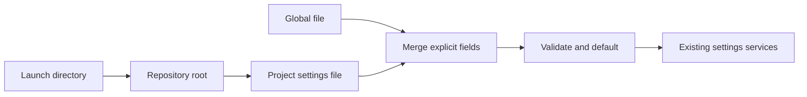

# Repository settings

Status: built; decisions live in [Settings](../settings.md).

## Goal

Allow this repository to set `commit.avoidBreakingChanges` without changing other repositories.

## Current shape

| System | Current behavior | Proposed change |
| --- | --- | --- |
| `src/host/Settings.ts` | Reads `~/.tau/settings.json`, validates it, applies defaults and provides settings services. | Expand to resolve global and repository settings before applying defaults. |
| `src/cli/main.ts` | Composes `Settings.layer` at startup. | Supply the repository context when resolving settings; exact wiring follows scope agreement. |
| `src/workspace/Repository.ts` | Finds the Git root for a directory. | Reuse Git-root discovery; define behavior outside Git. |
| `/commit` | Receives resolved `CommitSettings`. | Keep consuming resolved settings. |

## Proposed shape

Layered configuration: merge explicitly supplied fields, then apply defaults once.



| Decision | Recommendation | Alternative and cost |
| --- | --- | --- |
| Location | Agreed: one `<git-root>/.tau/settings.json` project file; no separate personal project tier. Outside Git, use `<launch-directory>/.tau/settings.json`. | Two project files add another precedence decision. |
| Precedence | Agreed: built-in defaults < global file < project file. Merge explicit fields, then apply defaults. | Separate defaults and requirements: extra concepts and conflict rules for ordinary settings. |
| Merge | Merge nested objects by explicitly supplied fields; preserve `false`; do not materialize defaults per file. | Generic deep merge: simpler surface, but unclear collection and deletion behavior. Define those if collections enter scope. |
| Scope | Agreed: use the same settings surface globally and in the project, including `agentsFiles`; no behavior-only allowlist. | Separate scope allowlists add classification rules and prevent project overrides. |
| Refresh | Read at startup, matching current settings. | Live reload adds lifecycle and consistency work. |
| Invalid file | Stop with the path and invalid setting, matching current behavior. | Ignore invalid overrides: hides repository policy errors. |

Example proposal:

```json
{ "commit": { "avoidBreakingChanges": true } }
```

## Project precedence

Agreed: settings supplied by the project override global settings. Do not add separate defaults, requirements, lock markers or policy enforcement for this feature. A project setting `agentsFiles: true` overrides global `agentsFiles: false`.

Agreed: one project file uses the same settings surface as the global file. Missing fields inherit; nested sections merge field by field. No dedicated personal project file or enforcement layer. Project precedence alone does not provide tamper-proof enterprise enforcement.

## Next round

Inspect startup, provider resolution and explicit run choices before the code-level plan so their interaction is stated accurately. Pi’s trust gate is reference behavior, not an agreed addition to Tau. Open questions are in [questions.md](../questions.md#repository-settings).

## Reference comparison

Read-only sources inspected in `/Users/shanepadgett/.tau/references/`:

| System | Existing approach |
| --- | --- |
| Pi | `packages/coding-agent/src/core/settings-manager.ts`: global `<agent-dir>/settings.json`, project `<cwd>/.pi/settings.json`; project overrides global and nested objects merge. Project loading is trust-gated. Certain getters deliberately use global values, such as `defaultProjectTrust`. Resource lists have special combination rules. |
| OpenCode | `packages/core/src/config.ts` and `config/discovery.ts`: global config below discovered project config; `opencode.json` and `opencode.jsonc`, plus `.opencode` directories. Inline content follows project config; managed system settings load last. Current core exposes ordered documents rather than one universal merged object. |

Neither inspected discovery path adds a dedicated `settings.local.json` tier. Personal project overrides are a Tau design choice, not a convention established by these references.

## Code boundaries

```text
src/host/ProjectDirectory.ts    resolved project folder supplied by CLI or tests
src/host/Settings.ts            read and validate files, merge fields, resolve services
src/cli/main.ts                 resolve Git root from launch directory; wire settings
tests/host/settings.test.ts     isolated global/project files and provider merging
```

```typescript
ProjectDirectory: { readonly directory: string }
readSettingsFile(path: string): Effect<SettingsFile, SettingsInvalid | PlatformError>
mergeSettings(base: Record<string, unknown>, overrides: Record<string, unknown>): Record<string, unknown>
```

Production: launch directory → existing `workspace/Repository.ts` `repositoryRoot` → `ProjectDirectory` → settings layer → existing settings services. Tests inject temporary `ProjectDirectory` and `TauHome` values into the same settings layer. CLI owns root discovery to preserve the host/workspace import boundary.

Read and schema-validate each file independently; missing files supply empty objects. Recursively merge objects with project leaves winning, then resolve providers and apply defaults once. This replaces the single-file reader’s early defaulting and deletes its duplicate no-settings defaults. Explicit CLI `--model` remains above resolved settings through the existing run-options path.

Dependency API review: Effect `Context.Service`, `Layer.effect`, `Layer.effectContext` and `Layer.provide` (service/layer examples); `Schema.decodeUnknownEffect` (installed Schema source); `Predicate.isObject` (installed Predicate source). No recursive merge helper was found in Effect Struct or Record; keep merge logic private to settings.
