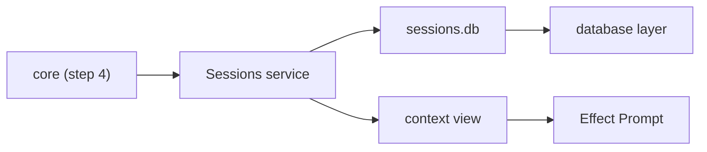

# Build step 3: sessions

Status: archived. Built 2026-10-13; its lasting decisions are in [architecture.md](../architecture.md#core-ideas) (Sessions). Rebuilt from the planning conversation, because the plan was never committed.

A session is one conversation: what the user said, what the model answered, and what tools returned, saved as it happens so Tau can resume it, branch it, and build the next model request from it. Step 3 builds the `session` layer that stores sessions. The turn loop that fills them comes at step 4.

## What exists

| Piece | Where | State |
| --- | --- | --- |
| SQLite service: open, WAL, migrations, write transactions, decoded rows | `src/database/database.ts` | Built (step 1); used only by the credential store |
| Model calls take a conversation ID | `Models.languageModel(ref, conversationId)` in `src/ai/models.ts` | Built (step 2); every caller makes a new ID today |
| Decided: entries are Tau's own schema, never deleted, converted to Effect `Prompt` parts per request | [architecture.md](../architecture.md#core-ideas) | Agreed |
| Decided: live text deltas are events, not entries; one writer per session | [architecture.md](../architecture.md#core-ideas) | Agreed, built at step 4 |
| Branching and storage | Decisions 1 and 2 below | Agreed |

## Shape (agreed)

The `session` layer is new. It sits between `core` (step 4) and the `database` and `ai` layers, as the layer table already says.



- **A session is an ordered list of entries.** Each entry has a number that only grows. That number is also the cursor an SDK subscriber resumes from, as [sdk.md](../sdk.md) requires for facts.
- **The context view is a pure function** from entries to an Effect `Prompt`. It is the one place that knows Effect's part types.
- **The session ID is the conversation ID** passed to `Models.languageModel`, so OpenCode Go and, later, Codex see one ID per conversation.
- **Child sessions** (subagents, step 7) store their parent's ID and are listed under it.
- **Each session records its working directory**, and the session list shows the current directory's sessions first.

Pattern: an append-only log with views computed from it. It beat updating message rows in place as text streams in, as OpenCode's `message-updater.ts` does: an append-only log is what lets the turn loop rebuild a session after any step.

## Decision 1: how branching works

Agreed: **a branch is a new session.** Forking copies the parent's entries up to a chosen entry into a new session, which records where it came from. Every session stays one straight list. The branch tree is a tree of sessions, which the session list shows.

| Option | Used by | Cost |
| --- | --- | --- |
| **Fork into a new session** (agreed) | OpenCode (`fork_session_id`, `fork_boundary` in `packages/core/src/session/sql.ts`), Codex (`ForkBoundary` in `codex-rs/thread-store`) | Copied entries take disk space. Every reader of a session (context view, compaction, resume, SDK cursors) reads one list. |
| Tree inside one session | Pi: entries have `parentId`, the session tracks a current leaf | Every reader walks parent links from the leaf. Pi still needed `/fork` and `/clone` beside `/tree`, so users meet three ways to branch (`docs/sessions.md`). |

A copy, not a reference to the parent, means deleting or exporting one session never touches another.

## Decision 2: where sessions are stored

Agreed: **one shared file, `~/.tau/sessions.db`**, separate from `credentials.db`.

| Option | Used by | Cost |
| --- | --- | --- |
| **One shared SQLite file** (agreed) | Goose (`sessions.db`), OpenCode | Listing, search, forks and child sessions are queries. One migration path. Exporting a session is a command that writes it to its own file. |
| One file per session | Pi (JSONL), Codex (rollout JSONL) | A file is easy to copy or delete by hand. Listing and search open every file, and a schema change must migrate every file. |

Several Tau processes can share the file: WAL lets them read while one writes, and each session still has one writer.

## Round 2: code (agreed)

Step 3 stores and reads sessions and builds the model's view of one. Nothing calls it until the turn loop (step 4), so the tests are its only caller.

```text
src/session/
  entry.ts          Entry schema: Tau's own types, saved as JSON
  sessions.ts       Sessions service on ~/.tau/sessions.db: create, fork, list, append, read
  context-view.ts   entries -> Effect Prompt (pure)
tests/sessions.test.ts
```

```ts
type SessionId = string & Brand<"SessionId">      // UUIDv7, so IDs sort by creation time
type Origin =
  | { kind: "new" }
  | { kind: "fork"; from: SessionId; through: number }   // copied entries 1..through
  | { kind: "child"; parent: SessionId }                 // subagent, step 7
type Session = { id; directory: string; origin: Origin; createdAt; updatedAt }

type ProviderData = Record<string, Json | null>    // Effect's provider options, kept opaque
type Part =
  | { type: "text"; text; providerData }
  | { type: "reasoning"; text; providerData }
  | { type: "tool-call"; id; name; params: Json; providerData }
type EntryBody =
  | { type: "user"; text }
  | { type: "assistant"; model: ModelRef; parts: Part[]; usage; finish }
  | { type: "tool-result"; callId; name; result: Json; isFailure: boolean }
type Entry = { session: SessionId; number: number; at: DateTime; body: EntryBody }

interface Sessions {
  create(directory, origin?): Session
  fork(session, through: number): Session      // copies entries in one write transaction
  list(directory): Session[]                   // newest first
  append(session, bodies: EntryBody[]): Entry[] // numbers are given inside a write transaction
  entries(session, after?: number): Entry[]    // `after` is the subscriber's cursor
}

contextView(entries: Entry[]): Prompt
```

Context view rules, one line each:

```text
user entry            -> user message with one text part
assistant entry       -> assistant message; providerData -> part options
tool-result entries   -> one tool message per run of consecutive results
system prompt         -> not here; core adds it (step 4)
compaction            -> not here yet; the latest summary rule comes with step 5
```

Storage: two tables in `sessions.db`, made by migration 1 through the existing `openDatabase`.

```text
sessions(id PK, directory, origin JSON, created_at, updated_at)
entries(session_id, number, at, body JSON, PK(session_id, number))
```

Wiring: `sessionsLayer(path)` in `session`; `cli` passes `~/.tau/sessions.db` from `host`, as it does for `credentials.db`. Tests pass a temp directory.

Reuse: `openDatabase` and `writeTransaction` (step 1); `Schema.Json` and `Schema.fromJsonString` for bodies; `Prompt.fromMessages` and Effect's message constructors for the view. New: nothing outside `src/session/`.

Tests (`tests/sessions.test.ts`, real temp SQLite):

| Test | Proves |
| --- | --- |
| Append, then read back, then build the view | Provider data such as a Claude thinking signature reaches the part options unchanged |
| Fork at entry 2 of 4, then append to both | The fork holds entries 1–2; the parent still holds 1–4; numbers do not collide |
| Two `Sessions` on one file append to different sessions | Two Tau processes can share `sessions.db` |
| `entries(after: n)` | A subscriber resumes from its cursor |
| `list` for two directories | Each directory sees only its own sessions, newest first |

Left for later: user images and files (the entry union grows without a migration), session titles (the auto-name extension), deleting and exporting sessions (manage-sessions), and turning a model reply into an assistant entry (step 4, through `Prompt.fromResponseParts`).

## As built

Usage and the finish reason on assistant entries, the `child` origin and the `cli` wiring were left out because nothing used them yet; each is in [deferred.md](../deferred.md).
