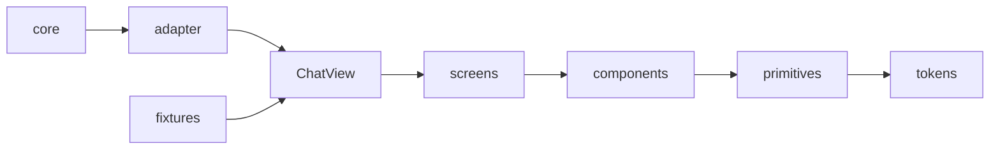

# TUI design system and gallery

Status: direction changed 2026-10-15. The goal is a new front end, designed and approved in a gallery, then swapped in for the current one. The current front end is not touched. Order step 1 is built (shell, story registry, `Panel` primitive with the current panel look as its starting point). The first screen to design is the chat transcript as a scenario.

**What the user gets:** a dev program, `mise run gallery`, where the user sees and approves the new look, the chat flow and the animations before any of it reaches the app. Approved designs become the new front end; the swap deletes the old one.

## Today

```text
core (agent, events)
  -> chat-client.ts   ChatClient: chat state, flows (commit, qna, picker), actions, all in one object
  -> chat-state.ts    ChatState: pure data, a reducer over AgentEvent (the part that is already clean)
  -> components       *.tsx: some take ChatState, some take the whole ChatClient
```

- `chat-state.ts` is pure data: `applyActions(state, actions)`. A scripted list of actions yields any chat a design needs, with no agent.
- `ChatClient` mixes state, flows and callbacks, and several components take it whole. They cannot be shown without faking the client.
- `ChatItem` has little to draw: a tool item has a `summary` and a `status`, no output, no diff, no duration. A richer design may need richer data from core.

## Architecture

New code goes beside the old in `src/tui/internal/ui/`. Old components stay until the swap.



| Tier | Rule |
| --- | --- |
| tokens | colors, spacing, glyphs, motion (durations, easings) in one file |
| primitives | `Panel`, `SelectableRow`, key hints; take props only |
| components | one job each; props are plain data and callbacks; never import `ChatClient` |
| screens | compose components for one view of the app; take a `ChatView` |
| `ChatView` | the one type the design needs from the backend: data to draw plus callbacks |
| adapter | `ChatClient -> ChatView`; the only new code that knows the backend |

- Pattern: a view model (`ChatView`) between the design and the backend. Alternative: components read `ChatClient` directly, as today. That ties every story to the backend and every design change to client code.
- The design leads: the first fixtures define `ChatView`. When a design needs data core does not have, that is a separate backend change, planned after the design is approved.
- Reuse comes from the tiers: a screen contains the real components, so a change to one shows in every story that uses it.

## Story types in the gallery

| Story | Shows | Example |
| --- | --- | --- |
| primitive, component | one piece alone in a box of the chosen width, in each state | `Panel`, a tool-call row |
| screen | a full screen at the chosen terminal size | chat with the sidebar docked |
| scenario | a screen playing a scripted list of `ChatAction`s with delays; play, pause, step | a reply that streams, runs two tools, then asks a question |

Scenarios show chat flow and animation. They reuse `applyActions`, so they need no agent. The Shell from the approved mockup holds all three.

## Files

```text
src/tui/Gallery.ts                  public entry: runGallery(); added to Fallow's entry list with it
src/tui/internal/ui/
  tokens.ts                         the new theme
  primitives/                       Panel, SelectableRow, ...
  components/                       one file per component
  screens/                          one file per screen
  view.ts                           ChatView type
  adapter.ts                        ChatClient -> ChatView (written at the swap)
src/tui/internal/gallery/
  Shell.tsx                         tabbed list, preview, size, state, play controls
  stories.ts                        Story registry
  fixtures.ts                       ChatView data, scenarios
  frame.ts                          story + size -> captured spans (headless)
tests/tui/gallery.test.ts           every story state at 50x15, 80x24, 120x30 against a snapshot
```

## Types

```ts
type Size = { readonly width: number; readonly height: number };
type Story = {
  readonly id: string;
  readonly group: "primitives" | "components" | "screens" | "scenarios";
  readonly title: string;
  readonly states: readonly { readonly name: string; readonly view: (size: Accessor<Size>) => JSX.Element }[];
};
type Scenario = readonly { readonly afterMilliseconds: number; readonly action: ChatAction }[];
```

## Order

1. Shell and the story registry, with one primitive story to prove the loop. Needs the Fallow entry.
2. Tokens and `ChatView` from the first screen the user wants to redesign (proposed: the chat transcript as a scenario).
3. Headless frames and snapshot tests.
4. At the swap: write the adapter, switch `showChat` to the new screen, delete the old components, move `AGENTS.md`'s mockup rule to the gallery.

## Agreed

- The entry `src/tui/Gallery.ts` is added to `entry` in `.fallowrc.jsonc` in the same change that creates it.
- The mockup rule in `AGENTS.md` changes to "add the story to the gallery and have the user open it" once the first stories exist.
- Fixtures may define the data a design needs first. Backend changes follow after the user approves the design.
- The shell mockup of 2026-10-15 is approved, with keys `s` for state and `z` for size and a clipped preview. Not built yet: focus moving into a live preview (`tab`), which waits for the first story that takes keys, and the `Scenarios` group with play, pause and step keys; show that mockup before building it.
