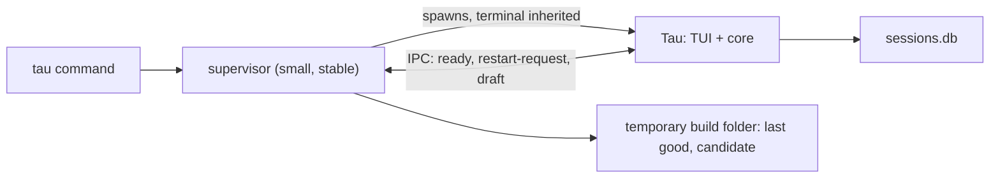

# Reloading Tau while it runs

Status: round 1 (architecture) agreed, 2026-10-14; this slice comes next, before 6b and 6c. Spike 15 (`spikes/reload/`) passed: see [Spike result](#spike-result). Round 2, the code plan, is agreed in [work/reload.md](work/reload.md).

## Decisions (2026-10-14)

| Question | Decision |
| --- | --- |
| Pattern | A supervisor process restarts Tau when idle, after the new build passes a start check; a second crash in 10 s falls back to the last good build |
| Builds in development | The supervisor runs a bundle of `src/`, not the source files |
| Restart trigger | Automatic when idle, with a note first; also a `/restart` command and a setting that turns the automatic restart off |
| Process sessions | They end at a restart, and the checkpoint list tells the model. The supervisor owning them is in [deferred.md](deferred.md) |
| Extension UI | A separate `./ui` export, reversing [sdk-packages.md](sdk-packages.md), so a later split of TUI and core into two processes does not break extensions |
| Order | 6a (done), this slice, then 6b and 6c |

**What the user gets:** Tau can change itself while it is in use. When Tau edits an extension, the change shows at the next turn without a restart. When Tau edits its own code in `src/`, Tau waits until it is idle, checks that the new code builds and starts, and then restarts into the same session: same messages, same unsent input, about half a second of redraw. Broken code never replaces working code. The same path installs updates later (build step 8).

## Today

| Piece | State | Where |
| --- | --- | --- |
| Process model | One process: CLI, core and (soon) the TUI | [architecture.md](architecture.md#layers) |
| Extension reload | Agreed, not built: in process, by deleting `require.cache` entries; a failed reload keeps the last working version | [sdk-packages.md](sdk-packages.md), spike 1 |
| Tau's own code | Loaded once at start; a change needs a manual restart | `src/cli/main.ts` |
| Session state | Every step is saved to SQLite; a session rebuilds after any step | [architecture.md](architecture.md#core-ideas) |
| Process sessions | Children of Tau; they end when Tau exits | [work/process-sessions.md](work/process-sessions.md) |
| Extension UI | Was: in the same package entry as its logic. Now agreed: a separate `./ui` export | [sdk-packages.md](sdk-packages.md) |

## Systems studied

| System | How it changes running code | Cost |
| --- | --- | --- |
| OpenCode | TUI and server are separate processes. In development, Vite and `solid-refresh` swap TUI components in place (`packages/cli/dev/`, about 400 lines). Server code changes need a server restart; a version mismatch replaces the server | Two processes always; a fragile dev launcher |
| VS Code | Extensions run in a separate extension host; "Reload Window" restarts it | Every API call crosses processes; UI runs in webviews |
| Pi | `/reload` re-imports extensions in process | A bad extension can take the process down |
| Erlang/OTP | Supervisors restart failed processes from a known state | The model for Tau's supervisor; Tau does not swap code in place |
| `bun --watch`, nodemon | Restart the process on every save | Restarts in the middle of work |

No system swaps an agent's core in place. Each one restarts it; the difference is when, and what survives.

## Proposed shape



- **Supervisor + restart when idle.** A small parent process starts Tau as a child that owns the terminal, and restarts it only when Tau is idle. Alternatives: the OpenCode split (only UI edits avoid a restart, at the cost of two processes always) and Vite hot swap (fast for components, fragile, and core still restarts). The split stays possible later, because clients use one `send`/`subscribe` interface.
- **Builds, not source.** In development the supervisor runs a bundle of `src/`, not the source files. A last good version then still exists after the files change, so the supervisor can fall back to it.
- **Extensions stay in process.** They reload at the next turn boundary. Guards: an error boundary around each UI place, and a throwing function becomes a failed tool result.

## Restart as a state machine

```mermaid
stateDiagram-v2
  [*] --> Running
  Running --> Pending: Tau source changed
  Pending --> Pending: run going or prompts queued
  Pending --> Checking: idle
  Checking --> Switching: build and start check pass
  Checking --> Running: failure, notice to user and model
  Switching --> Running: new child reports ready
  Running --> Recovering: child exits unexpectedly
  Recovering --> Running: restart; a second crash in 10 s uses the last good build
```



| Change | Action |
| --- | --- |
| Extension file | Reload in place at the next turn boundary |
| Tau source in `src/` | Restart when idle, through the state machine |
| `package.json`, `bun.lock`, `bunfig.toml` | Same, after `bun install` |
| `settings.json` | Out of scope here; see [deferred.md](deferred.md) |

## Boundaries (interfaces only)

```ts
// IPC between supervisor and child (Bun.spawn ipc)
type ToSupervisor =
  | { type: "ready"; session: SessionId }
  | { type: "idle"; idle: boolean }                      // no run, nothing queued
  | { type: "handoff"; session: SessionId; draft: string } // sent just before a planned exit
type ToChild = { type: "restart-pending"; reason: string } | { type: "exit-for-restart" };

// child start options the supervisor passes
type ChildStart = { session: Option<SessionId>; draft: string; build: BuildId };
```

## Costs and open points

- **Process sessions end on restart.** The checkpoint list tells the model. Keeping them alive needs the supervisor to own them; see [deferred.md](deferred.md).
- **Two terminals owners must never overlap.** The old child exits and restores the terminal before the new one starts. The start check runs headless.
- **Releases.** Released binaries do not watch `src/`; they get extension reload, and `tau update` uses the same restart when idle.

## Spike result

Spike 15 ran this design with a stand-in app, under `bun` and as a compiled binary (macOS arm64). Every case passed:

| Case | Result |
| --- | --- |
| Idle restart | 0.55 s from save to new frame: 100 ms debounce, about 40 ms build, about 290 ms start check, about 105 ms switch. About 100 ms of empty screen. Draft kept |
| Edit during a run | Notice shown; switch 1 ms after the run ends |
| Syntax error, or code that throws at start | Old build keeps running, with a notice |
| Hard crash after passing the check | Restarted once, then the last good build. Draft kept |
| Quit, or the supervisor gives up | Terminal fully restored. A crashed child without a supervisor leaves the terminal broken |

What the build must do, from the spike:

- **Bundle options.** Set `external` to the other platforms' `@opentui/core-*` packages, and `publicPath` to the build's absolute folder, so the native library loads from any current folder.
- **Compile option.** Set `autoloadBunfig: false`. A compiled binary otherwise reads `bunfig.toml` from the current folder, and a project's preload breaks Tau. Children started as `BUN_BE_BUN=1 tau <bundle>` still read it; this needs a fix or a check before the build.
- **Crash means a hard exit.** OpenTUI catches uncaught errors and shows them in its console overlay, so the child keeps running. Only a hard exit or a signal reaches the supervisor.
- **The supervisor resets the terminal** after a crash. The raw terminal mode was also restored when it exited, most likely by Bun; that cause was not tested separately.
- **Still to test in the build:** Linux, resize during a switch, keys typed during the gap, a hang (watchdog), and deleting old builds.
