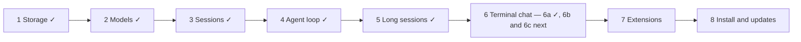

# Roadmap

Status: snapshot of 2026-10-14. A one-page view of what Tau does today, what comes next, and what is only an idea. The details live in the files linked from [README.md](README.md).

## Where we are

Tau is built in eight steps ([architecture.md](architecture.md#build-order)). Steps 1–5 are built; step 6, the terminal chat, is part done.

## Built

| Area | What the user can do | Guide |
| --- | --- | --- |
| Log in | Save an API key or a subscription login for Anthropic, OpenAI, ChatGPT, Codex, OpenRouter or OpenCode Go | [log-in](../guide/log-in.md) |
| Models | Pick a model with `--model`, in settings, or with `/model` in the chat; Tau retries rate limits and says when a plan limit resets | [choose-a-model](../guide/choose-a-model.md), [rate-limits](../guide/rate-limits.md) |
| Settings | `~/.tau/settings.json`: model, run limits, extra providers, `AGENTS.md` on or off | [settings](../guide/settings.md) |
| Print mode | `tau -p "fix the failing test"` runs one prompt and exits | [print-mode](../guide/print-mode.md) |
| Chat | `tau` opens a chat: answers in Markdown, each script shown, steer (Enter) or queue (Tab) during a run, cancel, `/sessions` and `/new`, context and cost in the footer, skipped skills and instruction files above the input, select text to copy | [chat](../guide/chat.md) |
| Tools | The model has two tools: `run` (a JavaScript script that calls shell, file and search functions) and `checks`. A failed script is fixed with small edits; long output is saved to a file | — |
| Project checks | `.tau/checks.json` formats changed files and makes lint, types or tests pass before a run ends | [project-checks](../guide/project-checks.md) |
| Instructions | `AGENTS.md`, instruction files (always on, or read when a situation applies), skills | [write-agents-md](../guide/write-agents-md.md), [write-instruction-files](../guide/write-instruction-files.md), [add-skills](../guide/add-skills.md) |
| Long sessions | A cheap model writes notes on older entries in the background; the agent checkpoints with a handoff; older notes fold into a session memory | [checkpoints](../guide/checkpoints.md) |
| Process sessions | The agent leaves a dev server, watcher or REPL running and comes back to it | [process-sessions](../guide/process-sessions.md) |
| Reload | When Tau's own code changes, the chat restarts into it once idle; broken code shows above the input | [chat](../guide/chat.md) |
| Diagnostics | Each session writes a log under `~/.tau/logs` | — |

Built underneath but not reachable by the user yet: branching a session (storage only) and decision models (the AI layer has them; nothing calls them).

## Next, in order

| # | Work | Plan |
| --- | --- | --- |
| 1 | Daily driver: built; live checks, then the expired-login warning | [work/daily-driver.md](work/daily-driver.md) |
| 2 | Thinking levels: built; live check (see live-checks.md) | [work/thinking.md](work/thinking.md) |
| 3 | `/commit`, a built-in: built; live check (see live-checks.md) | [work/commit.md](work/commit.md) |
| 4 | `/qna`, a built-in: built; live check (see live-checks.md) | [work/qna.md](work/qna.md) |
| 4a | Web search and fetch as `run` functions, then `/references`: web built, live check pending; references built, live check pending | [work/web-and-references.md](work/web-and-references.md) |
| 5 | Ctrl+C as cancel: it clears or cancels what is there, and quits only when there is nothing else | [work/tui.md](work/tui.md) |
| 6 | The rest of 6b, sidebar: running processes, compaction state | [work/tui.md](work/tui.md) |
| 7 | The rest of 6c, commands: `/compact`, `/settings`, login | [work/tui.md](work/tui.md) |
| 8 | Step 7: the extension SDK (`@shanepadgett/tau`), then rebuild the other built-ins from `main` on it | [sdk.md](sdk.md) |
| 9 | Step 8: packages, install, updates | [sdk-packages.md](sdk-packages.md) |

The built-ins planned for step 7: md-lint, attention, auto-name, branch, cost-report, stash, tool-approval, web, image-gen, worktree, run-summary, handoff, reference, aside, manage-sessions.

## Agreed, but not scheduled

| Feature | What it does |
| --- | --- |
| Prompt classifier | One cheap model call per prompt picks the route, flags off-topic prompts, and suggests functions and skills |
| Prompt files | Reusable prompts with `$1`, `$ARGUMENTS` and code blocks that run when the file is used |
| Deferred functions | Extension functions stay hidden until the model searches for them |
| Branching and reset in the chat | Branch from an earlier entry; start fresh from a handoff |
| Custom messages | The user or an extension adds a message, and chooses whether it starts a turn |
| Simulation mode | The real chat on scripted model replies, so screens are reviewed without paying for model calls. Paused 2026-10-14 so Tau becomes the daily driver sooner; round 1 waits in [work/simulation.md](work/simulation.md) |
| Cache miss warnings | The chat warns when a model call re-bills tokens that should have come from the prompt cache, with the cost and the likely cause |

## Ideas, not decided

Multi-repository sessions, bundled ripgrep, cache warnings, a 1-hour cache setting, asking to compact when the cache is cold, a live inspector (`tau observe`), a system prompt view, HTML export, a question tracker. Each is described in [features.md](features.md); later decisions are in [deferred.md](deferred.md).

## Waiting on you

Twelve live checks with real models are open in [live-checks.md](live-checks.md). They cover script edits, instruction files, project checks, output limits, reload and diagnostics. Several finished work plans stay in `work/` until their live checks pass.
