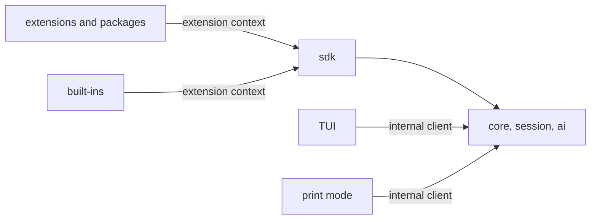

# SDK: what people build Tau with

Status: round 1 (the shape) agreed. Round 2, what each area offers, is proposed in [sdk-catalog.md](sdk-catalog.md). Built at step 7, but its shape is settled now, because every service built before then ends up behind it.

The SDK is everything outside Tau's core can use: extensions, extension packages and Tau's own built-ins. Tau is a personal interactive tool, not something deployed as a bot or service, so outside programs are not an audience. Today the plan only says the `sdk` layer is a "deliberate public facade" over `core` and `ai`, that built-ins use only the SDK, and that extensions add turn-loop operations, `run` functions, I/O middleware and TUI slots. This round decides the shape everything else hangs on.

## What Pi and OpenCode do, and what to keep

| | Pi (`ExtensionAPI`) | OpenCode V2 (`@opencode/plugin`) | Lesson for Tau |
| --- | --- | --- | --- |
| Entry | One factory gets one `pi` object | `Plugin.define({ id, effect })` gets a host with one namespace per domain | Namespace by domain |
| Interception | `pi.on(name)` for 32 events; whether a handler observes, transforms, blocks or replaces depends on each event's result type | `transform` (replayed to rebuild a domain's state) and `hook` (at a live boundary), separate | Make the kind of each extension point explicit |
| Cleanup | Unsubscribe functions; idempotent `session_shutdown` handlers | Every registration belongs to a `Scope`; closing it removes them | Scope-owned registrations |
| State | Tool `details`, custom entries, memory rebuilt on `session_start` | Domain state rebuilt from registrations | Derive state from the session log |
| Authority | Everything: credentials, session manager, full UI | Purpose-built hook contexts; no core objects | Hand out capabilities, not internals |
| Public types | Internal types exported | Generated SDK types; core keeps its own | SDK owns its types |
| Effect | n/a | Effect API first; a promise wrapper over it | Same |

Other systems studied:

- **VS Code:** static contribution points in the manifest, lazy activation events, an out-of-process extension host, `Disposable`.
- **Backstage:** plugins publish named extension points, and modules extend one plugin only through them.
- **Rollup and webpack's tapable:** hook kinds named by how results combine (first, sequential, parallel; bail, waterfall).
- **Fastify:** encapsulated plugin scopes.
- **Object capabilities:** authority is a reference handed over, never ambient.
- **Event sourcing:** the log is the truth, and views are projections replayed from it.

## Agreed: one public face, the extension context



- **Everything goes through extensions.** Tools, commands, hooks, TUI components, one-off model calls (with tools and structured output, which Pi lacks), and child sessions. A subagent system is an extension that starts child sessions and gives the model a tool to call them.
- **The whole terminal UI is extensible.** Tau's UI is built from named places (sidebar, input editor, chat messages, tool calls and results, overlays). Tau's own pieces are the default occupants, so an extension can add to any place or replace it: a to-do widget, a subagent panel, a new input editor, a new look for one tool's calls. Extensions write OpenTUI components with Solid directly, using the host's copies. Rejected: wrapping OpenTUI in our own component API, which would limit extensions to what we wrap. The cost: OpenTUI is pre-1.0, so its version is pinned and an upgrade is an SDK change.
- **The TUI and print mode** share an internal client interface that is not published to outside programs. Rejected: a public API for outside programs (RPC, headless deployment). There is no user for it, and it can be layered on the internal client later.

## Agreed: four kinds of extension point, named by what they can do

| Kind | Can change Tau? | Runs | Examples |
| --- | --- | --- | --- |
| **Observe** | No | Async stream per subscriber; a slow or failing observer affects nobody else | `tool.finished`, `turn.ended`, text deltas, usage |
| **Intercept** | Yes, at one boundary | In order, one at a time; the hook's kind says how results combine | `transform` (each sees the last one's output: edit a prompt), `guard` (first "deny" or "ask" wins: tool approval), `wrap` (around I/O: audit, redaction) |
| **Contribute** | Adds to a registry | Collected when the domain is built; removed when the scope closes | `run` functions, commands, turn operations, model routes, checks, settings, TUI components |
| **Replace** | Swaps a whole runtime part | One active implementation per part, chosen in settings; Tau's default is built the same way | compaction, building the model's context from the session, choosing the model per request |

Events come in two kinds:

- **Facts** are committed session entries. They are durable, and a subscriber can resume from a cursor.
- **Signals** are live progress, such as text deltas and tool progress. They are never stored.

This is the existing split between effects and events in the code. Extension state is a projection of its own entries, never memory, so reload, branching and crash recovery need no extension code.

Replace exists because hooks can only nudge a part that Tau still owns; Pi cannot swap compaction as a whole. Backstage lets an installation replace a core service the same way, and Tau's internals are already swappable Effect services.

Rejected: one `on(event)` with per-event results, as Pi does. It is fewer concepts to learn, but each event's power is hidden in its types, and every new event adds a special case.

## Agreed: a scoped, capability-based context

```text
activate(context) runs inside a Scope owned by Tau
  context.session    entries of this extension, projections, append
  context.turn       operations, prompt and tool hooks
  context.functions  run functions the model calls
  context.commands   commands the user calls
  context.models     one-off calls: text, structured output, tools, decisions (no credentials)
  context.sessions   child sessions (subagents)
  context.ui         add to or replace named UI places; dialogs, notifications (absent in print mode)
  context.runtime    replace a named runtime part
  context.events     observe facts and signals
  context.services   extension points other extensions publish
close the Scope -> every registration, fiber and resource is released
```

- **Least authority.** The context holds only the domains the extension's manifest asks for. Credentials, the database and other extensions' state are never reachable. Trust prompts can then name what a package can do.
- **Extensions publish their own extension points** as typed services, as in Backstage. For example, the `checks` built-in publishes check providers and md-lint registers into them. This replaces an untyped extension-to-extension event bus.
- **SDK-owned types, written once as Effect Schemas.** TypeScript types come from the Schemas, input from extensions is checked at the boundary, and JSON Schema comes free for tool parameters and docs. Core maps to and from them, so internal types such as `Route`, `ModelRef` and Effect's AI parts can change freely. Rejected: generating types from an API description, as OpenCode does for its HTTP client. Tau has no wire protocol and one language, so codegen adds a build step for nothing.
- **Effect first, promises by adapter.** The Effect API is the source of truth; a small adapter turns each Effect function into one returning a promise. The host gives extensions its own `effect`, OpenTUI and Solid instances.

## Later rounds

- **Round 2:** what each area offers: [sdk-catalog.md](sdk-catalog.md).
- **Round 3:** packages, loading and versioning: [sdk-packages.md](sdk-packages.md). Agreed already: local extensions reload automatically on save, as OpenCode's plugins do. Tau watches each extension's files and the local files they import, skips saves that change nothing by content hash, and waits 100 ms so a burst of saves reloads once. The new version starts in a fresh scope and the old scope closes. If the new version fails to load, the last working one keeps running and the error is shown. Installed packages reload only on install or update.
- **Round 4:** isolation: in-process with capabilities, or an out-of-process host; trust.
