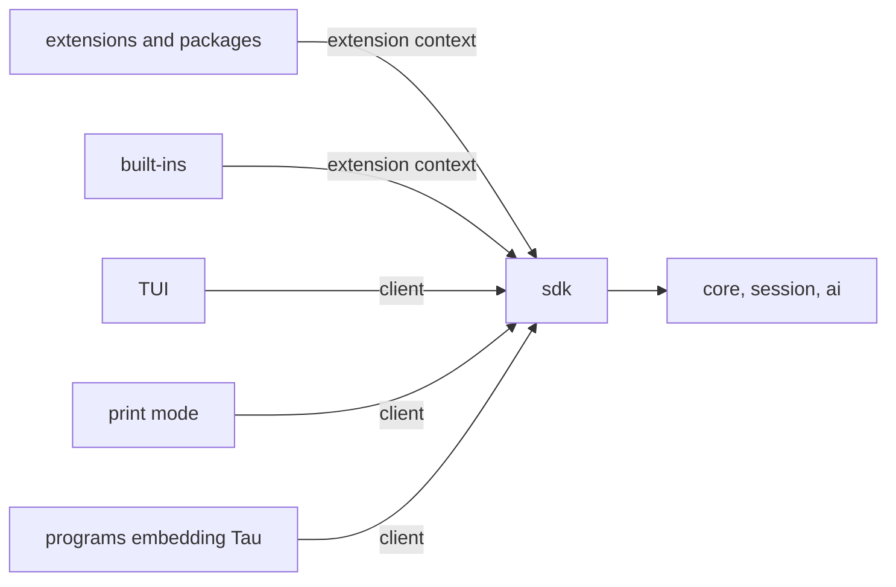

# SDK: what people build Tau with

Status: round 1 (the shape): proposals 2, 3 and 4 agreed; proposal 1 is open in [README.md](README.md#open). Built at step 7 of [architecture.md](architecture.md#build-order), but its shape is settled now, because every service built before then ends up behind it.

The SDK is everything outside Tau's core can use: extensions, extension packages, Tau's own built-ins, and programs that embed Tau. Today the plan only says the `sdk` layer is a "deliberate public facade" over `core` and `ai`, that built-ins use only the SDK, and that extensions add turn-loop operations, `run` functions, I/O middleware and TUI slots. This round decides the shape everything else hangs on.

## What Pi and OpenCode do, and what to keep

| | Pi (`ExtensionAPI`) | OpenCode V2 (`@opencode/plugin`) | Lesson for Tau |
| --- | --- | --- | --- |
| Entry | One factory gets one `pi` object | `Plugin.define({ id, effect })` gets a host with one namespace per domain | Namespace by domain |
| Interception | `pi.on(name)` for 32 events; whether a handler observes, transforms, blocks or replaces depends on each event's result type | `transform` (replayed to rebuild a domain's state) and `hook` (at a live boundary), separate | Make the kind of each extension point explicit |
| Cleanup | Unsubscribe functions; idempotent `session_shutdown` handlers | Every registration belongs to a `Scope`; closing it removes them | Scope-owned registrations |
| State | Tool `details`, custom entries, memory rebuilt on `session_start` | Domain state rebuilt from registrations | Derive state from the session log |
| Authority | Everything: credentials, session manager, full UI | Purpose-built hook contexts; no core objects | Hand out capabilities, not internals |
| Public types | Internal types exported | Generated SDK types; core keeps its own | SDK owns its types |
| Effect | n/a | Effect API first; a promise wrapper over it | Same |

Other systems studied:

- **VS Code:** static contribution points in the manifest, lazy activation events, an out-of-process extension host, `Disposable`.
- **Backstage:** plugins publish named extension points, and modules extend one plugin only through them.
- **Rollup and webpack's tapable:** hook kinds named by how results combine (first, sequential, parallel; bail, waterfall).
- **Fastify:** encapsulated plugin scopes.
- **Object capabilities:** authority is a reference handed over, never ambient.
- **Event sourcing:** the log is the truth, and views are projections replayed from it.

## Proposal 1: two faces over one core



- **Extension context:** code running inside Tau, activated with a scope.
- **Client:** code driving Tau from outside: open a session, send commands, subscribe to events. The TUI and print mode use only the client, so Tau's own front ends prove it the way built-ins prove the extension context. RPC later is the client over a socket.

Alternative: the TUI talks to `core` directly (the current plan). It is less code now, but the client interface goes unproven until someone outside needs it.

## Agreed: three kinds of extension point, named by what they can do

| Kind | Can change Tau? | Runs | Examples |
| --- | --- | --- | --- |
| **Observe** | No | Async stream per subscriber; a slow or failing observer affects nobody else | `tool.finished`, `turn.ended`, text deltas, usage |
| **Intercept** | Yes, at one boundary | In order, one at a time; the hook's kind says how results combine | `transform` (each sees the last one's output: edit a prompt), `guard` (first "deny" or "ask" wins: tool approval), `wrap` (around I/O: audit, redaction) |
| **Contribute** | Adds to a registry | Collected when the domain is built; removed when the scope closes | `run` functions, commands, turn operations, model routes, checks, settings, TUI slots |

Events come in two kinds:

- **Facts** are committed session entries. They are durable, and a subscriber can resume from a cursor.
- **Signals** are live progress, such as text deltas and tool progress. They are never stored.

This is the existing split between effects and events in [architecture.md](architecture.md#core-ideas). Extension state is a projection of its own entries, never memory, so reload, branching and crash recovery need no extension code.

Rejected: one `on(event)` with per-event results, as Pi does. It is fewer concepts to learn, but each event's power is hidden in its types, and every new event adds a special case.

## Agreed: a scoped, capability-based context

```text
activate(context) runs inside a Scope owned by Tau
  context.session    entries of this extension, projections, append
  context.turn       operations, prompt and tool hooks
  context.functions  run functions the model calls
  context.commands   commands the user calls
  context.models     language and decision models (no credentials)
  context.ui         slots, dialogs, notifications (absent in print mode)
  context.events     observe facts and signals
  context.services   extension points other extensions publish
close the Scope -> every registration, fiber and resource is released
```

- **Least authority.** The context holds only the domains the extension's manifest asks for. Credentials, the database and other extensions' state are never reachable. Trust prompts can then name what a package can do.
- **Extensions publish their own extension points** as typed services, as in Backstage. For example, the `checks` built-in publishes check providers and md-lint registers into them. This replaces an untyped extension-to-extension event bus.
- **SDK-owned types.** Public types are SDK Schemas, versioned with the SDK. Core maps to and from them, so internal types such as `Route`, `ModelRef` and Effect's AI parts can change freely.
- **Effect first, promises generated.** The Effect API is the source of truth, and a promise wrapper is derived from it. The host gives extensions its own `effect` instance.

## Later rounds

- **Round 2:** the domain catalog: every event, hook and contribution per domain, mapped to the services behind it.
- **Round 3:** the manifest and lazy activation; extension packages (extensions, skills, prompts, themes, checks); versioning.
- **Round 4:** isolation: in-process with capabilities, or an out-of-process host; trust.
