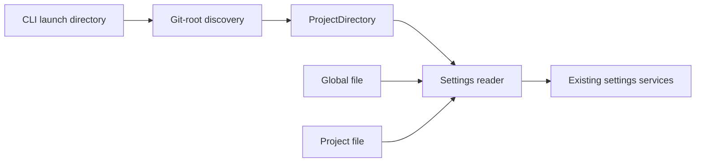

# Settings

Status: built. Guide: [Change Tau’s settings](../guide/settings.md).

## Resolution

| Source | Location | Priority |
| --- | --- | --- |
| Built-in defaults | `src/host/Settings.ts` | Lowest |
| Global file | `~/.tau/settings.json` | Overrides defaults |
| Project file | `<git-root>/.tau/settings.json` | Overrides global fields |

Outside Git, the project file is `<launch-directory>/.tau/settings.json`. Inside Git, launching from a subdirectory still finds the Git-root file. Each worktree uses its own file.

Both files use the same schema and accept comments. Validate each file independently, recursively merge explicitly supplied object fields, then apply defaults once. Missing fields inherit; `false` is a value. No separate personal-project tier, scope allowlist, or requirement markers. An explicit CLI `--model` still overrides the model from settings.

## Boundaries

| System | Responsibility |
| --- | --- |
| `src/cli/main.ts` | Reuses `workspace/Repository.ts` to find the Git root, falls back to the launch directory, and supplies `ProjectDirectory`. |
| `src/host/ProjectDirectory.ts` | Resolved project folder; tests supply a temporary one. Keeps host settings independent of workspace imports. |
| `src/host/Settings.ts` | Reads and merges both files, validates settings, resolves provider definitions, provides `Settings`, `ProviderTable`, `ContextSettings` and `CommitSettings`. |
| Existing consumers | Receive resolved services; `/commit` needs no new configuration path. |

Settings load at startup. Invalid syntax or values stop startup and name the file. Project settings may change provider connections; review unfamiliar repository settings before launching Tau. This is configuration precedence, not an enterprise enforcement boundary or trust sandbox.

## Verification

Host tests cover missing files, defaults, inheritance, empty sections, explicit booleans, nested settings, provider merging and invalid files. A focused compiled-binary test passes for Git-root discovery from a nested launch directory and launch-directory lookup outside Git.

## References

The Pi reference at `/Users/shanepadgett/.tau/references/pi/packages/coding-agent/src/core/settings-manager.ts` uses project-over-global settings with nested object merging. Tau follows that shape with Git-root discovery instead of Pi’s working-directory lookup. Pi’s trust gate and special resource-list rules are not added by this feature.
