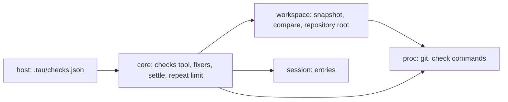

# Slice 4d: checks and change detection

Status: round 1 (architecture) agreed, 2026-10-13. Slice 4c's architecture round agreed most of this slice; those rows are carried below. Next: round 2, the code plan.

**What the user gets:** projects define checks (formatters, lint, type checks, tests). Fixers run silently after the model changes matching files, and the model calls `checks` when it is done. If it skips them, or changes files after, Tau runs them before the run ends and sends the failures back. A model that sends the same failing call again and again ends its run instead of looping.

## Today

| Piece | Where | How it works now |
| --- | --- | --- |
| `workspace` layer | `.fallowrc.jsonc`, `architecture.md` | declared as a leaf that may import nothing; no code yet |
| Repository root | `src/core/internal/instructions/folders.ts` | found through `proc` |
| Tool calls | `src/core/internal/loop/run-tool-calls.ts` | one call at a time; the result entry saves `files` and `script` |
| Step | `src/core/internal/loop/step.ts` | operations in order: interrupt started calls, run tool calls, turn limit, call the model |
| Run end reasons | `src/core/internal/loop/run-context.ts` | `answered`, `turn-limit`, `output-limit`, `cancelled`, `failed` |
| Repeated calls | nowhere | in the live model matrix, DeepSeek on one backend sent 229 empty `run` calls in a row |

## Systems



| System | Change |
| --- | --- |
| `workspace` | added: snapshot of the working tree and the files changed between two snapshots; takes over finding the repository root from `folders.ts` |
| `core` | changed: new `checks` tool; fixers after each `run` call; two new step operations, *settle checks* before the run ends and *repeat limit* after tool calls |
| `session` | changed: the tool result saves the files a call changed; a new `checks` entry |
| `host` | changed: reads the project's `.tau/checks.json` |

## Patterns

| Choice | Beat | Tradeoff |
| --- | --- | --- |
| Compare snapshots before and after each `run` call | OpenCode formats only files its own tools write; Codex's `TurnDiffTracker` sees only `apply_patch` | catches changes made through `sh`, at the cost of one `git status` per call |
| Settle checks as a step operation | Silent Command Runner's end-of-run hook | state comes from entries, so it is re-entrant and testable like the other operations |
| Repeat limit as a step operation that reads the last tool results | Goose's `RepetitionInspector` (counts identical consecutive calls); OpenCode's `doom_loop` permission (asks the user after 3) | no memory between steps; print mode has nobody to ask, so the run ends |

## Agreed (slice 4c, round 1)

| # | Question | Agreed |
| --- | --- | --- |
| 1 | Snapshot shape | **A: `git status` plus a hash of each changed and untracked file** (`Bun.hash`; files over 2 MB compare size and change time). B, OpenCode's shadow git repository with a tree per call, also gives diffs and undo; it waits until undo is planned. `workspace`'s interface (`snapshot`, `changed(before, after)`) stays the same for B |
| 2 | Outside a git repository | **No change detection:** fixers do not run, `checks` runs every check, and settle runs them once at the end of a run with any `run` call |
| 3 | `workspace` may import `proc` | **Yes** (permission given). It needs git. Changes `.fallowrc.jsonc` and the layer table in `architecture.md` |
| 4 | Where checks are defined | **The project's `.tau/checks.json`,** with a schema like Silent Command Runner's, one list per kind of check. `settings.json` stays for Tau's own settings. A cloned repository's file runs commands without asking, so SDK round 4 (isolation and trust) adds a trust prompt |
| 5 | How the model calls checks | **A second tool, `checks`,** with no parameters, shown only when checks exist. Not a script function, so its result is its own entry |
| 6 | `{files}` in a command | **Replaced with `"$@"`; the paths are passed as arguments to `sh -c`,** so no path is ever quoted or pasted into the command |
| 7 | Limit repeated failing calls | **Yes** (2026-10-13), in this slice |

Check entry shape, carried over from Silent Command Runner: `name`, `command`, `details`, `include` and `exclude` globs (`Bun.Glob`), `cwd`, `env`, `timeoutSeconds`; the kind (`fix`, `check`, `final`) is the list the entry is in. Designed in the code round.

## Agreed (round 1)

```text
step operations, in order
  interrupt started calls
  run tool calls
  repeat limit        new: the last N tool results are the same failed call → run ends
  turn limit
  settle checks       new: files changed since the last checks → run checks, send failures back
  call the model
```

| # | Question | Agreed | Reason |
| --- | --- | --- | --- |
| 1 | What counts as a repeat | **The same tool name and parameters, failed, in consecutive calls** | a call that succeeds, or that changes its parameters, may be making progress; Goose counts identical consecutive calls too |
| 2 | How many repeats end the run | **3** | OpenCode's `doom_loop` uses 3; a model fixing its call changes the parameters, so 3 identical failures means it is stuck |
| 3 | What happens at the limit | **The run ends with a new reason, `repeated-call`, naming the call;** no warning to the model first | DeepSeek's 229 calls each got a failed result that said what was wrong, and that did not stop it |
| 4 | How many times settle sends check failures back before the run ends | **3, then the run ends with `checks-failed`** | stops a model that cannot fix a check from looping, and still gives it room to try |
