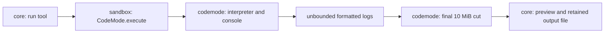
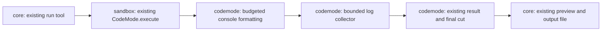

# Slice 4e: script output memory

Status: version-pinned codemode patch approved and implemented, 2026-10-13. The user chose to keep codemode and patch it directly without another code plan. The QuickJS experiment is on hold. All 49 focused tests and compiled smoke checks pass.

**Decision:** keep `@opencode/codemode` and patch output capture inside the package. Bound console formatting and retained logs during execution, rather than only cutting them afterwards. This protects against runaway printing; it does not impose a total script-memory ceiling.

## Unpatched boundary and the gap

| Finding | Evidence |
| --- | --- |
| No public console callback | `CodeMode.Options` exposes tools, tool/extension hooks, extensions and execution limits; console is a built-in, not an extension |
| An extension cannot replace console | `CodeMode.make` rejects globals that shadow built-ins; a read-only probe returned `Extension "capture" global "console" is already defined.` |
| Hooks cannot intercept console | A read-only probe logged 200 lines with zero tool/extension hook calls; the returned result reported six retained lines out of 200 |
| Capture grows before the output cap | `stdlib/console.js` formats each message and appends it to `ctx.logs`; `interpreter/execute.js` calls `boundOutput` after execution |
| Formatting also needs a bound | Console inspection and tables build complete arrays and joined strings before capture; limiting only `logs.push` leaves oversized single messages unsafe |
| Other memory remains unbounded | Returned values are copied and serialized before cutting; individual string/array limits are not a total allocation limit |

OpenCode's reference `packages/core/src/codemode/tool.ts` uses `CodeMode.make` directly, without a worker or VM and without optional execution limits. Its interpreter bounds individual strings, arrays, pending promises and nesting, not total memory. Tau already supplies a timeout and a 10 MiB returned-output budget.

## Implemented architecture

**Pattern:** an execution-local bounded output collector, inside the existing interpreter. Use Bun's version-pinned dependency patch mechanism, not a fork or imports of private package modules from Tau.

| System | Responsibility |
| --- | --- |
| Patched codemode | Replace unbounded console formatting and log accumulation with budgeted formatting and capture; preserve `CodeMode.Result` and mark discarded text with `truncated` |
| Capture | Use the existing 10 MiB output limit and a 65,536-entry ceiling; count each newline as one byte; stop formatting later messages after the first discarded entry |
| Script execution | Continue after output is discarded, preserving tool execution and the existing timeout/cleanup behavior |
| Tau sandbox | Keep `CodeMode.execute`, tool definitions, discovery and cancellation; consume the existing result contract |
| Core and session | Keep previews and the “Retained output” warning for discarded script output |
| Dependency maintenance | Store the generated patch in `patches/`, register it in `package.json` and the lockfile, and revalidate it when upgrading codemode |

`patches/@opencode%2Fcodemode@2.0.27.patch` adds an execution-local `ConsoleLogs` collector and a formatting preflight. The preflight charges UTF-8 text, JSON escapes, collection entries and table row/column expansion before the existing formatter allocates. Its allowance is the remaining capture budget, with a 64 KiB minimum plus two argument/value slots. This conservative estimate can discard a collection whose final text would fit. It is not an exact heap measurement.

The final result still shares its byte budget between the returned value and logs. Truncation reports retained versus attempted entries, including messages skipped after capture closes. No-limit codemode executions keep their existing behavior. The patch is registered in `package.json` and `bun.lock`; upgrading codemode requires reviewing and revalidating it.

## Alternatives and limits

| Shape | Tradeoff |
| --- | --- |
| **Version-pinned codemode patch** | Keeps the simple integration; adds a patch to maintain at upgrades; protects console output, not all script allocations |
| Public extension or hooks | No suitable console boundary exists in 2.0.27; wrapping scripts to replace console would alter script behavior and is not a reliable confinement boundary |
| QuickJS worker | Provides an enforced guest-allocation ceiling, but replaces execution and adds messaging, compatibility and cleanup work; on hold |

**Accepted remaining risk:** scripts can still allocate many values or return a huge structure. This route is not a substitute for a hard memory limit. Protecting returned-value formatting and host-boundary copies would require further dependency changes; those are not included in this console-output patch.

## Verification

| Case | Required result |
| --- | --- |
| Repeated printing and empty lines | Byte and entry retention remain bounded before execution ends |
| One large object, array or table | Formatting stops within its budget rather than building the entire representation |
| Unicode and multiline messages | Correct byte accounting and an explicit truncation marker |
| Output cap followed by a tool call | The tool still runs; truncation does not become a script failure |
| Failure, timeout and cancellation after printing | Preserve retained logs, truncation status and existing tool cleanup |
| Consecutive runs and compiled executable | Fresh accounting for each execution; patch behavior survives compilation |

`tests/core/script-output.test.ts` covers capture, formatting, continued tool execution, failure and cleanup. The focused suite also covers output limits, script edits and the agent loop. A differential probe matched unpatched codemode on 90 ordinary output cases. A compiled sandbox smoke test confirms bounded oversized formatting, a 12 MiB printing flood and a fresh next execution; the compiled Tau executable starts with `--help`. No live models were used.

## References

- `docs/reference/copies/index.md`: codemode 2.0.27 and Bun 1.4.3.
- Codemode's copied README and installed `codemode.d.ts`, `tool-runtime.d.ts`, `codemode.js`, `interpreter/execute.js`, `interpreter/objects.js`, `data.js` and `stdlib/console.js`.
- Read-only OpenCode reference: `packages/core/src/codemode/tool.ts` and `packages/codemode/src/interpreter/limits.ts`.
- Bun's pinned `docs/pm/cli/patch.mdx`: `bun patch` prepares a cache-safe working copy; `bun patch --commit` generates the patch and updates package metadata. The latter is a package-patch operation, not a Git commit.
