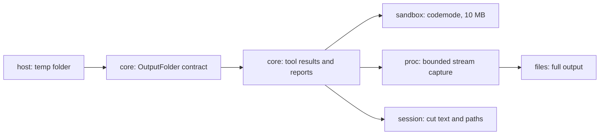

# Slice 4e: output limits

Status: round 1 and round 2 agreed, output capture and warning implemented, 2026-10-13. The [version-pinned codemode patch](agent-loop-4e-memory.md) is approved and implemented. It bounds console capture and formatting, not total script memory. Code plan: [agent-loop-4e-code.md](agent-loop-4e-code.md).

**What the user gets:** a command that prints without end, such as `yes` or a runaway test, cannot fill Tau's memory, and a big result does not fill the model's context. The model sees the start and the end, and gets the path of a file with the output it can search with `sh`. For scripts past codemode's bound, discarded output cannot be recovered.

## Today

| Piece | Where | How it works now |
| --- | --- | --- |
| Shell output | `src/proc/Command.ts` `runCommand` | bounded capture: 50 KB or 2,000 lines, start and end; spills the whole stream to a private file |
| Script result | `src/sandbox/Sandbox.ts` | patched codemode bounds console capture and formatting during execution, then cuts returned logs and value to 10 MB; Tau caps its result and saves retained output |
| Check output | `src/core/internal/checks/run-checks.ts` | bounded shell capture and combined report; saves the rendered report for replay |
| Program output (git) | `runProgram` | fails over 10,000,000 characters; stays as it is |

## Agreed

| # | Question | Agreed |
| --- | --- | --- |
| 1 | Where full output goes | **`$TMPDIR/tau/<session>/`**, in the OS temp folder. The OS clears it, so Tau has no cleanup code. Files only the user can read (`0600`), never written through an existing link |
| 2 | What the model sees | **50 KB or 2,000 lines, whichever is smaller**, as Pi and OpenCode |
| 3 | Which part is kept | **Start and end, half each** |
| 4 | Shell output over the cap | **Keep the start and a rolling end in memory; spill the whole stream to a file**, and give its path in the cut marker |
| 5 | Check output over the cap | **Same as shell output**, through one code path in `proc` |
| 6 | Script output over 10 MB | **Codemode cuts it, start only**. The file has what codemode kept, not the discarded output |
| 7 | What the session saves | **Cut text plus the file path in `details.output`**, so the saved result is what the model saw |
| 8 | Warning wording | **“Output shortened. Full output saved at `<path>`. Search that file or print less.”** Use “Retained output” when script output has already been discarded |
| 9 | Script memory | **Version-pinned codemode patch.** Bound console capture and formatting during execution; accept that other script allocations and oversized returned-value formatting remain unbounded |

## Systems

| System | Change |
| --- | --- |
| `host` | new production layer for `core/OutputFolder`: `$TMPDIR/tau`. A test gives a temp folder; `core` cannot import `host` |
| `proc` | changed: `runCommand` keeps only the start and a rolling end in memory; past the cap it writes the whole stream to a file it is given |
| `sandbox` | changed: patched codemode bounds console capture and formatting during execution, and returns up to 10 MB of logs and value, not the model's limit; the QuickJS experiment is on hold |
| `core` | changed: `run` cuts its result to the cap and saves the retained text; `sh` and checks get a file path per call |
| `session` | expanded: saves output paths beside the cut text |

**Pattern:** bounded stream capture with a one-way transition from memory to file. Cutting only after collecting the stream is simpler, but leaves runaway commands able to fill memory. Pi's streamed output files and OpenCode's result transform informed these two shapes; Tau rebuilds the behavior on Effect services.

## Agreed warning

“Output shortened. Full output saved at `<path>`. Search that file or print less.”

For codemode's 10 MB cut, say **retained output**, not **full output**: discarded text cannot be recovered.

## References read

- Pi: `packages/coding-agent/src/utils/output-files.ts`, exclusive `0600` output files and stream writers.
- OpenCode: `packages/core/src/tool-output.ts`, 2,000 lines or `50 * 1024` bytes, retained head and a file link.
- Dependency APIs and code boundaries are listed in the [round 2 plan](agent-loop-4e-code.md).
