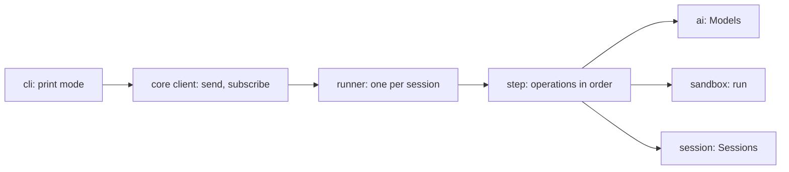

# Build step 4: the agent loop

Status: round 1 (architecture) agreed, 2026-10-13. Slices 4a and 4b are built and confirmed live; their decisions are in [architecture.md](../architecture.md#core-ideas). Next: instruction files and skills, then slice 4c.

After step 4, `tau -p "fix the failing test"` works from a terminal: Tau sends the prompt to a model, runs the model's `run` scripts in the working directory, saves every entry to the session, and prints the answer. The TUI (step 6) later drives the same core.

## What exists

| Piece | Where | State |
| --- | --- | --- |
| Model calls, structured output, catalog, logins | `src/ai/` | Built (step 2) |
| Sessions: create, fork, append, read; `contextView` builds the `Prompt` | `src/session/` | Built (step 3) |
| `tau login`, `tau logout` | `src/cli/main.ts` | Built; no chat command yet |
| `@opencode/codemode` runs scripts as Effect fibers; Esc stops busy loops | spike 9, `spikes/codemode/` | Proven; not installed in the root package |
| Soul, the base system prompt | `main` branch, `packages/agent/extensions/soul/prompt.ts` | To be rewritten for Tau's two tools |
| Decided: re-entrant step function, operations in phases, one writer per session, effects only append entries, events are not stored | [architecture.md](../architecture.md#core-ideas) | Agreed |

## Shape (from earlier decisions)



- **The step** reads the session's entries, runs the operations in order, and appends what the first operation that applies produces. Pattern: Goose's re-entrant state machine (`crates/goose/src/agents/state_machine`, one `ops_*.rs` file per operation). It beat OpenCode's single runner loop with an `Outcome` union (`packages/core/src/session/runner/step.ts`): Goose's operations can be added one at a time, which is what the SDK's `turn` area exposes.
- **The `sandbox` layer** is new: `@opencode/codemode` plus Tau's functions, made with `Tool.make`. `core` decides which functions a script sees.
- **The runner** is a fiber that takes commands from a queue, so a session has one writer.

## Decision 1 (agreed): build step 4 in three slices

| Slice | Delivers |
| --- | --- |
| **4a: a working agent** | print mode; the loop (call the model, run its tool calls, an optional turn limit, off by default); `run` with `sh`, `read`, `write` and `replace`; Soul rewritten as the base prompt; Ctrl-C cancels cleanly; continue a session by ID; three safety rules from [loop-research.md](../loop-research.md#changes-for-slice-4a-agreed): a tool call is recorded as started before it runs, the context view repairs tool history, an interrupted reply's text is kept |
| **4b: instructions and errors** | instruction sources as value deltas (`AGENTS.md`, date, environment); retries on rate limits and network errors; plan usage-limit messages |
| **4c: script tools** | edit a failed script by ID; queue writes to one file; the `checks` tool and change detection (the `workspace` layer) |

Each slice ends with checks and one live run. A slice is planned in its own code round.

## Decision 2 (agreed): print mode

After Claude Code's and Pi's `-p`:

```text
tau -p "prompt"              new session in the current directory
echo "prompt" | tau -p       prompt from stdin
tau -p --session <id> "..."  continue a session
tau -p --model <route>/<model> "..."
```

- The answer streams to stdout. One short line per `run` call goes to stderr, so `tau -p ... > answer.md` keeps only the answer.
- The session ID goes to stderr at the end. The exit code is not zero when the run fails.
- JSON output waits until something needs it.

## Decision 3 (agreed): which model print mode uses

**`model` in `~/.tau/settings.json`** (such as `"anthropic/claude-sonnet-5-5"`), overridden by `--model`. With neither, Tau stops and says how to set one. No built-in default: the right model depends on which logins the user has.

## Decision 4 (agreed): no approval prompts

**`run` acts with the user's permissions, with no approval prompts**, as in Pi. Print mode has nobody to ask. OS-level confinement stays in [deferred.md](../deferred.md).
