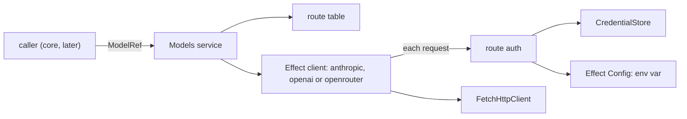
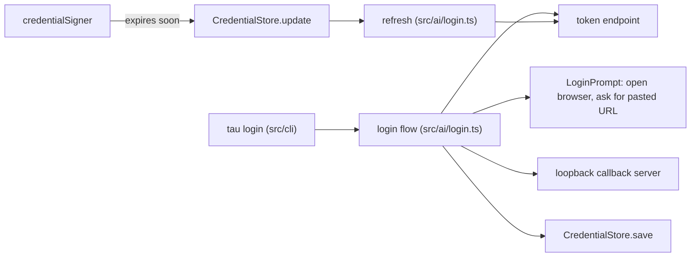

# Build step 2: the AI layer

Status: rounds 1, 2 and 2b implemented and confirmed live.

After step 2, Tau code can name a model, such as `anthropic/claude-sonnet-5-5` or `openrouter/~typesafe/jev-latest`, and get Effect's `LanguageModel` service (streaming, text, structured output) or `DecisionModel` service (Jev and Luna decisions). The model is authenticated with a stored credential or an environment variable, and subscription tokens refresh on their own. The turn loop that uses it is step 4.

Spike 8 ([spikes.md](../spikes.md)) proved every route on Effect's four AI packages; `spikes/effect-ai/` is reference code only.

## Round 1 (implemented): from a model name to an Effect service



| File | Does |
| --- | --- |
| `src/ai/routes.ts` | `Route` and the four built-in routes: `anthropic` (Claude subscription), `openai` (API key, Luna decisions), `openai-codex` (ChatGPT subscription), `openrouter` (API key, System One decisions). |
| `src/ai/route-auth.ts` | `credentialSigner(route)` reads the credential (store, then the route's environment variable through Effect's `Config`), rejects a missing, expired or wrong-kind one, and returns what sets the headers. `signRequests(route)` runs it on every request. |
| `src/ai/codex.ts` | Codex only streams: sends non-streaming requests as streams and answers with the `response.completed` body, without `phase: "commentary"` messages. |
| `src/ai/openai-decisions.ts` | `DecisionModel.make` adapter for `POST /v1/decisions`. |
| `src/ai/models.ts` | `Models` service (`languageModel`, `decisionModel`) and `modelsLayer(routes)`. |
| `tests/models.test.ts` | Each chat route streams a tool call and returns a structured object; both decision APIs answer; missing and expired credentials fail before sending. Replays `tests/recordings/`. |

```ts
type RouteAuth =
  | { kind: "apiKey"; environmentVariable: string }
  | { kind: "claudeSubscription" }
  | { kind: "chatgptSubscription" }

type Route = {
  id: RouteId; provider: ProviderId; apiUrl: string; auth: RouteAuth
  client: "anthropic" | "openai" | "openrouter"
  decisions: "systemOne" | "openaiDecisions" | undefined
}

class Models: {
  languageModel(ref: ModelRef): Effect<LanguageModel, ModelsError>
  decisionModel(ref: ModelRef): Effect<DecisionModel, ModelsError>
}
modelsLayer(routes): Layer<Models, never, CredentialStore | HttpClient>
```

| `auth` | Headers on each request |
| --- | --- |
| `apiKey` | `x-api-key` on Anthropic, `Authorization: Bearer` elsewhere |
| `claudeSubscription` | `Authorization: Bearer`; betas `claude-code-20250219`, `oauth-2025-04-20` appended to the package's own |
| `chatgptSubscription` | `Authorization: Bearer`, `chatgpt-account-id` (from the token's JWT claim), `originator`, `OpenAI-Beta` |

- **System One reuses Effect's OpenRouter decision model.** It already speaks System One but posts to `/api/alpha/decisions` (404); the route's client rewrites the path to `/api/v1/systemone`. The tests assert the path, so an Effect change shows up there.
- **Credential failures are typed up front.** Both `Models` methods check the credential before building a client, so a missing login fails with `CredentialUnavailable`. Inside a request, Effect's clients accept only HTTP errors, so the same failure becomes a transport error.
- **Tests differ from production only by injection:** routes point at a `Bun.serve` replay server, the store lives in a temp directory, and the environment comes from `ConfigProvider.fromUnknown`. OpenRouter's key comes from that environment, so every run covers the fallback.
- **Not yet built:**
  - the OpenCode Go route: its models span three protocols, so it waits for the catalog;
  - `session-id` and the Codex priority tier, which need a session and the catalog;
  - parsing a `provider/model` string, until the first caller needs it.

## Round 2 (implemented): log in, and refresh tokens instead of failing

After round 2:

- **`tau login`** takes no arguments. It lists the providers to choose from, then:
  - for Claude, asks for the browser or the copy-code page;
  - for ChatGPT, asks for the browser or a device code;
  - for OpenRouter and OpenAI, asks for an API key without echoing it.

  It then saves the credential.
- **`tau logout`** takes no arguments. It lists the providers with a saved credential and removes the one chosen.
- An expired token refreshes on the next request instead of failing. Only a refused refresh asks you to log in again.

Today `credentialSigner` (`src/ai/route-auth.ts`) fails with `CredentialUnavailable` reason `expired` as soon as a token is within a minute of expiry. `CredentialStore.update` (`src/ai/credential.ts`, built in step 1) already serializes refreshes across processes; nothing calls it yet.



### Types

```ts
// src/ai/routes.ts: subscription auth now carries its OAuth client, so tests point it at a fake server
type OAuthClient = {
  clientId: string; authorizeUrl: string; tokenUrl: string; scopes: string
  callback: { port: number; path: string; anyPort: boolean } // Claude accepts any loopback port; Codex needs 1455
  tokenBody: "json" | "form"                                 // Claude posts JSON; OpenAI posts a form
  authorizeParams: Record<string, string>                    // e.g. Codex's id_token_add_organizations, originator
  headless:                                                  // the login for a machine without a browser
    | { kind: "copyCode"; redirectUri: string }              // Claude: a page shows code#state to paste
    | { kind: "deviceCode"; userCodeUrl: string; pollUrl: string; verificationUrl: string; redirectUri: string } // ChatGPT
}
type RouteAuth =
  | { kind: "apiKey"; environmentVariable: string }
  | { kind: "claudeSubscription"; oauth: OAuthClient }
  | { kind: "chatgptSubscription"; oauth: OAuthClient }

// src/ai/login.ts
class LoginPrompt: {                          // injected: the CLI in production, the test in tests
  openBrowser(url: string): Effect<void>
  showUrl(url: string): Effect<void>          // printed too, for a browser on another machine
  askPastedUrl(): Effect<string>              // the redirect URL copied from the browser's address bar
  chooseMethod(provider: ProviderId): Effect<"browser" | "headless">
  askCode(): Effect<string>                   // Claude's copy-code page: code#state
  showDeviceCode(code: string, url: string): Effect<void>
  askApiKey(provider: ProviderId): Effect<Redacted<string>>
}
login(route): Effect<void, LoginFailed, CredentialStore | LoginPrompt | HttpClient | Crypto>
refreshTokens(route): (stale: Credential) => Effect<Credential, RefreshRefused | HttpClientError>

class LoginFailed     { provider; reason: "stateMismatch" | "denied" | "exchangeFailed" | "deviceCodeExpired"; message; cause? }
class RefreshRefused  { provider; message }  // the token endpoint answered 400 or 401
```

### Login (browser, with a pasted-URL fallback)

```text
login(route)
  apiKey route: key = prompt.askApiKey; store.save(ApiKey(key)); done
  verifier = base64url(Crypto.randomBytes(32)); challenge = base64url(Crypto.digest("SHA-256", verifier))
  state = base64url(Crypto.randomBytes(16))
  server = serve callback on oauth.callback.port (free port when anyPort and it is taken), scoped
  url = authorizeUrl with client_id, redirect_uri, scope, code_challenge (S256), state, authorizeParams
  prompt.openBrowser(url); prompt.showUrl(url)
  query = race(server.firstCallback, prompt.askPastedUrl then parse query)
  query.state != state -> LoginFailed stateMismatch; query.error -> LoginFailed denied
  tokens = POST tokenUrl { grant_type: authorization_code, code, code_verifier, redirect_uri, client_id }
  store.save(provider, OAuthTokens(access, refresh, now + expires_in))
```

The pasted URL also covers SSH: the browser on your laptop fails to load the `localhost` page, and you paste its address into Tau.

### Login without a browser

```text
Claude copy-code
  same PKCE and state; redirect_uri = headless.redirectUri; authorize param code=true
  prompt.showUrl(url); input = prompt.askCode()        // "code#state"
  state differs -> LoginFailed stateMismatch
  exchange as above with headless.redirectUri, also sending state

ChatGPT device code
  POST userCodeUrl { client_id } -> device_auth_id, user_code, interval
  prompt.showDeviceCode(user_code, verificationUrl)
  repeat every interval, up to 15 minutes (Effect Schedule):
    POST pollUrl { device_auth_id, user_code }
      403, 404 or deviceauth_authorization_pending -> wait
      slow_down -> lengthen the interval
      200 -> authorization_code, code_verifier
  past 15 minutes -> LoginFailed deviceCodeExpired
  exchange authorization_code with that code_verifier and headless.redirectUri
```

### Refresh

```text
credentialSigner(route)
  credential = current credential
  OAuth and expires within a minute:
    credential = store.update(provider, credential, refreshTokens(route))
      none           -> CredentialUnavailable missing
      RefreshRefused -> CredentialUnavailable expired ("login has expired. Run tau login.")
      HttpClientError -> fails this request only; the next request tries again
refreshTokens(route)(stale)
  POST tokenUrl { grant_type: refresh_token, refresh_token, client_id }
  -> OAuthTokens(access, new refresh, now + expires_in)   // providers rotate the refresh token on each use
```

Requests that find the same expired token at once all call `update`. The first refreshes; the rest see the stored credential has changed and use it without calling the endpoint.

### Files

| File | Change |
| --- | --- |
| `src/ai/routes.ts` | `OAuthClient`; Claude and ChatGPT client values on the built-in routes |
| `src/ai/login.ts` | New: `LoginPrompt`, `login`, `refreshTokens`, PKCE, the callback server (`BunHttpServer.make` from `@effect/platform-bun`) |
| `src/ai/route-auth.ts` | `credentialSigner` refreshes through `CredentialStore.update` instead of failing on expiry |
| `src/cli/main.ts` | New: `tau login` and `tau logout`, no arguments, with Effect's `cli/Command`; providers and methods chosen with `cli/Prompt` `Select`; `LoginPrompt` from `cli/Prompt` (`Password` for keys, `String` for the pasted URL) and the `open` or `xdg-open` command through Effect's `ChildProcess`; `BunRuntime.runMain` |
| `src/host/tau-directory.ts` | New: resolves `~/.tau` (only `host` reads the environment) |
| `tests/login.test.ts` | New: the flows below against a fake auth server |

Reused:

- PKCE uses Effect's `Crypto` (`randomBytes`, `digest`) and `encoding/Base64Url`.
- Requests use `HttpClient` and `HttpClientResponse.schemaBodyJson`.
- Prompts use `cli/Prompt`.

Nothing hand-written where Effect has it.

### Injection: production and tests

| | Production | Tests |
| --- | --- | --- |
| OAuth endpoints | `builtInRoutes` | Routes whose `OAuthClient` points at a `Bun.serve` fake: `/authorize` redirects to `redirect_uri` with a code; `/token` checks the verifier against the challenge, rotates refresh tokens, and refuses a stale one with 400 |
| Callback port | 53692 (Claude), 1455 (Codex) | 0 |
| `LoginPrompt` | Terminal prompts (`Select` for the method) and the system browser | `openBrowser` fetches the URL and follows the redirect to the callback; `askPastedUrl` and `askCode` return what the fake server issued, or never answer |
| Device-code interval | from the server | the fake server answers 0 seconds, pending twice, then success |
| `Crypto` | `BunCrypto.layer` | the same |

Tests, each well under a second:

1. Claude login through the callback saves tokens, and the fake server confirms the PKCE pair.
2. ChatGPT login through a pasted URL saves tokens without the callback.
3. A wrong `state` fails with `stateMismatch` and saves nothing.
4. An expired token refreshes on the next request, and the request carries the new token.
5. Three concurrent requests with an expired token cause one refresh.
6. A refused refresh fails with `CredentialUnavailable` reason `expired`.
7. Claude copy-code login saves tokens from a pasted `code#state`.
8. ChatGPT device-code login waits through pending and `slow_down` answers, then saves tokens.
9. Logging in to an API-key route saves the key, and a stored key wins over the environment variable.

### Replaces

- The immediate `expired` failure in `credentialSigner`.
- Logging in by copying Pi's `~/.pi/agent/auth.json`, which the spike relied on.

### Not in this round

- Background refresh before a token is needed.

### As built

How the code differs from the plan above:

- **The code is in four files.**
  - `src/ai/token-endpoint.ts` holds `requestTokens`. Login and refresh share it. It fails with `TokenRequestFailed`, whose reason is `refused` (400 or 401) or `failed`; there is no separate `RefreshRefused`.
  - `src/ai/login.ts` exports one function, `logIn(provider, oauth, "browser" | "headless")`.
  - `src/ai/route-auth.ts` refreshes the tokens.
  - `src/cli/main.ts` holds the commands.
- **`LoginPrompt` has three methods:** `openBrowser`, `show` and `ask`. The CLI chooses the provider and the method, and saves API keys straight to `CredentialStore`.
- **Errors:**
  - `LoginFailed` reasons are `stateMismatch`, `denied`, `requestFailed` and `deviceCodeExpired`.
  - `CredentialUnavailable` gains `refreshFailed`, for a refresh that failed but was not refused.
  - A failed login prints only its message and exits with code 1. Ctrl+C exits with code 130.
- **`OAuthClient` changes:**
  - It has no `anyPort` setting. When the callback port is taken, Tau says so and waits for a pasted address, for both providers.
  - `tokenBody` became `tokenFormat: "claudeJson" | "form"`. Claude's JSON body also carries the state; the standard form leaves it out.
- **The callback server is `Bun.serve`, not `BunHttpServer`.** `BunHttpServer` turns a taken port into a defect, which Tau could not handle as an ordinary failure.
- **The CLI resolves `~/.tau` itself.** There is no `src/host/tau-directory.ts` until a second caller needs the directory.
- **`package.json` changes:** `@effect/platform-bun` moved to `dependencies`, and `bin.tau` points at `src/cli/main.ts`.
- **Tests.** `tests/login.test.ts` has nine tests:
  - the four logins, each saving tokens;
  - device-code polling through two pending answers;
  - a pasted address from another login;
  - one refresh shared by three concurrent requests;
  - a refused refresh;
  - a saved API key winning over the environment variable.

  `slow_down` has no test, because each `slow_down` adds five real seconds. The models test for an expired login was removed: it would now send a real refresh request to Anthropic.
- **Live results (2026-10-12):**
  - **Confirmed:** browser logins to the Claude and ChatGPT subscriptions saved tokens. ChatGPT accepts `originator=tau`.
  - **State length.** Claude's authorize page rejected a 16-byte `state` with "Invalid request format", and accepted a separate random `state` of 32 bytes (43 characters, the length Pi sends). Pi sends the PKCE verifier itself as the state; Tau keeps the two separate.
  - **Also confirmed:** Claude's copy-code login, ChatGPT's device-code login, and saving OpenAI and OpenRouter API keys.
  - **Live calls and refresh ([spike 10](../spikes.md)):** both refreshes, both subscriptions' chat, and all three decision models work. The pass found two bugs, both fixed and confirmed live:
    - **Claude subscription requests returned 429.** Anthropic accepts a subscription request only when it carries both the Claude Code identity as the first system block and the headers `user-agent: claude-cli/2.1.280` and `x-app: cli`. `src/ai/claude-code.ts` adds them, with the betas, to every Claude subscription request. This replaces the step-4 identity prompt pass. The version is pinned at 2.1.296, the latest npm release on 2026-10-12, which Anthropic accepted live; round 3 replaces the pin with a lookup.
    - **Codex `generateText` sometimes returned empty text.** The Codex backend's `response.completed` event can carry an empty or null `output` after the items have arrived in `response.output_item.done` events. Many other projects report the same; Pi, OpenCode and Effect's streaming decoder all build the reply from the item events. `collectCodexStream` now does the same, and keeps only the response's other fields from the completed event.

    Tests: a recording whose completed event has an empty `output` (`tests/recordings/codex-object-empty-output.json`), and a check that Claude subscription requests start the system prompt with the identity and carry the headers.

## Under consideration: Sign in with ChatGPT

OpenAI expanded "Sign in with ChatGPT" at DevDay (2026-09-29). Its open-source path lets a tool spend a Plus or Pro plan on the public Responses API (`https://api.openai.com/v1/responses`) with an OAuth token, instead of the Codex backend (`chatgpt.com/backend-api/codex`). Pi and OpenCode both support it already. Pi labels its Codex login "legacy" now that this login replaces it.

Docs: [overview](https://developers.openai.com/siwc/token-sharing-open-source), [sign-in](https://developers.openai.com/siwc/token-sharing-open-source/sign-in), [accounts and sessions](https://developers.openai.com/siwc/token-sharing-open-source/profiles-and-sessions), [models and inference](https://developers.openai.com/siwc/token-sharing-open-source/models-and-inference), [preview limitations](https://developers.openai.com/siwc/token-sharing-open-source/preview-limitations). Learning references: Pi `packages/ai/src/auth/oauth/openai-chatgpt.ts`, OpenCode `packages/core/src/plugin/provider/chatgpt.ts`.

How it differs from the Codex login Tau has now:

| | Codex login (built) | Sign in with ChatGPT |
| --- | --- | --- |
| Model endpoint | `chatgpt.com/backend-api/codex`, with the Codex headers and stream shim | The public `api.openai.com/v1/responses`, a bearer token only |
| Client ID | Codex CLI's fixed ID | First login registers Tau with `client_id=dynamic_agent_client` and `agent_name_hint=Tau`; the callback returns an issued `oaiapp_…` ID that Tau saves and reuses |
| Install identity | None | A stable `ext_agent_host_id` per install, such as `urn:uuid:…`, created once and kept |
| Authorize and token URLs | `/oauth/authorize`, `/oauth/token` | `/api/accounts/authorize`, `/api/accounts/oauth/token`; both also send `resource=https://api.openai.com/v1` |
| Scopes | `openid profile email offline_access` | Adds `resource.invoke chatgpt.tokens.use.direct` |
| Callback | `localhost:1455/auth/callback` | `127.0.0.1` exactly, path `/auth/callback`; any port after the first login |
| ID token | Not checked | Verified against OpenAI's published keys, with a `nonce`; granted scopes must include `chatgpt.tokens.use.direct` |
| Without a browser | Device code | No device code; log in on a machine with a browser, then copy the credentials over |
| Log out | Delete locally | Also revoke the refresh token |
| Usage control | None | The user sets a weekly limit per app in ChatGPT settings |

Request limits in the preview: `store: false` and `stream: true` on every request; no `max_output_tokens`, `temperature`, `top_p`, `safety_identifier`, `user` or `metadata`; no system-role message items, only `instructions` or developer messages; tools grouped in namespaces; no hosted tools. The Decisions API still rejects these tokens, so Luna decisions keep the API-key route.

What Tau would change if adopted:

- A new auth kind on the `openai` route, beside the API key.
- A saved host ID.
- The issued client ID and ID token stored with the tokens, which changes the credential schema.
- ID-token verification.
- Revocation on logout.
- A request pass that drops the unsupported fields.

Spike 11 (`spikes/sign-in-with-chatgpt/`) logged in and made live calls on 2026-10-12:

- **Login and refresh work.** OpenAI issued an `oaiapp_…` client ID with the plan scope. The refresh token rotates, and the access token lasts one hour. The token response also has `earliest_refresh_at`, about 54 minutes after issue; an earlier refresh still succeeded.
- **The request limits fit, with one exception.** Effect's requests carry only allowed fields. Non-streaming requests are refused, so `generateText` and `generateObject` go through the same stream collector as Codex (`src/ai/codex.ts`), which works unchanged. A system message (sent as `developer`) and a top-level function tool both work.
- **Models offered:** `gpt-6.1-sol`, `gpt-6-astra`, `gpt-6-sol`, `gpt-6-luna`, `gpt-5.6-sol`, `gpt-5.6-terra` and `gpt-5.6-luna`.
- **Decisions refuse the token** (401 `rejected_by_access_enforcement`), so Luna decisions keep the OpenAI API key.

Agreed (2026-10-12): build it now, before round 3, and keep the Codex login as an equal choice, not labeled "legacy" or "fallback": it is the login that works without a browser. The plan is round 2b below.

## Round 2b (implemented): Sign in with ChatGPT

After round 2b, `tau login` offers two ChatGPT plan logins side by side (names in [README.md](../README.md#open)). Both spend the same plan allowance:

| | Sign in with ChatGPT | Codex login |
| --- | --- | --- |
| How Tau appears to OpenAI | Its own registered app, with a weekly cap you set in ChatGPT settings | The Codex CLI |
| Where requests go | `api.openai.com/v1/responses` | `chatgpt.com/backend-api/codex` |
| Without a browser | Pasted address only; or log in elsewhere and copy `~/.tau/credentials.db` | Device code |

### Types

```ts
// src/ai/routes.ts: a new route and auth kind
{ id: "chatgpt", provider: "chatgpt", client: "openai", apiUrl: "https://api.openai.com/v1",
  auth: { kind: "chatgptApp", app: ChatgptApp }, decisions: undefined }
type ChatgptApp = {
  authorizeUrl; tokenUrl; revokeUrl; jwksUrl; issuer   // auth.openai.com/api/accounts/..., tests point them at the fake
  resource: "https://api.openai.com/v1"; scopes; agentName: "Tau"
  callback: { port: 1455; path: "/auth/callback" }      // 127.0.0.1, never localhost
}

// src/ai/credential.ts: the registration travels with its tokens
const ChatgptAppTokens = TaggedStruct("ChatgptAppTokens", {
  clientId,            // the issued oaiapp_… ID; refresh and later logins need it
  idToken: Secret,     // sent as id_token_hint on the next login
  access: Secret, refresh: Secret, expiresAt,
})
Credential = ApiKey | OAuthTokens | ChatgptAppTokens
```

The host ID is not a credential: it names this machine, and must not travel when credentials are copied to another machine. `host` keeps it in `~/.tau/host-id`, created once (`urn:uuid:` and a UUIDv4), and `cli` passes it to the login.

### Login, refresh, logout

```text
logInChatgptApp(app, hostId, saved: ChatgptAppTokens | undefined)
  pkce, state, nonce
  callback server on 127.0.0.1:1455 (any free port once registered); pasted address also accepted
  authorize with client_id = saved.clientId, or dynamic_agent_client + agent_name_hint=Tau on first login
    + ext_agent_host_id, resource, nonce, id_token_hint (when saved)
  reply: state must match; error=access_denied -> LoginFailed denied
         new registration must return client_id; a re-login must not return a different one
  requestTokens(form + resource) -> verify the ID token: RS256 signature against app.jwksUrl (Web Crypto),
    iss, aud = clientId, exp, nonce; granted scope must include chatgpt.tokens.use.direct
  save ChatgptAppTokens

refresh (credentialSigner): requestTokens(grant refresh_token, client_id = credential.clientId, resource)
logout (cli): POST app.revokeUrl { token: refresh, token_type_hint: refresh_token, client_id }, then remove;
  if revoking fails, remove anyway and say so (the user can disconnect Tau in ChatGPT settings)
```

Requests on this route go through the stream collector, because the route refuses non-streaming requests. `src/ai/codex.ts` becomes `src/ai/responses-stream.ts` (`collectResponseStream`), shared by both ChatGPT routes; the commentary filter stays Codex-only.

### Files

| File | Change |
| --- | --- |
| `src/ai/routes.ts` | `ChatgptApp`, `chatgptApp` auth kind, the `chatgpt` route |
| `src/ai/credential.ts` | `ChatgptAppTokens` |
| `src/ai/chatgpt-app.ts` | New: login, ID-token check, revoke |
| `src/ai/token-endpoint.ts` | Optional `resource` and per-credential client ID |
| `src/ai/route-auth.ts` | Signs and refreshes `ChatgptAppTokens` |
| `src/ai/responses-stream.ts` | Renamed from `codex.ts` |
| `src/ai/models.ts` | Collector on the `chatgpt` route |
| `src/host/host-id.ts` | New: reads or creates `~/.tau/host-id` |
| `src/cli/main.ts` | The new choice in `tau login`; revoke in `tau logout` |
| `tests/chatgpt-app.test.ts` | New, against the fake auth server |

### Tests

The fake auth server gains a registration callback with `client_id`, an ID token signed by a key generated for the test run with its JWKS, and a revocation endpoint.

1. **First login registers.** The fake sees `dynamic_agent_client`, `agent_name_hint` and the host ID, and the saved credential has the issued client ID.
2. **Later logins reuse the registration.** A second login sends the saved client ID and `id_token_hint`, with no `agent_name_hint`.
3. **A bad ID token saves nothing.** An ID token with a wrong nonce or a wrong signature fails the login, and nothing is saved.
4. **A missing plan scope fails.** Without `chatgpt.tokens.use.direct`, the login fails with a message saying plan use was not allowed.
5. **Refresh sends the registration.** A refresh sends the issued client ID and `resource`.
6. **Logout revokes.** Logout revokes the refresh token and removes the credential.
7. **Every request streams.** A request on the `chatgpt` route goes out streamed, with the bearer token.

### Not in this round

- Usage-limit errors (`subscription_sharing_usage_limit_exceeded`) with a link to ChatGPT usage settings; they surface as the API's error until the turn loop handles errors (step 4).
- More than one ChatGPT account at a time.

### As built (round 2b)

- **Renames.**
  - The Codex route and provider are now `codex`, with auth kind `codexLogin`.
  - `src/ai/codex.ts` became `src/ai/responses-stream.ts` (`collectResponseStream`). It drops `phase: "commentary"` messages on both ChatGPT routes, since they are never the reply.
  - A Codex login saved under `openai-codex` must be made again.
- **Shared browser step.** `login.ts` exports `authorizeInBrowser`, which runs the token exchange while the callback server is still open, so the browser always gets its page. It also exports `asLoginFailed`. The Claude, Codex and ChatGPT browser logins all use both.
- **`token-endpoint.ts` changes.** It takes a `TokenEndpoint` (URL, client ID, format, optional `resource`). It returns the ID token and granted scopes beside the tokens.
- **Refresh.** `route-auth.ts` refreshes both `OAuthTokens` and `ChatgptAppTokens` through one `freshTokens`. A refreshed ID token has no `nonce`, so Tau verifies the ID token only at login and keeps the refreshed one as the next login's hint.
- **ID-token check.** It uses Web Crypto against the JWKS. The JWK schema names `n` and `e` as `modulus` and `exponent` through `Schema.encodeKeys`.
- **Callback port.** It is always 1455. When 1455 is taken, Tau asks for the pasted address; the "any free port after registration" option was not built.
- **Tests.**
  - `tests/chatgpt-app.test.ts` has eight tests: the seven planned, plus one that the host ID is created once and kept.
  - The streaming test is in `tests/models.test.ts`.
  - The login harness moved to `tests/support/login-harness.ts`, shared with `tests/login.test.ts`.
  - The logout path in the CLI is checked by hand.
- **Live (2026-10-12).** The spike's registration and host ID were copied into `~/.tau` (`spikes/sign-in-with-chatgpt/import.ts`), so Tau reuses the "Tau" app the spike registered rather than registering a second one. A chat call on the `chatgpt` route (`gpt-6.1-sol`) through `Models` answered. The Claude and `codex` routes answered in the same run. A live refresh through Tau's code has not run yet; the spike refreshed the same registration by hand.

## Later rounds

- Round 3: the model catalog, the `host` settings file (user routes), and the OpenCode Go route through `@effect/ai-openai-compat` (ignored by Fallow until then). The same refresh also looks up the Claude Code version the Claude subscription route sends: the `version` of `https://registry.npmjs.org/@anthropic-ai/claude-code/latest` (the `latest` tag), with the version current at build time bundled as the floor. Tau checks at most once a day, caches the result in `~/.tau`, never makes a request wait for it, and keeps the last version it saw when npm cannot be reached.
- Round 4: structured-output forced-tool fallback and the one retry on invalid output.
