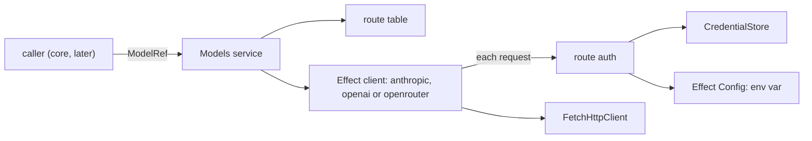

# Build step 2: the AI layer

Status: round 1 implemented; round 2 (login flows and token refresh) next.

After step 2, Tau code can name a model, such as `anthropic/claude-sonnet-5-5` or `openrouter/~typesafe/jev-latest`, and get Effect's `LanguageModel` service (streaming, text, structured output) or `DecisionModel` service (Jev and Luna decisions). The model is authenticated with a stored credential or an environment variable, and subscription tokens refresh on their own. The turn loop that uses it is step 4.

Spike 8 ([spikes.md](../spikes.md)) proved every route on Effect's four AI packages; `spikes/effect-ai/` is reference code only.

## Round 1 (implemented): from a model name to an Effect service



| File | Does |
| --- | --- |
| `src/ai/routes.ts` | `Route` and the four built-in routes: `anthropic` (Claude subscription), `openai` (API key, Luna decisions), `openai-codex` (ChatGPT subscription), `openrouter` (API key, System One decisions). |
| `src/ai/route-auth.ts` | `credentialSigner(route)` reads the credential (store, then the route's environment variable through Effect's `Config`), rejects a missing, expired or wrong-kind one, and returns what sets the headers. `signRequests(route)` runs it on every request. |
| `src/ai/codex.ts` | Codex only streams: sends non-streaming requests as streams and answers with the `response.completed` body, without `phase: "commentary"` messages. |
| `src/ai/openai-decisions.ts` | `DecisionModel.make` adapter for `POST /v1/decisions`. |
| `src/ai/models.ts` | `Models` service (`languageModel`, `decisionModel`) and `modelsLayer(routes)`. |
| `tests/models.test.ts` | Each chat route streams a tool call and returns a structured object; both decision APIs answer; missing and expired credentials fail before sending. Replays `tests/recordings/`. |

```ts
type RouteAuth =
  | { kind: "apiKey"; environmentVariable: string }
  | { kind: "claudeSubscription" }
  | { kind: "chatgptSubscription" }

type Route = {
  id: RouteId; provider: ProviderId; apiUrl: string; auth: RouteAuth
  client: "anthropic" | "openai" | "openrouter"
  decisions: "systemOne" | "openaiDecisions" | undefined
}

class Models: {
  languageModel(ref: ModelRef): Effect<LanguageModel, ModelsError>
  decisionModel(ref: ModelRef): Effect<DecisionModel, ModelsError>
}
modelsLayer(routes): Layer<Models, never, CredentialStore | HttpClient>
```

| `auth` | Headers on each request |
| --- | --- |
| `apiKey` | `x-api-key` on Anthropic, `Authorization: Bearer` elsewhere |
| `claudeSubscription` | `Authorization: Bearer`; betas `claude-code-20250219`, `oauth-2025-04-20` appended to the package's own |
| `chatgptSubscription` | `Authorization: Bearer`, `chatgpt-account-id` (from the token's JWT claim), `originator`, `OpenAI-Beta` |

- **System One reuses Effect's OpenRouter decision model.** It already speaks System One but posts to `/api/alpha/decisions` (404); the route's client rewrites the path to `/api/v1/systemone`. The tests assert the path, so an Effect change shows up there.
- **Credential failures are typed up front.** Both `Models` methods check the credential before building a client, so a missing login fails with `CredentialUnavailable`. Inside a request, Effect's clients accept only HTTP errors, so the same failure becomes a transport error.
- **Tests differ from production only by injection:** routes point at a `Bun.serve` replay server, the store lives in a temp directory, and the environment comes from `ConfigProvider.fromUnknown`. OpenRouter's key comes from that environment, so every run covers the fallback.
- **Not yet built:**
  - the OpenCode Go route: its models span three protocols, so it waits for the catalog;
  - `session-id` and the Codex priority tier, which need a session and the catalog;
  - the Claude Code identity prompt pass (step 4);
  - parsing a `provider/model` string, until the first caller needs it.

## Later rounds

- Round 2: Claude and ChatGPT login flows (PKCE, device code) and token refresh, replacing the "expired" failure with `CredentialStore.update`.
- Round 3: the model catalog, the `host` settings file (user routes), and the OpenCode Go route through `@effect/ai-openai-compat` (ignored by Fallow until then).
- Round 4: structured-output forced-tool fallback and the one retry on invalid output.
