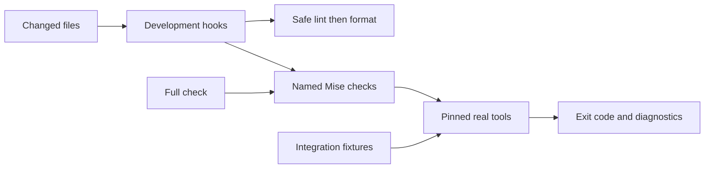

# Phase-zero code plan

Status: draft; implementation follows approval of [phase zero](../phase-zero.md) and the [acceptance spike](check-acceptance.md).

## Files

```text
package.json / bun.lock             [New] Root package, exact pins, prepare patch, SDK self-reference when implemented.
mise.toml                          [Existing] Bun pin; add task facade and serial aggregate.
tsconfig.json                      [New] Strict TS, Bun types, Effect plugin; include src, tools and tests, not spikes.
.oxlintrc.jsonc                     [New] Built-in lint, clean-room plugin, layer/test overrides; no Effect Oxlint preset.
.fallowrc.jsonc                     [New] Architecture zones, explicit roots, dead-code/boundary/duplicate policy.
.gitignore                         [Existing] Add local dependencies, build outputs, tool caches and reference copies.
.pi/tau/settings.json              [Existing shape on main] Development fix/check routing, not product settings.
tools/lint/tau-plugin.js            [New] Register syntax rules; typed with oxlint/plugins-dev JSDoc.
tools/lint/api-reference.js         [New] Resolve static same-file bindings; shared by API/test restrictions.
tools/lint/restricted-api.js        [New] Option-driven API allowlists by source layer and test scope.
tools/lint/no-module-let.js         [New] Top-level let, including export wrappers, in core/session.
tools/lint/no-generic-filenames.js  [New] Reject utils/helpers/misc/common source basenames.
tests/integration/checks.test.ts    [New] Actual-command check-infrastructure flow.
docs/reference/sources.json        [New] Documentation sources and version/tag mappings.
tools/reference-docs.ts            [New] Resolve locked versions and copy docs to ignored storage.
```

Enable JS checking for `tools/lint/` so the plugin is not an untyped gap. No layer `index.ts` placeholders; register implemented roots and test absent/present roots deliberately.

## Task boundary

| Task | Planned operation |
| --- | --- |
| `check:types` | `bun x --bun --no-install tsc --noEmit` |
| `check:lint` | `bun x --bun --no-install oxlint --type-aware` on source, tools and tests |
| `check:fmt` | Project-local Oxfmt `--check` on code and supported config files |
| `fix:lint` / `fix:fmt` | Same local tools; safe `--fix`, then `--write`, supplied file arguments only |
| `fallow:dead-code` | Project-local Fallow `dead-code --fail-on-issues`, including import boundaries |
| `fallow:dupes` | Fallow `dupes --fail-on-issues`; initial mild/50 tokens/5 lines/2 occurrences |
| `test` | `bun test tests/integration`; live-provider tests remain a separate later suite |
| `check:mise` | `mise tasks validate --errors-only` |
| `check` | All read-only gates above; serial execution bounds type/lint peak memory |
| `docs` | Version-matched documentation copy; separate from checks |

`prepare`: `bun x --bun --no-install effect-tsgo patch --typescript`. Full check entry: `mise run --jobs 1 check`. Missing tools, malformed configuration, crashes and parse failures fail the task; no install or safe-looking success fallback during checks.

## Rule ownership and scope

| Policy | Owner / scope |
| --- | --- |
| Types, floating Effect, missing Effect errors/context | Patched compiler; configure blocking severities explicitly |
| Floating/misused promises and other type-aware correctness | Native Oxlint/tsgolint rules; no custom type checker |
| `Effect.runPromise` | Syntax API restriction; allowed in `src/cli` and `src/sdk` |
| Environment reads | Syntax API restriction; source reads belong in `host` |
| `console` / global `fetch` / `Bun.spawn` | Syntax API restriction; allowed source layers `cli` / `ai` / `proc` respectively |
| Module-level `let` | Syntax rule; `core` and `session`, including exported declarations |
| Generic filenames | Syntax rule; application source |
| Module mocking / sleeps | Syntax API restriction; integration tests, including Bun's `mock.module` and `Bun.sleep` |
| Models through fake provider | Flow/test wiring; do not claim a syntax rule can prove endpoint behavior |
| Module import graph | Fallow; exact layer allowlists from architecture.md, including type-only imports |

Where syntax policy owns a concept, switch off the overlapping Effect diagnostics (environment, console, fetch and run-at-edge restrictions) explicitly. Do not port the spike's duplicate compiler/Oxlint Effect reports. Dynamic/computed references that cannot be resolved statically are a documented limit, not claimed enforcement.

Fallow zones cover every `src` file and separate `tools`/`tests` from production. Same-layer imports are allowed; leaf layers cannot import another application layer. Validate package self-reference and `bun:sqlite` restriction to `session`. Public SDK exports and default exports loaded dynamically need narrow consumer/entry registrations, not blanket unused-export exemptions.

Register the syntax plugin's default export and task-only tooling through supported configuration/task discovery. Keep an added unused tool dependency detectable; do not copy `main`'s dependency or callback exemptions wholesale.

## Composition and interfaces

Production rules use Oxlint's real source/scope objects; integration fixtures inject source files and options through the same root configurations and actual CLI.

```ts
type ApiReference = { module: string; member: string };
type Restriction = { api: ApiReference; message: string };
type ResolveApi = (node: Node, scope: Scope) => ApiReference | undefined;
type CommandResult = { exitCode: number; stdout: string; stderr: string };
type RunCommand = (argv: readonly string[], cwd: string) => Promise<CommandResult>;
type DocSource = { package: string; files: readonly string[];
  origin: { kind: "installed" } | { kind: "git"; repository: string; tagPattern: string } };
type CopyReferenceDocs = (sources: readonly DocSource[], versions: ReadonlyMap<string, string>,
  destination: string) => Promise<void>;
```

`Node`/`Scope` denote Oxlint API types, not new project AST types. Normal CLI output and exit codes remain authoritative; add a reporter only if a verified tool needs one.



```text
select fix/check tasks by changed file kind
pass existing changed files as separate arguments to fixes
run matching whole-project checks after fixes
run types and lint serially in the full aggregate
preserve failing exit codes and actionable diagnostics
invalidate verification after later writes
```

Routing includes TS/TSX/JS sources, tests, tools, relevant root config, `package.json` and `bun.lock`; plugin edits rerun lint and its integration tests. Deletions trigger graph checks but are not fixer arguments. Markdown uses the existing formatting automation. Adding a layer updates its Fallow zone/import policy, applicable lint scope and acceptance fixtures; adding a dependency updates the lockfile and documentation source manifest.
