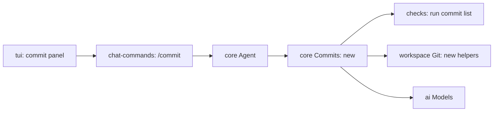

# `/commit`

Status: built; checks pass. Waiting for a live check. Guide: [commit.md](../../guide/commit.md).

Built differently from the mockups or the plan:

- The checks step shows how many checks run, not "n of m".
- The model sees the session's prompts since the latest commit's time, not since the last `/commit`.
- The push choices mark the chosen one with `›`.

Code: `core/Commits.ts` (types), `core/internal/commit/commits.ts` and `commit-plan.ts`, `workspace/Git.ts`, `tui/internal/commit-flow.ts` and `CommitPanel.tsx`. Commands now take text after their name (`takesArgument` in `chat-commands.ts`).

`/commit` turns every changed file in the repository into one or more commits. It runs the project's commit checks, asks a model to group the files into conventional commits, shows the plan for approval, commits, then offers to push.

## What exists

| Where | What it has |
| --- | --- |
| `main`, `packages/agent/extensions/commit/` | The whole flow as a Pi extension: checks registered by other extensions, a model tool call `create_commit_plan`, a review panel (`e` edit, `r` new message, `R` new plan with a note), commit per group, push question. About 1,700 lines. |
| Here, `.tau/checks.json` | Already has a `commit` list (this repo puts `mise run test:binary` in it). `core/internal/checks/checks-file.ts` reads it; nothing runs it. The guide says so. |
| Here, `core/internal/checks/run-checks.ts` | `dueChecks` and `runChecks` run checks and build the report the model sees. |
| Here, `workspace/Repository.ts` | `repositoryRoot`, built on `proc/Command.ts` `runProgram`. No other git helpers. |
| Here, `ai/Models.ts` | `languageModel` for chat models; `decisionModel` for structured answers (OpenAI and OpenRouter providers only; nothing calls it yet). |
| Here, `tui/internal/Picker.tsx` | The one-line list with sections built for `/model`. |
| `roadmap.md` | commit is one of the built-ins to rebuild on the extension SDK in step 7. |

How `main` does it:

```mermaid
flowchart LR
  A[/commit] --> B[run commit checks]
  B -- fail --> F[send failures to the agent]
  B -- pass --> C[read changes and diffs]
  C --> D[model: plan groups]
  D --> E[review panel]
  E -- approve --> G[git add + commit per group]
  G --> H[ask to push]
```

## Architecture (proposed)

**Shape:** a `Commits` service in `core` holds the flow as steps with no screen code. The TUI drives it with a commit panel. In step 7 the same service moves behind the SDK as the commit built-in.



| System | Change |
| --- | --- |
| `core` | adds `Commits`: `changes`, `runChecks`, `plan`, `newMessage`, `commit`, `push` |
| `workspace` | expands `Repository.ts` into git reads and writes (status, diff, log, add, commit, push) |
| `core/internal/checks` | expands: runs the `commit` list |
| `tui` | adds the commit panel (states below need a mockup) |
| `docs/guide` | new page: commit your changes; `project-checks.md` loses "does not run it yet" |

The panel is a **state machine**, not flags: `checking → planning → review → committing → asking-to-push → done`, and `cancelled` or `failed` from any step. `main` used the same phases.

## Agreed

| Decision | Answer |
| --- | --- |
| Shape | A built-in, built now. `Commits` in `core` keeps no screen code, so step 7 can move it behind the SDK. |
| Checks | The `check` list and the `commit` list from `.tau/checks.json`, on all changed files. |
| Failed checks | Nothing is committed. The failures go to the agent as a prompt so it fixes them; the user runs `/commit` again. |
| Model | One structured-output call (one retry if the answer does not fit the schema) to the chat provider's small model, at high thinking. Small models by default: \`anthropic\` Claude Haiku 5.5, \`codex\` and \`chatgpt\` and \`openai\` GPT-6 Luna, \`opencode-go\` DeepSeek V4.1 Flash. |
| Push | `commit.push` in `~/.tau/settings.json`: `"ask"` (default, "No" selected first), `true`, `false`. `commit.avoidBreakingChanges` stays, default `false`. |
| Model input | Diffs, the last 12 commit subjects, and the user's prompts in this session since the last `/commit`. |
| Small model setting | `providers.<id>.smallModel` in `~/.tau/settings.json`. Built-in values as above. |
| Mockups | Approved as drawn below. |
| Review | The plan is shown, one line per commit: the subject and a muted file count, never the file paths. Enter commits it, Esc cancels. No editing and no new plan from the panel. |
| Argument | `/commit <text>` passes the text to the model as the user's instruction, such as `/commit make this one commit`. |

## Prep work the answers need

| Gap today | Prep step |
| --- | --- |
| Commands match the whole input: `chat-client.ts` looks up `commands[text]`, so `/commit make this one` is sent as a prompt. | A command gets the text after its name. `run` becomes `(argument: string) => Effect`; the others ignore it. |
| Tau never sets a thinking level. | Built first, in [thinking.md](thinking.md). |
| Each built-in provider already has `noteModel` in `ai/Providers.ts`, the model background notes and memory use (`core/internal/context/notes/summarize.ts`). It is not a setting, and `opencode-go` and `openrouter` use GPT-6 Luna. | Agreed: rename `noteModel` to `smallModel`, make it a setting, and use it for notes, memory and `/commit` alike. Notes and memory on `opencode-go` and `openrouter` move to DeepSeek V4.1 Flash; `docs/guide/checkpoints.md` changes with it. |

## Mockups

The panel sits where the `/model` picker sits, above the input, and closes when the flow ends. Text in parentheses and file paths are muted. `⠋` is the spinner.

Today, `/commit` is not a command; the input sends it to the model as a prompt.

1. Checks running. Esc cancels; nothing is committed.

```
┌Commit─────────────────────────────────────────┐
│⠋ Running checks (3 of 10 done)                │
└esc cancel─────────────────────────────────────┘
```

2. A check fails. The panel closes and the chat starts a run with the failures:

```
  Commit checks failed: Lint, Type checking. Nothing was committed.
› [commit checks] Fix these, then I will run /commit again. …
```

3. Planning.

```
┌Commit─────────────────────────────────────────┐
│⠋ Planning commits (GPT-6 mini, openai)        │
└esc cancel─────────────────────────────────────┘
```

4. Review, three commits. Each commit is one line: its subject, then its file count, muted. A long subject ends in `…` and the count still shows. A breaking change shows only its subject line. Past 10 commits the list scrolls with Up and Down, as the `/model` picker does.

```
┌Commit─────────────────────────────────────────┐
│feat(tui): pin favorite models in… (14 files)  │
│feat(commit): add the /commit c… (212 files)   │
│docs(plan): plan the /commit command (2 files) │
└enter commit · esc cancel──────────────────────┘
```

5. Review, one commit with `/commit make this one commit`: the same panel with one line.

```
┌Commit─────────────────────────────────────────┐
│feat: pin models and add /commit (228 files)   │
└enter commit · esc cancel──────────────────────┘
```

6. Committing.

```
┌Commit─────────────────────────────────────────┐
│⠋ Committing 1 of 2 (hooks included)           │
└───────────────────────────────────────────────┘
```

7. Ask to push, with `commit.push: "ask"`. Up and Down choose; Enter confirms; Esc means No.

```
┌Push 2 commits to origin/main?─────────────────┐
│No, keep them local                            │ >
│Yes, push                                      │
└───────────────────────────────────────────────┘
```

8. Done. The panel closes and the chat shows one line:

```
  Committed 2 (a1b2c3d, e4f5a6b) and pushed to origin/main.
```

9. Lines for the other endings, in the warning color:

```
  Not in a git repository.
  Nothing to commit.
  Commit cancelled.
  A check changed files. Review the changes and run /commit again.
  Could not plan commits: <model error>
  Committed 1 (a1b2c3d), then failed: <git error>
  Committed 2 (a1b2c3d, e4f5a6b); push failed: <git error>
```
