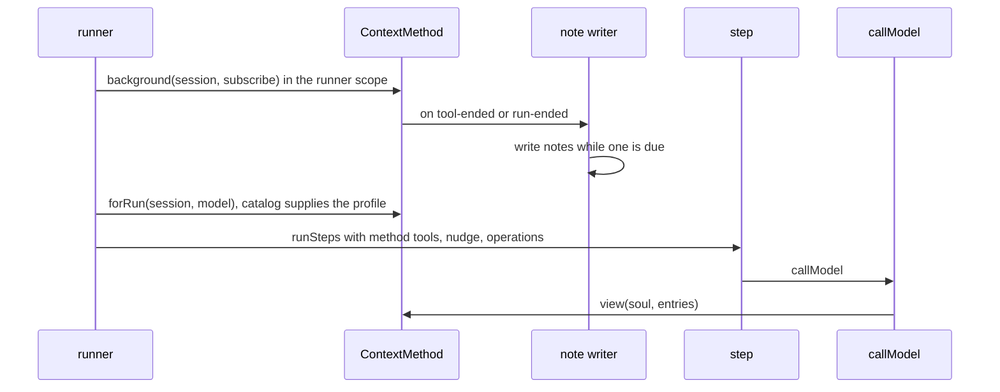

# Slice 5a, round 2: notes and checkpoints (code plan)

Status: round 2 implemented, 2026-10-14. The approved verification fixes use `flatMap`, a named transaction effect, schema-based test JSON, explicit settings types, error narrowing and platform-service injection. The design is in [compaction.md](compaction.md). Dreaming and the replay tool are round 3. Live calls remain deferred.

**What the code can do afterwards:** a cheap model writes notes on older entries while the agent works; the agent calls `checkpoint` with a handoff and its next model call sees notes, recent entries and the handoff; nudges (hidden notes for the model) tell it when to checkpoint; a `run` script can read the raw entries behind a note. The method is one service, so tests and later methods swap it.

## Files

```text
src/session/
  Notes.ts              new: the note table (append, list, copy on fork), like SkillUses.ts
  SessionStoreError.ts  moved from Sessions.ts: shared failure type for entries and notes
  Sessions.ts           changed: migration adds the note table; fork copies notes
  Entry.ts              changed: CheckpointDetails joins ToolDetails; new `nudge` entry
  ContextView.ts        changed: exports the message and system builders; renders nudges
  transcript.ts         new: the agent's view of a range of entries as plain text, for the note writer and `history`
src/ai/Routes.ts        changed: noteModel per route
src/host/Settings.ts    changed: compaction settings
src/core/
  ContextMethod.ts      new: the service, selected method and whole-history layer
  ContextSettings.ts    new: compaction settings schema and service
  internal/context/
    run-method.ts       new: per-run view, tools, nudges, operations and reply policy
    history.ts          new: the `history` script function
    notes/method.ts     new: builds the notes method
    notes/budget.ts     new: budget, context size, stage
    notes/note-writer.ts new: the background job
    notes/checkpoint.ts new: the checkpoint tool
    notes/view.ts       new: the context after a checkpoint
    notes/stage.ts      new: the stage nudge and the forced-stage operation
  internal/loop/        changed: step, call-model, run-context take the method; needsReply skips nudges; turn limit uses the method's reply policy
  internal/runner/runner.ts     changed: starts the background job; builds the method per run
docs/guide/settings.md, docs/guide/checkpoints.md
```

## Types

```ts
// core/internal/context/run-method.ts
type RunMethod = {
  readonly view: (soul: string, entries: readonly Entry[]) => Effect<Prompt.Prompt, SessionStoreError>;
  readonly tools: readonly ModelTool<never>[];             // notes: [checkpoint]
  readonly nudge: (entries: readonly Entry[]) => Option<NudgeEntry>; // saved before the model call; notes: the stage nudge
  readonly operations: readonly Operation<never>[];        // notes: [refuseCallsWhenForced]
  readonly shouldReply: (entries: readonly Entry[]) => boolean; // pending work or forced checkpoint
};
// core/ContextMethod.ts
class ContextMethod extends Context.Service<ContextMethod, {
  readonly forRun: (session: SessionId, model: ModelRef) => Effect<RunMethod, UnknownModel | UnknownRoute>;
  readonly background: (session: SessionId, subscribe: Effect<PubSub.Subscription<AgentEvent>, never, Scope>) => Effect<void, never, Scope>;
}>()("tau/core/ContextMethod") {}

// session/Notes.ts — not entries: a background entry would end a run (needsReply) and break one writer per session
type Note = { number: number; from: number; through: number; text: string; model: ModelRef; at: DateTime.Utc };
class Notes extends Context.Service<Notes, {
  append: (session: SessionId, note: Omit<Note, "number" | "at">) => Effect<Note, SessionStoreError>;
  list: (session: SessionId) => Effect<readonly Note[], SessionStoreError>;
}> {}

// session/Entry.ts — a hidden note for the model; the chat does not show it. First use: context stages
const NudgeEntry = Schema.Struct({ type: Schema.Literal("nudge"), key: Schema.String, text: Schema.String });

// session/Entry.ts — the checkpoint is the tool's result, so no new entry kind
const CheckpointDetails = Schema.Struct({
  tool: Schema.Literal("checkpoint"),
  handoff: Schema.String,
  notes: Schema.Array(Schema.Int),   // note numbers in the view, oldest first
  noteTokens: Schema.Int,           // pinned prefix estimate until the next provider usage report
  tailFrom: Schema.Int,              // first raw entry kept
});
```

## Call path



Production injects `ContextMethod.layer`, selected by `ContextSettings`; the test harness defaults to `ContextMethod.wholeHistory` (the whole `contextView`, no tools, nudges or operations). Notes tests inject `ContextMethod.layer`, a fake catalog and scripted note replies through the same model service.

## Logic

```text
budget(profile, settings) = min(profile.contextTokens − 16k, profile.longContextPrice.aboveTokens, settings.budgetTokens ?? 200k)

size(entries)                       // since the latest checkpoint
  reply = latest finished reply after the checkpoint with tokens
  none → characters/4 of the checkpoint view (or all entries before the first checkpoint)
          include the pinned noteTokens, instructions, raw tail and handoff; exclude the checkpoint call and result
  else → reply input + output, plus characters/4 of later entries
          input already includes cache reads and writes; never add them again
          estimate growth with the reply beside its later results, so tool output is counted

stage(entries) = none | notice (≥ 50% budget) | warning (≥ 75%) | forced (≥ 100%)
  an announced stage persists until checkpoint, even if a later usage report lowers the estimate
stage nudge: when that stage has not been sent since the checkpoint → nudge { key: "context-stage:{stage}", text: that stage's fixed text }
  forced text: "All tools except checkpoint are blocked until you call checkpoint alone with your handoff."

note writer, on opening the session and for each batch containing a tool-ended or run-ended event:
  loop
    from = last note's through + 1, or 1
    range = entries from `from`, ended before a user or assistant entry, at least 16k tokens
    stop if none, or size < notesStart (50k)
    model = route.noteModel if the route lists it, else the latest reply's model
    text = generateText(NOTE_RULES, earlier notes + transcript(range))
      // transcript: every message the agent sees for the range, in full: user messages,
      // assistant text, every tool call with its full input, every tool result, instruction notes, nudges
    Notes.append(from, through, text, model)
  a failed note is logged; the next event tries again

checkpoint tool (handoff ≤ 24k characters):
  reply = the entry holding this call
  notes = Notes.list where through < reply.number
  reject mixed tool calls or invalid handoffs as failed tool results
  details = { handoff, notes: their numbers, noteTokens: estimate of the note prefix, tailFrom: last note's through + 1 }
  text = "Checkpoint saved. Your next model call starts from your notes, recent entries and this handoff."

view(soul, entries):
  checkpoint = latest checkpoint result; none → contextView(soul, entries)
  [system: soul + newest system instructions]
  one user message per note "Notes on entries {from}–{through}:", cache mark on the last
  instruction notes before tailFrom, joined
  messages of entries tailFrom ..< checkpoint reply
  user message "Your handoff at the checkpoint:" + handoff + notice that older context-stage nudges no longer apply
  messages of entries after the checkpoint result, cache mark on the last

refuseCallsWhenForced: stage forced and open calls other than checkpoint
  → failed results: "All tools except checkpoint are blocked. Call checkpoint alone with your handoff."
```

The forced stage blocks calls instead of removing tools, because a changed tool list misses the cache at the largest context size.

## Decided in round 2

| # | Decision |
| --- | --- |
| 1 | Notes live in a `note` table beside entries. As entries, a note written mid-run would end the run, because `needsReply` reads the last entry |
| 2 | A checkpoint lives in the `checkpoint` result's details; no new entry kind |
| 3 | Stage notices are the first use of nudges ([features.md](../features.md#context)): a `nudge` entry the model reads and the chat hides, appended after the last message so the cache holds |
| 4 | At the forced stage, a nudge says all tools are blocked until `checkpoint`; Tau fails every other call. The tool list stays the same |
| 5 | Notes cover at least 16k tokens and roll up every message the agent sees, in full. Note model: `claude-haiku-5-5` on Anthropic, `gpt-6-luna` elsewhere, the session model when the route does not list it (to confirm on ChatGPT and Codex in live checks) |
| 6 | Settings: `compaction.method` (`notes` or `off`), `compaction.budgetTokens` (200k), `compaction.notesStartTokens` (50k) |
| 7 | "Context too long" recovery is deferred ([deferred.md](../deferred.md)) |
