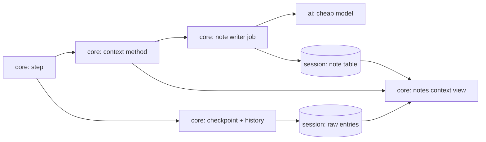

# Build step 5: background tasks and compaction

Status: rounds 1–2 decided; slice 5a implemented and repository checks passed, 2026-10-14. Round 3 (dreaming) is implemented and repository checks are pending; its plan is in [compaction-round3.md](compaction-round3.md). Replay is deferred. The research behind the design is in [compaction-research.md](../compaction-research.md). Live calls remain deferred.

**What the user gets:** the chat never stops for compaction. While the agent works, a cheap model writes notes on older entries in the background. When the agent decides to compact, it writes a handoff, and its context becomes the notes, the recent raw entries and the handoff at once, with most of the prompt cache intact. The agent can look up the raw entries behind any note. Slice 5b lets the model start long-running commands, such as a dev server, and come back to them.

## Before slice 5a

```mermaid
flowchart LR
  runner[core: runner] --> step[core: step]
  step --> ops[operations: tools, limits, checks]
  ops --> call[core: call model]
  call --> view[session: contextView]
  view --> entries[(session: all entries)]
```

| Piece | Where | State |
| --- | --- | --- |
| Context size | `assistant` entries save input, output and cache token counts | Saved, not read |
| Model window and price tier | `ModelProfile.contextTokens` and `longContextPrice.aboveTokens` in `src/ai/ModelProfile.ts` | Present |
| Context view | `contextView` in `src/session/ContextView.ts` turns every entry into a `Prompt` | No cut point, not swappable |
| Operations | a fixed list in `src/core/internal/loop/step.ts`; the first operation that applies acts | Not swappable |
| Overflow | a "context too long" error fails the run | No recovery |
| Long-running commands | `sh` waits for exit or timeout | No process sessions |

## Shape

Two lanes. The agent works in the main lane; a note writer works beside it and never blocks it.

```text
SESSION ENTRIES (raw, kept in SQLite)
 e1  e2  e3  e4 │ e5  e6  e7  e8 │ e9  e10 e11 │ e12 e13 e14
└──── note A ───┘└──── note B ───┘└── note C ──┘ └ not noted yet ┘

NOTE WRITER (cheap model, background)
 note B ← [A] + e5..e8          each note reads earlier notes + its new entries only
 note C ← [A, B] + e9..e11
```

The context is ordered from most stable to least stable, so a compaction keeps the cache up to the last old note:

```text
before:  [system][memory][A][B][C][e12 … e30][handoff 1]
after:   [system][memory][A][B][C][D][E][e28 e29 e30][handoff 2]
         └──── same bytes, still cached ────┘└──── rewritten ────┘
```

Dreaming folds old notes into the session's memory in the background. It changes the stable layer, so it is rare and only takes effect at a compaction:

```text
notes A..G → memory M2        context: [system][M2][H][I][J][tail][handoff]
```



| System | Change |
| --- | --- |
| `session` | expanded in 5a: separate append-only `note` table, checkpoint details in tool results, hidden `nudge` entries and reusable message builders; forks copy notes within their entry range |
| `core` | expanded in 5a: `ContextMethod` service (default: notes), session-scoped note writer, `checkpoint` tool and `history` script function, context-stage nudges and forced-call blocking; round 3 adds dreaming and the context worker |
| `ai` | expanded: picking the provider's cheap model |
| `proc` | expanded in slice 5b: process sessions |

**Pattern:** append-only background jobs whose output is applied only at a compaction. It beat Pi durable's single background summary, which rewrites the whole summary and loses the cache each time, and Mastra's frequent activation, which rewrites the context every 20–25k tokens and needs locks around shared state.

## Rules

| Rule | Decision |
| --- | --- |
| Budget | The smallest of: `window − 16k`, the model's long-context price tier, and a setting (default 200k) |
| Notes start | Once the context passes 50k (a setting) |
| Note writer | The provider's cheap model, falling back to the session model; never crosses providers. Each note covers whole entries, never splits a tool call from its result, and records the entry IDs it covers |
| Note contents | What the user asked for and corrected (word for word when short), decisions and why, files read or changed, commands and their result, what failed, facts about the codebase. No code bodies or long output |
| Compaction | The agent calls the `checkpoint` function with a handoff (goal, plan, next step, what to watch for). It is instant: the context becomes system, memory, notes, the raw entries after the last finished note, and the handoff. A note still being written is not waited for |
| Backstop | Hidden nudges at 50%, 75% (finish the current piece, then checkpoint) and 100%. Announced stages persist until checkpoint. At 100%, Tau fails all tool calls except `checkpoint`, keeping the tool list unchanged |
| Dreaming | When the notes in context pass about 30k, a background job folds them into memory: user preferences, decisions, project facts, open threads. Applied at the next compaction |
| Recall | A `run` function reads the raw entries behind a note by entry ID |
| Overflow | Deferred ([deferred.md](../deferred.md)) |
| Crash | A note being written is lost; the writer resumes after the last saved note |
| Swappable | Compaction is one Effect service; other methods and test fakes are other Layers, and extensions can supply one in step 7 |

## Decided in round 1

| # | Decision |
| --- | --- |
| 1 | Notes, a handoff, memory and dreaming replace the single summary |
| 2 | Build the swappable context method in 5a so methods can be compared |
| 3 | Process sessions are slice 5b |
| 4 | Manual `/compact` comes with the TUI (step 6) |
| 5 | Budget default 200k; notes start at 50k; the cheap model writes notes; the agent always writes the handoff |
| 6 | The agent's compaction function is named `checkpoint` |

## Round 2: code plan for 5a

Implemented: the note-table migration and fork copying, checkpoint metadata, context method injection, scoped note writing, same-route model selection, the `history` function and context-stage nudges.

| Boundary | Lasting decision |
| --- | --- |
| Storage | Notes are not entries: a background entry would affect `needsReply` and could end the run. Forks copy only notes whose covered entries are within the fork range, keeping note numbers |
| Checkpoint | A successful tool result pins note numbers, `noteTokens`, `tailFrom` and the handoff. Reject mixed calls and handoffs outside 1–24,000 characters; never wait for a note in flight |
| Injection | `ContextMethod.forRun` supplies the view, tools, nudge, operations and reply policy; `background` owns session-scoped work. `wholeHistory` supplies the ordinary context view without checkpoint behavior |
| Note writing | Wake on session opening, completed tools and run end. Cover at least 16k estimated tokens, keep the newest message raw, and never split a call from its result. Read the full model-visible transcript plus earlier notes; aim for notes of at most 2k tokens |
| Model selection | Same route only: `claude-haiku-5-5` on Anthropic, `gpt-6-luna` elsewhere; fall back to the session model if the route does not offer the note model. Availability on subscription routes awaits live checks |
| Settings | `compaction.method`: `notes` or `off`; `budgetTokens`: default 200k; `notesStartTokens`: default 50k |
| Estimates | Use total input plus output and later growth; input already includes cache reads and writes. Immediately after checkpoint, estimate pinned notes, instructions, raw tail and handoff, not the checkpoint call and result |
| Nudges | Save each reached stage once; it persists until checkpoint even if a later usage report is smaller. At forced, fail other tools without changing their definitions |

Round 3 plans dreaming; slice 5b plans process sessions. Replay comparisons and automatic overflow recovery are deferred ([deferred.md](../deferred.md)).
