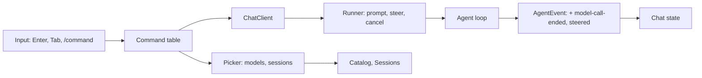

# Daily driver

Status: built 2026-10-14, except the expired-login warning of item 6 (it still shows only as the failed run's reason); waiting for the live checks in [live-checks.md](../live-checks.md). The user accepted every recommendation below and asked to build the set without a mockup per screen, and to tune the screens from inside Tau afterwards. A `/model` choice is kept once a reply uses it: a resumed session goes on with the model of its latest reply. The smallest set of work after which the user develops Tau in Tau instead of Pi. It pulls parts of 6b and 6c ([tui.md](tui.md)) forward and leaves the rest of them in place.

**What the user gets:** answers that read as Markdown; `/model` to change the model; `/sessions` to go back to an earlier session; the context use and cost under the input; a message typed during a run reaches the agent at its next step; skipped skills and unreadable instruction files show above the input instead of only in the log.

## The set

| # | Gap | Today | Shape | Systems |
| --- | --- | --- | --- | --- |
| 1 | Markdown | Marks hidden, nothing styled; only JS, TS and Zig code colored | A palette and `markup.*` rules; more languages. Plan: [markdown.md](markdown.md) | tui |
| 2 | Change model | `--model` or settings, then reopen the chat | `/model` opens a list of the models of the routes you are logged in to; the choice holds for the following prompts | tui, ai (`Catalog` lists models), cli |
| 3 | Context and cost | Not shown | A new event after each model call with its model and tokens; the footer shows `42k/200k · $0.84` | core loop, tui |
| 4 | Steering | A prompt sent during a run waits for the run to end | Core takes `steer`; the agent loop adds waiting steering messages as user entries at the next step | core runner and loop, tui |
| 5 | Resume | `tau --session <id>` | `/sessions` lists this folder's sessions by first prompt and time; `/new` starts one | session, core, cli, tui |
| 6 | Hidden warnings | Log only | The rest of [messages.md](messages.md)'s build order: each source sets a `Status` condition | core |
| 7 | Web access | None | Open question, below | sandbox or step 7 |

The cache miss warnings ([features.md](../features.md)) come after the set: they read the same event as item 3.

## How the systems meet

| System | Change | Pattern, and the one it beat |
| --- | --- | --- |
| tui `chat-client.ts` | **Expands.** `/restart` is an `if` in `send`; three more commands would make an `if` chain. A command table (`name → run`) replaces it, and step 7 extensions add to it | Table, beat the `if` chain: one place to list commands for completion and help |
| tui picker | **Adds** one list with a filter, used by `/model` and `/sessions` | OpenTUI's `<select>`; OpenCode wraps the same in `ui/dialog-select.tsx` |
| core `Client.ts` | **Expands** `Command` with `steer`, `AgentEvent` with `model-call-ended` and `steered` | Events, as today |
| core runner and loop | **Changes.** A steering queue beside the prompt queue; an operation that adds its messages as user entries when no tool call is open | Operation in the step list, beat a check in the runner: a step already reads entries, so a resumed run behaves the same |
| ai `Catalog` | **Expands** with a list of models for routes with a saved login | — |
| session `Sessions` | **Expands.** `list(directory)` exists; it gains each session's first prompt | — |
| cli `supervised-chat.ts` | **Changes.** The chat can end with "open session X"; `chat` loops and tells the supervisor the new session, so a restart reopens it | Reuses the restart handoff, beat a second renderer in one process |

## What the model rule becomes

| Situation | Model |
| --- | --- |
| New chat | `--model`, else settings |
| Resumed session | The model of its last reply, else as a new chat |
| After `/model` | The chosen one, for this chat and when it is resumed (its replies record it) |
| After a restart | As resumed. The supervisor passes `--model` only on the first start, as it already does with the prompt |

Assistant entries already save their model, so no new storage is needed.

## Decisions (agreed 2026-10-14)

| # | Decision | Agreed |
| --- | --- | --- |
| 1 | Is this the set? Add or drop items | All of 1–6; item 7 as below |
| 2 | Build order | 1 markdown, 2 `/model` (brings the command table and picker), 3 context and cost, 4 steering, 5 sessions (reuses the picker), 6 warnings |
| 3 | `/model` changes this chat only, or also writes `~/.tau/settings.json` | This chat only. Settings stay the default for new chats; Tau has no settings writer yet, and `/settings` (6c) adds it |
| 4 | Context and cost: in the footer now, or wait for the 6b sidebar | Footer now. This changes the agreed rule "footer: model and keys only"; the sidebar can take them over later. Mockup before build |
| 5 | Steering keys | Enter during a run steers; Tab queues a prompt for after the run (Codex: `composer.queue = Tab`). Pi uses Alt-Enter for that, but Tau's Alt-Enter adds a line |
| 6 | Sessions in other folders | `/sessions` lists this folder's only; multi-repository sessions stay an idea, so roadmap item 3 goes |
| 7 | Web access: needed for daily use? | No for now: reference repositories and dependency docs are local. If yes: `web.search` (Exa, key saved by `tau login`) and `web.fetch` (Bun `fetch`, `HTMLRewriter` to text) as `run` functions in core, moved into the `web` built-in in step 7 |

## Deletes or replaces

- The `RESTART_COMMAND` check in `chatClient.send`, by the command table.
- The "no model is set" notice text, by a hint to use `/model`.
- `Chat.tsx`'s own syntax style and the hex colors in six `.tsx` files, by `theme.ts`.
- Roadmap item 3 (decide multi-repository sessions), if decision 6 holds.
