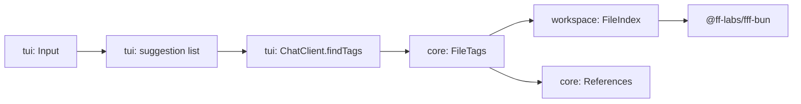
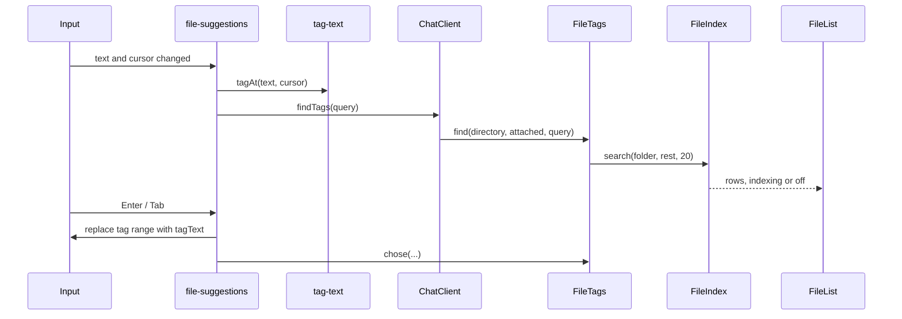

# File tags

Status: built 2026-10-15. Emoji alignment checked only in OpenTUI's test renderer; Ghostty, iTerm and tmux still need a look.

**Decision:** typing `@` in the input opens a list of matching files and folders above it, each with an icon for its kind. Choosing one puts `@path` in the prompt as plain text; the model reads the file itself through `run`. Asked for by the user.

## Agreed

| Topic | Choice | Taken from |
| --- | --- | --- |
| What the model gets | The path as text, never a file's contents. Paths with spaces are quoted: `@"docs/my notes.md"`. A tagged folder also sends a one-level listing (see [Folder listings](#folder-listings)) | Pi; folder listing from OpenCode, chosen by the user 2026-10-15 |
| Index | One FFF (`@ff-labs/fff-bun`, spike 7) index per session root, started with the session, closed with its scope | OpenCode `core/src/filesystem/search.ts` |
| Fallback | None. FFF refuses the home folder and `/` itself; there, or when it fails to load, the list says file search is off | Chosen by the user |
| Kinds | Files and folders, each with an icon | OpenCode; icons asked for by the user |
| Icons | Emoji: 📄 file, 📁 folder, 📚 reference. Each is two columns wide; check alignment in Ghostty, iTerm and tmux before building | Chosen by the user |
| Line ranges | `@src/a.ts#L10-20` is typed after the path and sent as text | OpenCode |
| References | Attached `/references` repositories are searched by typing `@<name>/…`; the tag written is the full path, such as `@~/.tau/references/opencode/src/a.ts` | OpenCode; full path chosen by the user |
| Ranking | FFF's own frecency and query-history databases (`frecencyDbPath`, `historyDbPath`, `trackQuery`) in `~/.tau/files/` | Chosen by the user |
| Later, if contents are ever attached | Skip a file the session already read and that has not changed since | Crush |

## Folder listings

Agreed and built 2026-10-15.

OpenCode, at send (`core/src/session/prompt.ts`, `runner/to-llm-message.ts`): each tagged folder's direct entries, folders first, then by name, each folder with a trailing `/`, under `Attached directory: <path>`. One level, names only.

Tau's shape:

- **When:** at send, in core. `runPrompt` and `withSteering` parse the tags of the text, keep the ones that are folders on disk, and save one hidden `folder-listings` entry right after the user entry (`core/internal/folder-listings/folder-listings.ts`, `withListings`). The model reads it as `<reminder kind="folder-listings">`. Saved once, so a replay or a later call sends the same bytes and the prompt cache holds; it can go stale, as OpenCode's does.
- **What is listed:** the folder's direct entries without `.git` and without gitignored entries, capped at 200 names, then `… and N more`.
- **Where paths resolve:** relative tags against the session folder; `~/` against the home folder (reference tags).
- **On screen:** nothing new. The user sees their message as typed; the listing is hidden like a nudge.
- **Tag parsing:** `tag-text.ts` moved from `tui/internal` to `core/TagText.ts`, so core and the TUI read tags the same way.
- **Ignored names:** `workspace/Repository.ts` `ignoredNames` asks `git ls-files --others --ignored --exclude-standard --directory` in the folder; outside a repository nothing is ignored.
- **Also:** one instruction line in the system prompt: `@path` in a user message names a file or folder relative to the session folder (`~` is the home folder), `#L10-20` names lines, and the model reads them with `run`.

## Mockup

Before: typing `@` does nothing.

```text
│ …transcript…                                                       │
├────────────────────────────────────────────────────────────────────┤
│ look at @█                                                         │
└────────────────────────────────────────────────────────────────────┘
  anthropic/claude-sonnet-5-5 · 42k/200k · $0.04   enter send · shift+enter new line · ctrl+d quit
```

After. `@` with nothing typed lists recently chosen paths first, then FFF's order:

```text
┌ Files ─────────────────────────────────────────────────────────────┐
│ ▸ 📄 src/tui/internal/Input.tsx                                    │
│   📁 src/tui/internal/                                             │
│   📄 docs/plan/work/file-tags.md                                   │
│   📚 opencode/                                       reference     │
└────────────────────────────────────────────────────────────────────┘
├────────────────────────────────────────────────────────────────────┤
│ look at @█                                                         │
└────────────────────────────────────────────────────────────────────┘
  anthropic/claude-sonnet-5-5 · 42k/200k · $0.04   ↑↓ move · tab open folder · enter tag · esc close
```

Typing filters, typos included; long paths are cut in the middle:

```text
┌ Files ─────────────────────────────────────────────────────────────┐
│ ▸ 📄 src/tui/internal/command-suggestions.ts                       │
│   📄 src/tui/internal/command-suggestions.test.ts                  │
│   📄 spikes/opentui/…/command-sugestion-probe.ts                   │
└────────────────────────────────────────────────────────────────────┘
│ look at @cmdsug█                                                   │
```

Tab on a folder puts it in the input and keeps the list open on its contents:

```text
┌ Files ─────────────────────────────────────────────────────────────┐
│ ▸ 📁 src/tui/internal/                                             │
│   📄 src/tui/Tui.ts                                                │
│   📄 src/tui/Notifications.ts                                      │
└────────────────────────────────────────────────────────────────────┘
│ look at @src/tui/█                                                 │
```

Enter on a file or folder tags it, adds a space and closes the list. Tags show in the accent color in the input and in the sent message:

```text
│ look at @src/tui/internal/Input.tsx █                              │
```

While the first index is still building (large trees only):

```text
┌ Files ─────────────────────────────────────────────────────────────┐
│ Indexing… 41,200 files                                             │
└────────────────────────────────────────────────────────────────────┘
│ look at @net█                                                      │
```

Off, in the home folder or when FFF cannot load:

```text
┌ Files ─────────────────────────────────────────────────────────────┐
│ File search is off in your home folder                             │
└────────────────────────────────────────────────────────────────────┘
│ look at @net█                                                      │
```

No match:

```text
┌ Files ─────────────────────────────────────────────────────────────┐
│ No files match "zzqx"                                              │
└────────────────────────────────────────────────────────────────────┘
│ look at @zzqx█                                                     │
```

Escape closes the list until the text changes, as the slash list does. `@` inside a word, such as `me@example.com`, opens nothing.

## Today

| Piece | File | Does |
| --- | --- | --- |
| Slash list state | `src/tui/internal/command-suggestions.ts` | Whole input text in, matching commands out, selected row, dismissed until the text changes |
| Slash list view | `src/tui/internal/CommandList.tsx` | Draws the rows above the input |
| List keys | `src/tui/internal/Input.tsx` `listKeys` | Up, Down, Tab, Enter, Escape while the slash list is open |
| Footer | `src/tui/internal/InputFooter.tsx` | `LIST_HINTS` while a list is open |
| TUI → core | `ChatAgent` in `chat-client.ts`, a `Pick` of `Agent` | Already carries `references` |
| Reference library | `core/References.ts` | `folder` and `list`; attached names come in `references-changed` events |

Nothing indexes files, and the slash list reads the whole input, not the word at the cursor.

## Architecture



| System | Change |
| --- | --- |
| `workspace` | Adds `FileIndex`: one FFF index per folder, opened on first use, kept in an `RcMap` and destroyed when its scope closes |
| `core` | Adds `FileTags`: splits a query into a folder (the session's, or an attached reference's) and a search, and turns FFF results into tag rows. `Agent` exposes it as `files`, as it exposes `references` |
| `tui` | Prep: one suggestion-list shape for commands and files. Then the file list, tag parsing and tag color |
| `cli` | Adds `FileIndex.at(~/.tau/files)` to the app layer and `FileTags.layer` to the agent layer. No build define: FFF picks glibc when `FFF_LIBC` is not set, and musl builds are untested |

**Pattern:** a generic suggestion list (rows plus a completion rule per kind) beat a second, file-only list with its own keys. The cost is one refactor of the slash list, which its tests cover.

## Prep: one suggestion list

```text
src/tui/internal/
  suggestion-list.ts        new   selected row, move, dismiss-until-text-changes, for any row type
  command-suggestions.ts    changed  uses suggestion-list; keeps its match and completion rules
  file-suggestions.ts       new   tag at the cursor → FileTags.find → rows; completion rules
  tag-text.ts               new   pure: find the tag at the cursor, write a tag, find tags to color
  FileList.tsx              new   rows with emoji, middle-cut paths, indexing / no-match / off lines
  Input.tsx                 changed  listKeys drives whichever list is open; colors tags
  InputFooter.tsx           changed  file-list hints: ↑↓ move · tab open folder · enter tag · esc close
  Chat.tsx                  changed  colors tags in sent user messages
src/core/FileTags.ts        new   service: find(directory, query) and chose(...)
src/workspace/FileIndex.ts  new   FFF wrapper
docs/guide/file-tags.md     new   how to tag files, folders, lines and references
```

## Types

```ts
// workspace/FileIndex.ts
type Found = { readonly kind: "file" | "folder"; readonly path: string } // relative, folders end in "/"
type Search =
  | { readonly state: "ready"; readonly found: readonly Found[] }
  | { readonly state: "indexing"; readonly scanned: number }
  | { readonly state: "off"; readonly reason: "home" | "root" | "unavailable" }
class FileIndex extends Context.Service<FileIndex, {
  readonly search: (folder: string, query: string, limit: number) => Effect.Effect<Search>
  readonly chose: (folder: string, query: string, path: string) => Effect.Effect<void>
}>()("tau/workspace/FileIndex") {}

// core/FileTags.ts
type TagRow =
  | { readonly kind: "file" | "folder"; readonly tag: string }   // "src/a.ts", "src/tui/"
  | { readonly kind: "reference"; readonly name: string }
type TagSearch = Exclude<Search, { state: "ready" }> | { readonly state: "ready"; readonly rows: readonly TagRow[] }
class FileTags extends Context.Service<FileTags, {
  readonly find: (directory: string, attached: readonly string[], query: string) => Effect.Effect<TagSearch>
  readonly chose: (directory: string, query: string, row: TagRow) => Effect.Effect<void>
}>()("tau/core/FileTags") {}

// core/TagText.ts (was tui/internal/tag-text.ts)
type TagAt = { readonly start: number; readonly end: number; readonly query: string; readonly lines: string | undefined }
const tagAt: (text: string, cursor: number) => TagAt | undefined   // "@" at text start or after whitespace
const tagText: (path: string, lines: string | undefined) => string // @src/a.ts#L10-20, @"my notes.md"
const tagRanges: (text: string) => readonly (readonly [number, number])[]
```

## Call path



## Logic

```text
FileTags.find(directory, attached, query)
  first segment names an attached reference and query has "/" after it
    search References.folder/<name> for the rest; tags are full paths, "~" for the home folder
  otherwise
    search directory; add references whose name starts with the query, after files

FileIndex.search(folder, query, limit)
  index = RcMap.get(folder)            create: FileFinder.create({ basePath, aiMode, disableMmapCache,
                                        disableContentIndexing, frecencyDbPath, historyDbPath })
  create failed → off (home, root or unavailable, from the error)
  getScanProgress().isScanning → indexing(scannedFilesCount)
  mixedSearch(query, { pageSize: limit }) → ready

file completion (Tab or Enter on a row)
  folder + Tab      replace tag with "@folder/", keep list open
  reference + any   replace tag with "@name/", keep list open
  file or folder    replace tag with tagText(path, lines) + " ", close list, chose(...)
```

## Tests

| Path | Production | Tests |
| --- | --- | --- |
| `FileIndex` | FFF on the session folder | FFF on a temporary folder: create, rename, delete, home refused |
| `FileTags` | real `FileIndex` and `References` | same, with a temporary references folder |
| `tag-text`, `file-suggestions` | — | pure tests: cursor positions, quoting, line ranges, `me@example.com` |
| Chat | `ChatAgent.files` from `Agent` | `tests/tui/chat.test.ts` passes a scripted `files` |
| Binary | compiled Tau | `tests/binary` finds a file from a compiled binary |

## As built

- `FileIndex` takes its database folder as `FileIndex.at(folder)`, as `TauHome.at` does, because `workspace` may not import `TauHome` from `database`.
- FFF gives up to 10 rows per query (not 20), so the list stays short above the input; matching references follow.
- On a reference row, Tab writes `@<name>/` to search inside it, and Enter tags its folder by full path, so a folder listing reaches the model (chosen by the user 2026-10-15).
- A reference tag uses `~` only when the references folder is under the home folder; otherwise it is the absolute path.
- FFF's databases opened from two Tau processes at once worked in a manual run.
- The chat starts the session folder's index with an empty search as it opens. While FFF indexes, the list asks again every 200 ms.

## Deletes or replaces

`command-suggestions.ts` loses its own selection and dismiss state to `suggestion-list.ts`. `LIST_HINTS` becomes one hint set per list kind.
