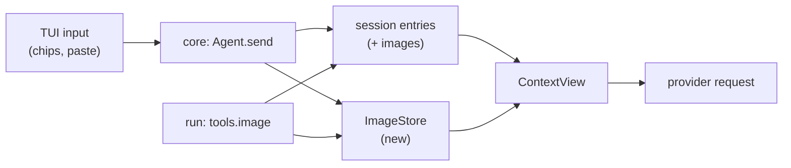
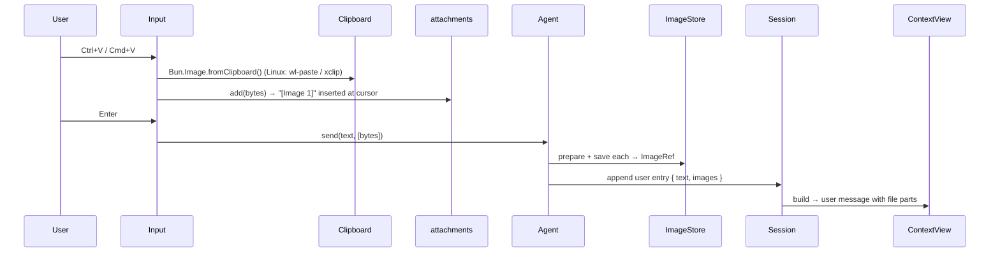

# Images

Status: experience and mockup approved 2026-10-15. Built 2026-10-15 (the `ImageRef` file path replaced the planned image store; guide page `docs/guide/images.md`). Not tried in a real terminal yet.

**Idea:** the model can see images. Two entry points: the model looks at an image file or screenshot through `run`, and the user pastes or attaches an image to a prompt.

## Today

| Part | State |
| --- | --- |
| `ModelProfile.images` (`ai/ModelProfile.ts`) | Set from the catalog's `modalities.input`. Nothing reads it. |
| Tool result (`session/Entry.ts` `ToolResultEntry`) | `result: Schema.Json`, built from `ToolOutcome.text`. Text only. |
| User entry | `{ type: "user", text }`. Text only. |
| `image()` in the `run` sandbox | Does not exist. (An earlier note here said it did; that was Pi's codemode.) Tau's sandbox has `read`, `write`, `replace`, `search` and the web functions. |
| Effect providers | Anthropic and OpenAI map a user message's file part with an `image/*` media type to an image block. Both turn a tool result into a string (`JSON.stringify`), so a tool result cannot carry an image. |
| `OutputFiles` (`core/internal/output`) | Gives private files in a per-session folder. The image store reuses its folder. |

## Resizing: Bun's own `Bun.Image`

Bun 1.4.3 ships `Bun.Image` (`bun-types/bun.d.ts`), so Tau needs no dependency and writes no codec. Tested here: it reads dimensions and resizes a PNG to JPEG.

| Need | `Bun.Image` |
| --- | --- |
| Format and size | `.metadata()` gives width, height, format |
| Downscale | `.resize(w, h, { fit: "inside", withoutEnlargement: true })` |
| EXIF rotation | Applied first in the fixed pipeline order (`autoOrient` then rotate, flip, resize) |
| Re-encode | `.jpeg({ quality })`, `.png()`, `.webp()`; `.bytes()` ends the pipeline |
| Clipboard (macOS, Windows) | `Bun.Image.hasClipboardImage()` and `fromClipboard()` |
| Clipboard (Linux) | `fromClipboard()` is always `null`; run `wl-paste` or `xclip` and pass the bytes to `new Bun.Image(...)` |
| HEIC and AVIF | macOS and Windows only; elsewhere they reject with `ERR_IMAGE_FORMAT_UNSUPPORTED` |

Pi carries 900 lines for this (Photon WASM, a resize worker, per-platform clipboard commands). We write one small module, `core/internal/images/prepare.ts`: bytes in, bytes out under the provider's limits.

## Agreed

| Topic | Choice |
| --- | --- |
| Paste key | Ctrl+V and Cmd+V (where the terminal passes it) |
| Dropped or `@`-tagged image file | Becomes a chip; the model sees it at once |
| Chat label | Only `[Image 1]`; no dimensions or size |
| Bytes | A file in the session folder; the entry holds a reference |
| Slices | One piece of work: the model seeing images through `run` and user attach ship together |

## Parts

1. **Model sees images.** Session parts for images, `ToolOutcome` carries them, `run`'s `image()` fills them, each provider's request mapper sends them. A model without vision gets a one-line note instead.
2. **User attaches.** The experience below.

## User experience (draft, awaiting approval)

Terminals do not send image data on a paste. Cmd+V on an image sends nothing, and dragging a file into the terminal types its path. So Tau reads the clipboard itself on a key.

| Way in | What happens |
| --- | --- |
| Paste key (Ctrl+V; Cmd+V when the terminal passes it) with an image on the clipboard | The image joins the prompt as a chip |
| Paste with text on the clipboard | Normal text paste |
| Drag a file onto the terminal | The path is pasted as text. If it is an image file, Tau turns it into a chip |
| `@shot.png` from the file-tag list | Already text for the model. An image file becomes a chip, so the model sees it without a `run` call |
| Remove | Backspace on the chip, or delete its `[Image 1]` text |

Draft input, one image attached, model has vision:

```
┌──────────────────────────────────────────────┐
│ why is the sidebar clipped here? [Image 1]   │
└──────────────────────────────────────────────┘
```

The input shows only the chip; no count or size line. Model has no vision: a line under the input says `this model cannot see images; Image 1 will be left out` in the warning color, and sending still works.

In the chat the user entry shows `[Image 1]` where it was placed. The terminal shows no pixels. Inline preview needs Kitty graphics or iTerm2 protocols; deferred.

States to mock before building: empty input with image only, several images, no-vision model, image too large and downscaled, clipboard read failure, resumed session.

## Architecture (round 2)

Expands three systems; adds one small one.



| System | Change |
| --- | --- |
| `session/Entry.ts` | Expands: `user` and `tool-result` entries get `images`, a list of `ImageRef`. Optional, so old sessions load unchanged |
| `core/internal/images` (new) | `ImageStore` saves prepared bytes in the session's output folder and loads them. `prepare` runs `Bun.Image` |
| `session/ContextView.ts` | Expands: puts image parts in the request, or a one-line note when `ModelProfile.images` is false. Decided at build time, so switching to a vision model later shows the old images |
| `run` tool | Expands: a new sandbox function `tools.image({ path })`; the tool outcome carries the images |
| TUI | Expands: chips, paste key, the no-vision line |

**Tool result images.** Effect's providers stringify tool results, so an image cannot ride inside one. Pattern chosen: the request builder adds a user-role message right after the tool message, labeled `<reminder kind="tool-images">` with the call id and the image parts (the same way `ContextView` already adds hidden messages for nudges and folder listings). Alternative: patch the provider mappers to emit images inside `tool_result`. That is native for Claude but needs a fork of three provider packages and has no OpenAI equivalent; rejected.

## Code

```
src/session/
  Entry.ts            ImageRef; UserEntry.images?; ToolResultEntry.images?
  ContextView.ts      userMessage gets file parts; toolImages(…) message after toolMessage; no-vision note
  Reminder.ts         kind "tool-images"
src/core/internal/images/
  prepare.ts          Bun.Image: bytes → { bytes, mediaType } within limits
  image-store.ts      save(session, prepared) → ImageRef; load(ref) → Uint8Array
  image-files.ts      isImagePath(path), readImageFile(path) (extension + magic bytes)
src/core/internal/tools/model-tool.ts   ToolOutcome.images
src/core/internal/run-tool/run-tool.ts  collects images like `touched`
src/sandbox/Sandbox.ts                  imageFunction(directory, collect)
src/core/Agent.ts                       send(text, attachments)
src/tui/internal/
  attachments.ts      chip state: Image N ↔ bytes; drop when chip text is deleted
  Input.tsx           Ctrl+V / Cmd+V binding, onPaste for dropped paths, chip color
  file-suggestions.ts @ choice on an image file inserts a chip
  InputFooter.tsx     no-vision line
```

```ts
type ImageRef = { id: string; mediaType: "image/png" | "image/jpeg" | "image/webp" | "image/gif"; name: string | undefined };
// Entry bodies
UserEntry:       { type: "user"; text: string; images?: ImageRef[] }        // text holds "[Image 1]" where each goes
ToolResultEntry: { …; images?: ImageRef[] }
ToolOutcome:     { text; isFailure; details; images: readonly PreparedImage[] }
// Agent
send: (text: string, attachments: readonly PastedImage[]) => void   // PastedImage = { bytes: Uint8Array }
```

**Prepare** (`prepare.ts`):
```
image = new Bun.Image(bytes)
meta = await image.metadata()                       // rejects non-images: ERR_IMAGE_*
if format not in {png, jpeg, webp, gif} or too wide/heavy:
  image.resize(MAX_EDGE, MAX_EDGE, { fit: "inside", withoutEnlargement: true })
  re-encode as jpeg (photo) or png (alpha)
return { bytes, mediaType }                         // limits are constants, set from provider docs
```

**User path:**

Paste, a dropped path and an `@` choice all end in `attachments.add`. Text on the clipboard stays a normal paste. At send, a chip whose text was deleted is dropped, and an `[Image N]` with no bytes stays plain text.

**Model path:** `tools.image({ path })` reads the file, prepares it, pushes it on the call's image list and returns `"Image 1 attached (jpeg, 1024×768)"` as text. `run-tool` saves the list through `ImageStore` into the result entry's `images`.

**Injection for tests:** the clipboard reader is a service (`ClipboardImage`); production uses `Bun.Image`, tests give bytes. `ImageStore` runs on the in-memory file system as `OutputFiles` does.

**Deletes:** nothing now. The deferred line "Images and files in user entries" in `deferred.md` is removed when this is built.

## Still open

1. Size limits for `prepare`: I'll take each provider's published maximum edge and bytes from its docs before building. No decision needed unless you want a lower cap to save tokens.
2. The guide page: `docs/guide/images.md` (paste keys, `@` image files, vision models), written with the TUI change.
