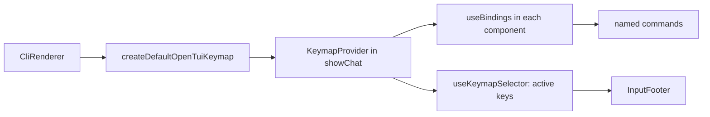

# Key handling

Status: agreed and built 2026-10-14 with `@opentui/keymap` 0.6.1, including the managed textarea layer and the Ctrl-C chain. Comes before the sidebar ([sidebar.md](sidebar.md)), whose toggle is the first new binding.

**What it gives:** every key goes through one keymap of named commands. Keys behave as today and the footer reads the same. Afterwards, a leader key, rebinding in settings, or a new owner like the sidebar is one layer or one addon, not another check in each component.

## Today: six places read raw keys

| File (`src/tui/internal/`) | Keys | How |
| --- | --- | --- |
| `App.tsx` | Escape, Ctrl-C, Ctrl-D | `useKeyboard`; skips when a panel is open or `suggestions.takes(key)` |
| `Input.tsx` | Enter, newline keys, Tab, Shift-Tab | textarea `keyBindings` plus `onKeyDown` checking `defaultPrevented` |
| `command-suggestions.ts` | Up, Down, Tab, Enter, Escape | `takeKey`, called first from `Input`'s `onKeyDown` |
| `Picker.tsx` | Escape, Up, Down, Ctrl-F | `onKeyDown` on its `<input>` |
| `CommitPanel.tsx` | Escape, Enter, Up, Down | `useKeyboard` |
| `InputFooter.tsx`, `CommitPanel.tsx` | none | hint strings typed by hand |

## Shape



Who wins a key is the layer's `priority` and `enabled`, not hand-written guards. A command that does not apply returns `false` and the key falls to the next layer, which replaces the early returns in `takeKey`.

## Layers

`PRIORITY` in `src/tui/internal/keymap.ts`. OpenTUI's text-area editing keys sit at 0, under the chat, so Ctrl-D quits instead of deleting.

| Layer (owner) | Priority, active when | Bindings → command |
| --- | --- | --- |
| Picker (`Picker.tsx`) | 30, while mounted | escape, ctrl+c → `picker.close`; up/down → `picker.up`/`picker.down`; ctrl+f → `picker.mark` (false when the item has no mark) |
| Commit (`CommitPanel.tsx`) | 30, while mounted | escape, ctrl+c → `commit.cancel`; return → `commit.answer`; up/down → `commit.up`/`commit.down` |
| List (`Input.tsx`, `listKeys`) | 20, input focused and list open | up/down → `list.up`/`list.down`; escape, ctrl+c → `list.close`; tab → `list.complete`; return → `list.choose` (both false when `completionFor` gives nothing) |
| Input (`Input.tsx`, `inputKeys`) | 10, input focused | tab → `prompt.queue` (false when idle); shift+tab → `thinking.next`; ctrl+c → `input.clear` (false when empty) |
| Chat (`App.tsx`, `chatKeys`) | 5, no panel open | escape → `run.cancel` (false when idle); ctrl+c → `chat.interrupt` (cancel or quit); ctrl+d → `chat.quit` |
| Editor (`keymap.ts`, managed textarea layer) | 0, global | return, kpenter → `input.submit`; shift/ctrl/meta+return, ctrl+j → `input.newline`; then OpenTUI's defaults |

## Files

```text
src/tui/internal/
  keymap.ts              new: tauKeymap(renderer): keymap with the managed textarea layer and Tau's overrides
  App.tsx                changed: KeymapProvider; App layer replaces keyAction and the useKeyboard guard
  Input.tsx              changed: Editor layer replaces KEY_BINDINGS and onKeyDown
  command-suggestions.ts changed: a layer replaces takeKey and takes
  Picker.tsx             changed: a layer replaces moveWith
  CommitPanel.tsx        changed: a layer replaces panelKeys
  InputFooter.tsx        changed: hints from active keys (see below)
tests/tui/chat.test.ts   changed: key cases through mockInput
```

```ts
// keymap.ts
export type TauKeymap = Keymap<Renderable, KeyEvent>;          // from @opentui/keymap
export const tauKeymap: (renderer: CliRenderer) => TauKeymap;  // createDefaultOpenTuiKeymap + managed textarea
// each binding that the footer shows carries desc (registerMetadataFields, installed by default)
{ key: "shift+return", cmd: "input.newline", desc: "new line" }
```

Injection: production and tests both go through `showChat(renderer, client)`; tests pass `createTestRenderer`'s renderer, so the keymap is real in both.

## Ctrl-C chain (in this change)

Each press does the first that applies ([tui.md](tui.md)): close the picker or commit panel or suggestion list, clear the input, cancel the run, quit. ctrl+c is bound in the picker, commit, suggestions and editor layers; the editor's command returns `false` when the input is empty, so the key reaches the App layer (cancel or quit).

## Footer hints

`InputFooter.tsx` keeps a fixed list of hints per state, each a list of command names and a word. `keyText` (`keymap.ts`) gives the first key bound to a command, with `return`, `escape`, `up` and `down` shown as `enter`, `esc`, `↑` and `↓`. The footer reads exactly as before.

## Deletes

`keyAction` and the `useKeyboard` guard in `App.tsx`, `KEY_BINDINGS` and `onKeyDown` in `Input.tsx`, `takeKey`, `takes` and `LIST_KEYS` in `command-suggestions.ts`, `moveWith` in `Picker.tsx`, `panelKeys` in `CommitPanel.tsx`, the hint constants in `InputFooter.tsx`.

## Later, each a small addition

| Want | Add |
| --- | --- |
| Leader keys | `registerTimedLeader(keymap, { trigger: "ctrl+x" })`, bindings like `<leader>b` |
| Rebinding in settings | `registerBindingOverrides`, overrides read from settings |
| Sidebar toggle | one global binding, `sidebar.toggle` |
