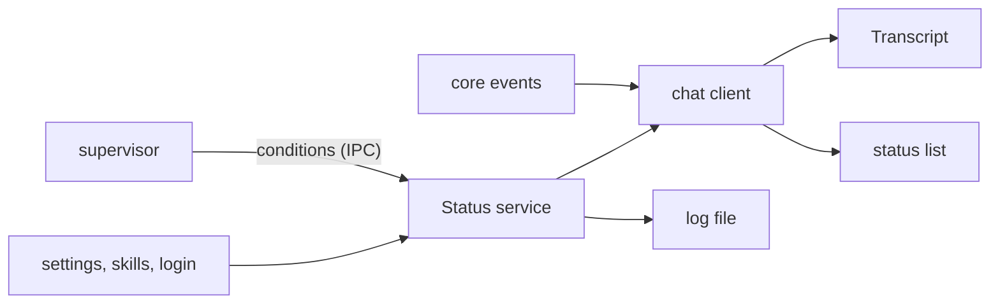

# Messages to the user

Status: the strip with the reload conditions is built, 2026-10-14. Next: the other sources, one at a time. This plan decides where every Tau message goes before 6b adds more.

## Decisions

| Decision | Agreed | Reason |
| --- | --- | --- |
| Model | Every message is an event, a condition or log only (table below) | One home for each message, and later features know where theirs go |
| Where conditions show | A strip above the input box, there only while a condition holds | Seen without a sidebar; the user accepts that it moves the input box |
| Footer | Model and keys only, always; the reload notices leave it now | The footer is not a message area |
| Until the strip exists | Reload failures go to the log file only | The supervisor shares the terminal with the chat, so it cannot print; the log file comes first |
| Strip size | Every condition shows, with no cap; long lines wrap, indented under their text | A hidden or cut condition can hide the one the user needs |
| Strip order | Errors, then warnings, then info | The worst problem is read first |
| Info mark | Info has no mark, only grey text | A dot added noise to the line |
| `/restart` during a run | The transcript gets a grey event line, "Tau restarts when this run ends." | The user sees that the command was taken |

Build order: the log file ([diagnostics.md](diagnostics.md)), then the footer notices out and the supervisor writing to the log, then the strip with the reload conditions, then the other sources one at a time (no model set, skills folder skipped, instructions unreadable, login expired).

## The strip (mockup approved 2026-10-14)

With no condition, the screen is as today. With conditions, one line each, directly above the input box; each goes away when its source clears it:

```
 ✗ Tau crashed twice soon after it started, so the last      red
   good build is running
 ! The new code does not build: src/tui/internal/            yellow
   InputFooter.tsx:42: Unexpected "}"
   New code is ready: send /restart                          grey
┌──────────────────────────────────────────────────────┐
│ > fix the footer test                                │
└──────────────────────────────────────────────────────┘
 anthropic/claude-sonnet-5-5         Enter send · Esc cancel
```

**What the user gets:** every message from Tau follows one set of rules. Something that happened sits in the transcript where it happened. A problem that is still true sits in one place that lists current problems, and goes away when it is fixed. Each message has one look for its severity, and its full detail is in the log.

## What exists

Every message today is yellow text, added wherever its author found room.

| Message | Comes from | Shown | Kept |
| --- | --- | --- | --- |
| The run failed: … | core `run-ended` | transcript, yellow | no |
| Retry 1 in 4 s: … | core `retrying` | transcript, yellow | no |
| Running the project's checks / These checks fail | core `checks-*` | transcript, yellow | entry saved, not replayed |
| No model is set … | `chat-client.ts` | transcript, yellow; prompt back to the editor | no |
| Tau restarts as soon as no run is going. | `chat-client.ts` | footer | no |
| The new code does not build / start; New code is ready | supervisor over IPC | footer | no |
| Tau crashed twice … | supervisor | stderr after the chat closes | no |
| Settings invalid, login failed | `cli/internal/failure.ts` | stderr, then exit | no |
| Skipped skills folder, instructions unreadable, catalog refresh, note worker | `Effect.logWarning` | nowhere: OpenTUI's console overlay hides it | no |

Problems: a passing check and a crash look the same; a problem that lasts (the code does not build) is treated like a one-time line; some warnings change what the agent knows (skills not loaded) and the user never sees them; nothing points to more detail.

## The model

Two kinds of message, on the pattern VS Code uses (notifications and the output log for events, the Problems panel for conditions):

| Kind | Meaning | Examples | Where | Lifetime |
| --- | --- | --- | --- | --- |
| Event | Happened once, at a point in the conversation | run failed, retry, checks result, prompt refused, restarted with new code | transcript, in order | saved as an entry when it belongs to the conversation |
| Condition | True now, until its source clears it | new code does not build or start, no model set, skills folder skipped, login expired | the status list | shown while true; set and cleared by its source |
| Log only | Detail nobody acts on now | catalog refresh failed once, full causes, build output | log file | 14 days |

Severity is one of three, with one mark (none for info) and one color everywhere:

```
 ✗ The run failed: 529 Overloaded                     red      error
 ! Retry 1 in 4 s: rate limited                       yellow   warning
   Running the project's checks: lint, types          grey     info
```

## Systems



| System | Change |
| --- | --- |
| core events | Unchanged shape; `run-failed` is a saved entry (built, diagnostics plan). |
| Status service (new, `src/core/Status.ts`) | Holds the current conditions; every `set` is also logged. |
| supervisor | Derives its conditions from the restart state and sends the whole list over IPC when it changes. |
| cli | Copies the supervisor's list into `Status`. |
| chat client and TUI | A strip that draws `Status.current`; footer stays model and keys. |
| print mode | Decided with the host sources step: today its warnings go to the log file only. |

## Code plan: the strip with the reload conditions

### 1. `Status` service: `src/core/Status.ts` (new)

Core, because host (later sources) and tui may both import it, and the supervisor may not.

```ts
export type Severity = "error" | "warning" | "info";
export type Condition = { readonly key: string; readonly severity: Severity; readonly text: string };

export class Status extends Context.Service<Status, {
  /** Adds the condition, or replaces the one with its key; logs it with `detail`. */
  readonly set: (condition: Condition, detail: string) => Effect<void>;
  readonly clear: (key: string) => Effect<void>;
  /** The current list, errors first, then warnings, then info; same severity in the order set. */
  readonly current: Stream<readonly Condition[]>;
}>()("tau/core/Status") { static readonly layer: Layer<Status> }
// SubscriptionRef<readonly Condition[]>: set = update (replace by key, else append), then sort.
```

`set` logs at `Error`, `Warning` or `Info` with `detail`, so the log has the full text (a build error's whole output) and the strip has one sentence.

### 2. Supervisor: conditions from the restart state

`RestartState` gains two fields, and a pure function lists the conditions:

```ts
readonly newCodeFailure: string | undefined;  // set by "failed", cleared by "checked"
readonly isOnLastGood: boolean;                // set by the fallback, cleared when a new build starts

export const reloadConditions = (state: RestartState): readonly ReloadCondition[]
// isOnLastGood                              -> error   "reload.fallback"  "Tau crashed twice soon after it started, so the last good build is running"
// newCodeFailure                            -> warning "reload.code"      "The new code does not build: <first line>" / "does not start: …"
// phase ready && !isAutomatic               -> info    "reload.code"      "New code is ready: send /restart"
```

`failed` events gain `stage: "build" | "check"` for the two texts. `messages.ts` adds `ReloadCondition` (the fields of `Condition` plus `detail`, since the supervisor cannot import core) and `ToChild` `{ type: "conditions", conditions }`. `Supervisor.ts`, after each step, sends the list when it differs from the last one sent, and sends it to each new chat right after `start-chat`. The `log` command stays for crashes that restart.

### 3. cli: from IPC to `Status`

`ReloadLink` gains `conditions: Stream<readonly ReloadCondition[]>`. `supervised-chat.ts` forks a fiber that, for each list, `set`s every condition and `clear`s the `reload.` keys that left it. `Status.layer` joins `appLayer` in `src/cli/main.ts`.

### 4. TUI: `StatusStrip.tsx` (new)

`chat-client.ts` reads `Status.current` into a `conditions` signal. `App.tsx` draws `<StatusStrip>` in `input.above`, under `RunPanel`, directly above the editor. Each condition is a row: a two-column mark (`✗` red, `!` yellow, blank for info) and the text in the severity color with `wrapMode="word"`, so wrapped lines indent under the text. No condition, no rows.

### 5. Tests

- `restart-machine.test.ts`: rows for `reloadConditions` (build failure, check failure, cleared by a good check, fallback, cleared by a new build, manual ready).
- `tests/core/status.test.ts`: replace by key, clear, order by severity, a `set` reaches the log.
- `tests/tui/chat.test.ts`: `fakeSupervisor` sends conditions; the frame shows the strip lines above the input; an empty list removes them.
- `tests/supervisor/supervise.test.ts`: a broken build sends `conditions` with `reload.code`; the fix sends an empty list.

### 6. Docs

`docs/guide/chat.md`: what the strip shows and that it clears by itself; `docs/plan/live-checks.md`: the Reload row passes when the broken file shows in the strip and the fix clears it.

## As built (2026-10-14)

| Change | Reason |
| --- | --- |
| No `stage` field on `failed`: the reason already starts with "The new code does not build" or "does not start", and the strip shows its first line | The supervisor wrote those texts already |
| `transition` adds the `conditions` message itself, after any step that changes the list, and after a `start` when the list is not empty | The table test covers when the chat hears about a change, and `Supervisor.ts` stays a command runner |
| The supervisor no longer logs build and check failures; the chat logs them through `Status.set`. The `log` command is for crashes only | One log line per failure; a chat that crashed cannot log its crash |
| `ReloadLink.conditions` is a queue stream with one reader; `supervised-chat.ts` sets only new or changed conditions | A condition that stays is not logged again |
| The `/restart` line is a new `info` transcript item, not a severity on `notice` | The severity styles for transcript events are a later step |
