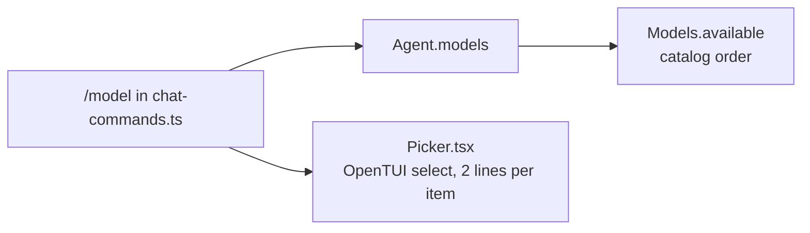
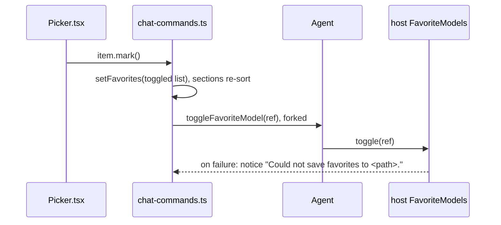

# Model favorites

Status: built; checks pass. Waiting for a live check in a real chat.

In `/model`, Ctrl+F moves the selected model into a section at the top of the list, or back out of it. The top section is saved, so it lasts across chats. In code and in the saved file these models are called favorites; the screen does not use the word.

## Agreed

| Decision | Choice |
| --- | --- |
| Toggle key | Ctrl+F, in the picker `/model` opens (`src/tui/internal/Picker.tsx`). It replaces the filter input's "cursor right" on Ctrl+F. |
| Sections | Favorites first, then a horizontal divider, then the rest. No star, no section title. |
| Order | Both sections sort by provider, then maker, then model. |
| Maker | The text before the first `/` in the model's name on its provider: `anthropic` in `openrouter/anthropic/claude-haiku-5.5`. A name with no `/` has no maker and sorts first in its provider. |
| Cursor after Ctrl+F | Stays at the same position in the list, so nothing jumps. The position may now hold another model. The divider is not a position. |
| Filtering | The filter applies to both sections. Matches the display name and the full `provider/model` ref. |
| Storage | `~/.tau/favorites.json`, a file Tau owns, listing `provider/model` refs. Tau never writes `~/.tau/settings.json`. |
| Model row | One line: display name, then the provider in parentheses in the muted color. No context window. |
| Spacing | One blank line between the filter input and the first row. When nothing matches, no blank line. |
| Key hint | `ctrl+f pin` as the bottom title of the `/model` box. `/sessions` has none. |
| Session row | One line, the same picker: first prompt, then `(this session)` or the date in parentheses in the muted color. |

## Mockup

Example models: `anthropic/claude-opus-5`, `anthropic/claude-sonnet-5-5`, `openai/gpt-6`, `openrouter/anthropic/claude-haiku-5.5`, `openrouter/openai/gpt-6-mini`. `>` marks the cursor row, drawn with the border color behind it. Text in parentheses is drawn in the muted color, and so is the divider.

Today:

```
┌Model──────────────────────────────────────────┐
│Type to filter                                 │
│                                               │
│openai/gpt-6                                   │ >
│GPT-6 · 400k                                   │
│anthropic/claude-sonnet-5-5                    │
│Claude Sonnet 5.5 · 1000k                      │
│...                                            │
└───────────────────────────────────────────────┘
```

1. Two favorites, no filter.

```
┌Model──────────────────────────────────────────┐
│Type to filter                                 │
│                                               │
│Claude Sonnet 5.5 (anthropic)                  │ >
│GPT-6 mini (openrouter)                        │
│───────────────────────────────────────────────│
│Claude Opus 5 (anthropic)                      │
│GPT-6 (openai)                                 │
│Claude Haiku 5.5 (openrouter)                  │
└ctrl+f pin─────────────────────────────────────┘
```

2. Cursor on the third model, Claude Opus 5; press Ctrl+F. Opus moves above the divider; the cursor stays on the third model, now GPT-6 mini.

```
┌Model──────────────────────────────────────────┐
│Type to filter                                 │
│                                               │
│Claude Opus 5 (anthropic)                      │
│Claude Sonnet 5.5 (anthropic)                  │
│GPT-6 mini (openrouter)                        │ >
│───────────────────────────────────────────────│
│GPT-6 (openai)                                 │
│Claude Haiku 5.5 (openrouter)                  │
└ctrl+f pin─────────────────────────────────────┘
```

3. Ctrl+F on a model above the divider moves it below, in sorted place. Same as 2, reversed.

4. Filter `gpt`: each section keeps its matches.

```
┌Model──────────────────────────────────────────┐
│gpt                                            │
│                                               │
│GPT-6 mini (openrouter)                        │ >
│───────────────────────────────────────────────│
│GPT-6 (openai)                                 │
└ctrl+f pin─────────────────────────────────────┘
```

5. Only one section has models, because there are no favorites, every model is one, or the filter leaves one section empty: no divider.

```
┌Model──────────────────────────────────────────┐
│claude                                         │
│                                               │
│Claude Opus 5 (anthropic)                      │ >
│Claude Sonnet 5.5 (anthropic)                  │
│Claude Haiku 5.5 (openrouter)                  │
└ctrl+f pin─────────────────────────────────────┘
```

6. Nothing matches the filter: the input only, as today.

```
┌Model──────────────────────────────────────────┐
│zzz                                            │
└ctrl+f pin─────────────────────────────────────┘
```

7. A name too long for the box is cut with `…` before the provider, so the provider always shows.

```
│Some Very Long Model Name With A Lot Of… (openrouter)│
```

8. Saving fails. The model still moves for this chat, and the transcript shows a notice line in the warning color, like today's `Could not read …` notice:

```
Could not save favorites to ~/.tau/favorites.json.
```

9. `/sessions`: one line per session, no divider, no key hint.

```
┌Session────────────────────────────────────────┐
│Type to filter                                 │
│                                               │
│Add favorites to /model (this session)         │ >
│Fix the login retry (2026-10-13 16:42)         │
│(no prompt) (2026-10-12 09:05)                 │
└───────────────────────────────────────────────┘
```

## Today



Nothing stores favorites. `PickerItem` is `{ label, detail, choose }`; the filter matches label and detail.

## Code plan

### Files

```
src/core/FavoriteModels.ts        new   service tag + FavoriteModelsError (core, so the agent and TUI can name it)
src/host/FavoriteModels.ts        new   favoriteModelsLayer: ~/.tau/favorites.json, like host/CatalogCache.ts
src/core/Agent.ts                 change  exposes favoriteModels and toggleFavoriteModel
src/cli/main.ts                   change  adds favoriteModelsLayer to appLayer
src/tui/internal/model-picker.ts  new   the /model picker: splits and sorts models into the two sections, Ctrl+F
src/tui/internal/chat-commands.ts change  one-line items, sections, Ctrl+F for /model
src/tui/internal/Picker.tsx       change  own rows instead of select: sections, divider, cursor, Ctrl+F
src/tui/internal/model-picker.test.ts new  sort and split
tests/tui/chat.test.ts            change  harness agent gets the two new members
docs/guide/choose-a-model.md      change  Ctrl+F, the sections, favorites.json
```

### Boundaries

```ts
// core/FavoriteModels.ts. Implemented in host, like ai/Catalog.ts's CatalogCache.
class FavoriteModelsError extends Schema.TaggedError { path: string; cause: Defect }
class FavoriteModels extends Context.Service<FavoriteModels, {
  /** Empty when the file is missing or damaged. */
  readonly read: Effect<readonly ModelRef[]>;
  /** Reads the file, adds or removes ref, writes a temporary file and renames it. Returns the new list. */
  readonly toggle: (ref: ModelRef) => Effect<readonly ModelRef[], FavoriteModelsError>;
}>

// core/Agent.ts, added to the service
readonly favoriteModels: Effect<readonly ModelRef[]>;
readonly toggleFavoriteModel: (ref: ModelRef) => Effect<readonly ModelRef[], FavoriteModelsError>;

// tui/internal/Picker.tsx
type PickerItem = {
  readonly label: string;          // "Claude Sonnet 5.5", first prompt
  readonly note: string;           // "anthropic", "this session", date; drawn muted in ( )
  readonly search: string;         // what the filter matches: name + "provider/model"
  readonly choose: () => void;
  readonly mark?: () => void;      // Ctrl+F; absent in /sessions
};
type PickerList = {
  readonly title: string;
  readonly sections: Accessor<readonly (readonly PickerItem[])[]>;  // reactive: Ctrl+F re-sorts
  readonly markHint?: string;      // "ctrl+f pin", the bottom title
};

// tui/internal/model-picker.ts
const modelSections: (models: readonly ListedModel[], favorites: readonly ModelRef[])
  => readonly [favorites: ListedModel[], rest: ListedModel[]];
```

`favorites.json` is a JSON array of `provider/model` strings. A favorite that is not in `Agent.models` now (logged out, removed) is kept in the file and not shown.

### Call path for Ctrl+F



### Logic

```
/model:
  models, favorites = Agent.models, Agent.favoriteModels   (in parallel)
  favorites signal = favorites
  sections = () => modelSections(models, favorites signal) mapped to items
  each item.mark = toggle ref in the signal; fork Agent.toggleFavoriteModel(ref); notice on failure

modelSections:
  key = (provider, maker or "", model)        maker = model text before its first "/"
  split models by "ref is in favorites"; sort each by key

Picker:
  cursor signal = 0
  filter changes      -> cursor = 0
  shown = each section filtered by every filter word in item.search; drop empty sections
  rows  = shown sections joined with a divider row; cursor counts items only
  sections change     -> keep cursor, clamp to last item
  up / down           -> move cursor, stop at the ends
  ctrl+f              -> shown item at cursor . mark
  enter               -> close; item at cursor . choose
  escape              -> close
  draw: input; blank line if any rows; a window of 10 rows that keeps the cursor in view
  row: <box row> <text truncate>label</text> <text muted, no shrink> (note)</text> </box>
```

The note sits in its own `<text>` that does not shrink, so a long label is cut with `…` and the note stays.

### Reuse and deletions

| Piece | Reuses | Deletes or replaces |
| --- | --- | --- |
| host layer | `TauHome`, `FileSystem`, temp file and rename from `host/CatalogCache.ts` | — |
| rows | `<text truncate>` as in `Chat.tsx`'s tool line; `COLORS.muted`, `COLORS.border` | OpenTUI `select` in the picker, `PickerItem.detail` |
| filter | `matching` in `Picker.tsx`, now on `search` | label + detail matching |
| model row | `ListedModel.name` | `tokenText` in the model row (still used by `InputFooter.tsx`) |

OpenTUI's `select` draws each option name in one color (`SelectRenderable`, `drawText(nameContent, …, nameColor)`) and has no dividers, which is why the picker draws its own rows. Owning the cursor also gives the fixed-position cursor.

### Tests

- `model-picker.test.ts`: provider, then maker, then model; a name with no maker first in its provider; favorites split out; a favorite not listed is dropped.
- A host test for `favoriteModelsLayer`: missing file reads empty, toggle adds then removes, damaged file reads empty and toggle rewrites it.
