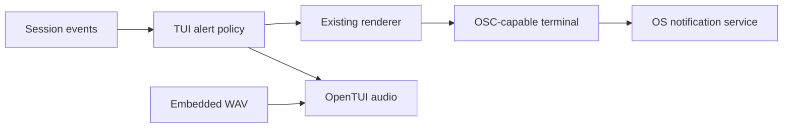

# Terminal notifications and custom sound

Status: generic OpenCode-style delivery, bundled custom sound, and enabled-by-default behavior agreed; implemented; formatting, lint, types, filenames, application tests, import boundaries, dead code and duplicate-code checks pass; standalone-binary and live terminal verification pending.

## Agreed asset

| Item | Decision |
| --- | --- |
| Source | User-provided `intuition-561.ogg`; retain the original in Downloads. |
| Repository asset | `assets/sounds/notification.wav`, the complete sound (approximately 0.381 seconds after decoding) without trimming, added fade or gain adjustment. |
| Format | 44.1 kHz, mono, 16-bit PCM WAV. Installed OpenTUI does not decode Vorbis. |
| Distribution | Bundle inside the compiled executable. [Source](https://notificationsounds.com/notification-sounds/intuition-561) and [license page](https://notificationsounds.com/license) confirm CC BY 4.0; attribution and changes are recorded in `assets/sounds/README.md`. Include that credit in distributed third-party notices. |
| Defaults | Enable notifications and custom sound by default; provide settings to disable them. |
| Terminal coverage | Target cmux, Ghostty, iTerm2, Terminal.app and other popular terminals through OpenTUI, matching OpenCode first. |

## Current shape and research

Tau creates its renderer in `src/tui/Tui.ts` and mounts the screen in `src/tui/internal/App.tsx`. It has no notification or sound path. Existing compiled-binary tests build the CLI entry through `tests/support/compile-tau.ts`.

| System studied | What it does |
| --- | --- |
| Local OpenCode `packages/tui/src/attention.ts` | Uses renderer `triggerNotification(message, title)` for banners; OpenTUI audio for custom sound. Banner defaults to blurred; sound defaults to always. Tracks focus as unknown, focused, or blurred. |
| OpenCode `attention-sounds.bun.ts` and `audio.ts` | Imports MP3 assets with Bun’s file import attribute; reads asset bytes into `Audio.loadSound`; lazily starts one engine and caches sounds. |
| OpenCode `feature-plugins/system/notifications.ts` | Event-driven completion, failure, question and permission alerts; deduplicates terminal events and suppresses subagent banners. |
| OpenTUI native `terminal.zig` | Chooses OSC 99, OSC 777 or OSC 9 by capability and terminal detection; has multiplexer handling. OSC 99 output does not request silent sound. |
| [Kitty OSC 99](https://sw.kovidgoyal.net/kitty/desktop-notifications/) | Supports queries, activation and named sounds, including `silent`. Does not define a way to embed an arbitrary audio file. Other sound names are implementation-dependent. |

References are read-only under `~/.local/share/tau-agent/references/`. Installed API and documentation checked: `docs/reference/copies/index.md`, OpenTUI 0.6.1 `core-concepts/audio.mdx`, `node_modules/@opentui/core/renderer.d.ts` and `audio.d.ts`, Bun 1.4.3 `docs/bundler/executables.mdx`.

## Proposed architecture

Use event-driven alerts in the TUI client, with separate banner and audio outputs. Reuse the renderer and audio engine already supplied by `@opentui/core`; no new dependency or native notification helper is proposed. Core remains independent of terminal and audio devices.



| Choice | Maintenance tradeoff |
| --- | --- |
| Recommend renderer notifications plus OpenTUI audio | Reuses terminal detection and native runtime; unsupported terminals get no banner. |
| Alternative: OS-specific notification and playback commands | More helpers, platform branches and packaging; can cover terminals without OSC support. Remote commands act on the remote host. |

The future asset import must be reachable from the CLI entry and use `with { type: "file" }`. Bun embeds imported bytes under an internal path; read bytes through Bun or supported filesystem APIs, then pass them to `Audio.loadSound`. Native audio avoids handing that internal path to an external player. A folder alone does not cause embedding.

Audio lifecycle uses documented `Audio.create({ autoStart: false })`, an error listener, `loadSound`, `start`, `play`, and `dispose`. Load lazily, reuse decoded sound, and release with the TUI scope. Failures must not stop the agent.

## Terminal coverage and proposed behavior

Use OpenTUI’s existing protocol selection before adding terminal-specific code. [cmux documents OSC 777 and OSC 99](https://cmux.com/docs/notifications); the inspected OpenTUI detection has no explicit cmux entry, so detection needs a live check. OpenTUI selects OSC 777 for Ghostty, WezTerm and Warp, OSC 99 for Kitty and foot, and OSC 9 for iTerm2 and Apple Terminal. Selection is not proof of delivery: Terminal.app banner support remains unverified. Add a native macOS fallback only after confirming the gap and agreeing its design.

Proposed settings in the existing user settings file: `notifications.enabled` and `notifications.sound`, both default true. Disabling notifications disables both outputs; disabling sound keeps banners. No terminal bell output.

### Banner mockup for approval

The OS and terminal draw the actual banner, including their own app icon and attribution. These mockups show the full text area Tau requests; the chat layout stays the same.

Before: no banner.

After successful turn, when unfocused:

```text
┌──────────────────────────────────┐
│ Tau                              │
│ Response ready                   │
└──────────────────────────────────┘
```

After failed turn, when unfocused:

```text
┌──────────────────────────────────┐
│ Tau                              │
│ Run failed                       │
└──────────────────────────────────┘
```

| State | Banner | Custom sound |
| --- | --- | --- |
| Turn completes, unfocused | Response ready | Once |
| Turn fails, unfocused | Run failed | Once |
| Turn completes or fails, focused | None | Once |
| Focus unknown | None, matching OpenCode | Once |
| User cancels | None | None |
| Notifications disabled | None | None |
| Sound disabled | Same banner policy | None |
| Unsupported banner delivery | None | Once if audio is available |
| Audio unavailable | Same banner policy | None; log failure without interrupting the run |

Use one alert per user turn, never per model step, tool completion or retry. Event and cancellation policy are proposed. Future input/permission alerts are outside the initial slice. Banners contain no response text, path or error details.

## Constraints for the next round

- OSC 777 provides a title and body, with no standard custom-audio or mute field. OSC 99 supports named sounds, not portable custom sound bytes.
- OpenTUI’s current renderer notification API exposes no sound option. A terminal or OS may play its default sound in addition to Tau’s custom sound; do not promise exactly one sound without testing.
- OSC notifications travel to the local terminal over SSH; OpenTUI audio plays on the machine running Tau. Remote custom audio requires a separate decision.
- A successful renderer return means the request was emitted, not proof that the OS displayed it; terminal permissions and Do Not Disturb still apply.
- Before implementation: agree event and focus policy, show banner wording and states for approval, then write the code-level plan and update the user guide.
- Verify actual playback, absence or presence of duplicate sound, and a compiled binary running outside the repository. None of these live checks has run.

Open questions are in [questions.md](../questions.md).

## Implementation boundary

```text
src/tui/Notifications.ts                 callable attention resource, focus/settings policy, injectable sound resource
src/tui/internal/notification-sound.ts    embedded WAV, native audio lifecycle and playback
src/tui/internal/audio.d.ts              WAV file-import type
src/tui/Tui.ts                           opens notifications for the renderer lifetime
src/tui/internal/chat-client.ts          maps live turn outcomes to attention after updating chat state
src/tui/internal/turn-attention.ts       per-session live-turn tracking and completion request policy
src/host/Settings.ts                     validates enabled/sound settings with true defaults
src/cli/internal/supervised-chat.ts      passes host settings into TUI setup
tests/tui/notifications.test.ts          focus, events, settings, audio failure and scoped cleanup
tests/host/settings.test.ts              notification settings defaults and validation
docs/guide/notifications.md              settings, behavior, attribution and platform limits
```

Boundaries: `NotificationOptions = { enabled: boolean; sound: boolean }`; `openAttention(renderer, options): Effect<Attention, never, Scope>`; `NotificationAudio` supplies a scoped playback Effect, replaced in tests. The TUI client uses its existing event subscription; no new core event or second event reader. Run-started/run-ended form a two-state live-run tracker to ignore duplicate ends and history. Cancellation is silent; failed runs say Run failed; other terminal reasons say Response ready.

Production: CLI settings → runTui → openAttention; existing live event reader → turnAttention → attention.request → renderer banner and cached native audio. Tests: same path with a recording sound resource and test renderer. Sound loading is cached for the terminal lifetime, acquired only on first playback; scope closes audio and focus listeners. No existing behavior or code is removed.

## Verification

The audio resource returns `{ play: Effect<void> }`, so acquisition returns data rather than a nested Effect directly. Generated binary-test import specifiers use `Schema.fromJsonString(Schema.String)`. Git now records the existing PascalCase filenames, using case-only renames without content changes.

The standalone-binary decoding test is in the before-commit tier and has not run. Live audio playback, terminal banner delivery and duplicate OS sounds remain unverified.

## Attention API consideration

Status: shared callable attention service agreed. Built-ins and a future SDK API delegate to the same service; lifecycle events remain factual. Implemented through the TUI attention resource; public SDK exposure remains future work.

| Shape | Tradeoff |
| --- | --- |
| Recommend a typed attention service, callable by built-ins and eventually the SDK | One place applies settings, focus, deduplication and delivery; callers request attention without knowing terminal or audio APIs. |
| Alternative: a general attention event on an event bus | Useful for multiple independent consumers, but adds delivery ordering and subscription lifecycle concerns for a single delivery service. |

The session runner publishes `run-ended` on its existing agent-event stream. Each chat creates its own live-turn listener, which decides whether to call the shared attention resource. The resource accepts direct requests independently of run state.

Keep lifecycle events factual: never suppress `run-ended` to prevent a notification. Decide whether a turn needs attention where its final outcome is known, then call the shared attention service. Keep settings and focus policy in the service. A future SDK function should delegate to that same service rather than duplicating delivery. If completion handling gains follow-up work, settle its outcome before requesting attention; neither a function call nor an event bus alone resolves that ordering.

### Callable boundary

```ts
type Attention = { readonly request: (message: string) => Effect.Effect<void> };
```

`openAttention` in `src/tui/Notifications.ts` acquires focus tracking and cached scoped audio once per terminal. `chatClient` receives that resource and creates `turnAttention` once per displayed session. Production and tests use the same request path; tests replace audio acquisition or inject a recording `Attention`.

Turn-level deduplication and cancellation stay in `turnAttention`, not in delivery. Each direct request is intentional and may repeat the same text. No new event bus, deferred queue or extension SDK is added. Existing banner wording, focus behavior and settings stay the same.

## Input requests (to consider)

Status: vocabulary and policy agreed; implemented as `Attention.waitForUser`, used by the `/commit` review and push questions; checks pending. Today only run end calls `attention.request`. Nothing raises attention when a run is waiting on the user.

### Vocabulary

| Term | Meaning |
| --- | --- |
| Input request | Anything the agent or an extension starts that suspends work until the user answers: a question panel (`/qna`), a tool approval, the `/commit` push question, an extension widget. |
| Surface | How an input request looks and behaves: select, multi, text, confirm, custom widget. Surfaces vary; the request does not. |
| Attention | The banner and sound that tell the user something needs them. Already built as `Attention.request`. |
| User-opened picker | `/model`, `/sessions` and similar. The user is already at the keyboard, so these are not input requests and raise no attention. |

### Proposed shape

Attention is a consequence of registering an input request, not something each surface calls. One service owns all input requests:

```ts
type InputRequest<A> = { readonly title: string; readonly surface: Surface<A> };
type UserInput = { readonly ask: <A>(request: InputRequest<A>) => Effect.Effect<A> };
```

`ask` queues the request, shows its surface when it reaches the front, calls `attention.request("Input needed")` at that moment, and resumes with the answer. Interrupting the effect closes the surface. Built-ins and the future SDK both go through `ask`; a surface cannot be shown without it, so none can forget to raise attention. Chat state also gains a "waiting for input" run state from the same registry.

### Agreed policy

| Item | Decision |
| --- | --- |
| Term | "Input request". Pickers the user opens themselves are not input requests and raise no attention. |
| Several pending | One alert when the queue goes from empty to non-empty; later requests added while the queue is non-empty raise none. |
| Wording | Generic "Input needed"; no request title or content. |
| Focus rule | Same as run end: banner only when unfocused, sound always, subject to the notification settings. |

## Reload race (to consider)

Status: policy agreed and implemented (hold until the reload settles, no time cap); checks pending. After a reload the new renderer's focus is unknown, so the banner is usually skipped; the sound plays. With `autoRestart` on, the supervisor sends `exit-for-restart` as soon as the chat reports idle and a checked build is ready. `run-ended` raises attention at the same moment, so the sound (about 0.4 s) and banner come from a process that is exiting and can be cut off or lost. When the last edit's build is still running at run end, the sound plays first and the reload follows seconds later.

Proposed: the supervisor owns the order. The chat sends the run-end attention message with its idle report instead of delivering it. The supervisor then either sends it back to deliver now (no reload coming), or holds it while it builds or checks and passes it to the next chat in `start-chat`. Unsupervised chats deliver at once. Input-needed attention is unaffected because a waiting run is not idle.

### Agreed policy

Attention means the user has something to see or do, so the supervisor holds the run-end attention until the reload settles. No time cap.

| Outcome of the pending build | Where the attention plays |
| --- | --- |
| New build starts | In the new chat, once its UI is up |
| Build or check fails | In the current chat, together with the failure condition the user now has to read |
| Manual mode, build ready, waiting for `/restart` | In the current chat at once; the user decides when to restart |
| Source changes again while holding | Keep holding until the latest build settles |
