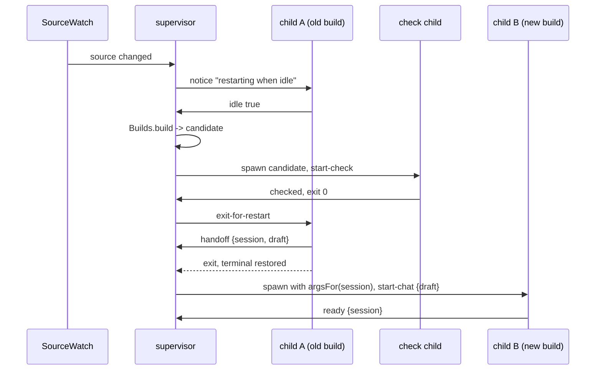

# Reload slice: code plan

Status: built, with the compiled-binary test, 2026-10-14; the live check in [live-checks.md](../live-checks.md) is open. See "As built" at the end for where the code differs from this plan. The architecture and its decisions are in [reload.md](../reload.md). Evidence: spike 15 (`spikes/reload/`).

## Decisions (2026-10-14)

| Question | Decision |
| --- | --- |
| Where the supervisor lives | A new `supervisor` layer in `.fallowrc.jsonc` that imports only its own `internal/`; `cli` may import it. Reason: the boundary check keeps it from loading `core` or `tui`, whose broken code it must survive |
| Start check | Parse the arguments, build the layers (reads `settings.json`), import the TUI module, exit. No database, no drawing. Reason: OpenTUI catches render errors anyway, and a migration run during a check could leave the last good build facing a newer database |
| `/restart` | Now, as one exact match in `chat-client.ts`; 6c's command table replaces it. Reason: `"autoRestart": false` is useless without it |
| Build folder | A temporary folder per supervisor (`FileSystem.makeTempDirectoryScoped`), deleted when Tau quits. Reason: two Tau windows on one repository must not share builds |
| When Tau rebuilds itself | Only when started from source with `bun` (`Bun.main` ends in `.ts`). Reason: no `BUN_BE_BUN=1` and no compiled binary running bundles; a released binary still gets crash recovery and `/restart` |

**What the user gets:** `tau` (chat, no `-p`) starts a small parent process, the supervisor, which runs the chat as a child. Run from source, Tau rebuilds itself when a file in `src/` changes, checks the new build, and restarts the chat into the same session with the same unsent input as soon as no run is going. `/restart` does the same on request; `"autoRestart": false` in `settings.json` makes `/restart` the only way. A crash restarts the chat once, then falls back to the last good build.

## Today

| Piece | State | Where |
| --- | --- | --- |
| Chat start | `rootCommand` opens the session, loads the TUI lazily, calls `chatInTerminal`, prints `Session: <id>` | `src/cli/internal/root-command.ts` |
| Chat state | `run` (`"idle"` or running) and `queued` prompts; the editor text lives only in `Input.tsx` | `src/tui/internal/chat-state.ts` |
| Supervisor | Spike only: one imperative file with about six boolean flags; draft passed in an environment variable | `spikes/reload/supervisor.ts` |
| Compiled binary | Built with the `bun build` command line, which cannot add Solid's transform | `tests/binary/login.test.ts` |

## Prep steps (separate from the feature)

1. **New layer `supervisor`** in `.fallowrc.jsonc`: may import only `supervisor-internal`; `cli` may import it (agreed above).
2. **Verify two unknowns** in `spikes/reload/` before building: IPC between a compiled binary and itself (the spike used an environment variable instead), and `bun --config=<empty bunfig.toml> <bundle>` ignoring the project's `bunfig.toml` (Bun `run --config`, `docs/reference/copies/bun/1.4.3/docs/snippets/cli/run.mdx`).

## Files

```text
src/supervisor/                      new layer
  Supervisor.ts          superviseChat(start): the parent process loop
  ReloadLink.ts          child side of the IPC: ReloadLink service, ipc and none layers
  messages.ts            ToChild, ToSupervisor as Schema unions; decoded at both ends
  internal/
    restart-machine.ts   RestartState, RestartEvent, RestartCommand, transition(): pure
    restart-machine.test.ts   table test, like chat-state.test.ts
    run-commands.ts      runs each RestartCommand with the three services below
    builds.ts            Builds service: Bun.build into a build folder, plus bundleOptions
    children.ts          Children service: Bun.spawn with ipc, terminal inherited; start check
    source-watch.ts      SourceWatch service: FileSystem.watch on src/, Stream.debounce 100 ms
src/cli/internal/root-command.ts     changed: chat branch supervises, checks, or chats (below)
src/tui/Tui.ts                       changed: chatInTerminal takes a RestartLink, returns ChatEnd
src/tui/internal/chat-client.ts      changed: reports idle, handles /restart, keeps the draft reader
src/tui/internal/chat-state.ts       changed: `notice` field and `restart-notice` action
src/tui/internal/Input.tsx           changed: starts with the handed-over draft; registers its reader
src/tui/internal/InputFooter.tsx     changed: shows the notice
src/host/Settings.ts                 changed: `autoRestart: boolean`, default true
tests/supervisor/supervise.test.ts   new: run-commands with fake services
tests/binary/chat.test.ts            new: compiled binary in a PTY: chat opens, Ctrl-D quits, terminal restored
tests/support/compile-tau.ts         new: Bun.build compile with Solid's plugin; replaces the CLI build in login.test.ts
docs/guide/chat.md                   changed: restart, /restart, autoRestart
```

## Boundaries

```ts
// messages.ts: over Bun IPC (`Bun.spawn({ ipc })`, child `process.send` / `process.on("message")`)
type ToChild =
  | { type: "start-check" }
  | { type: "start-chat"; draft: string }
  | { type: "notice"; text: string }          // "Tau's code changed; restarting when idle", "build failed: ..."
  | { type: "exit-for-restart" };
type ToSupervisor =
  | { type: "checked" }
  | { type: "ready"; session: string }
  | { type: "idle"; idle: boolean }           // run idle and nothing queued
  | { type: "restart-request" }               // /restart
  | { type: "handoff"; session: string; draft: string };

// Supervisor.ts: what cli gives the supervisor, so it stays free of Tau's flags
type SupervisorStart = {
  readonly argsFor: (session: string | undefined) => readonly string[]; // first child: original args
  readonly autoRestart: boolean;
  readonly source: Option<string>;            // repository root when run from source, else none
};
declare const superviseChat: (start: SupervisorStart) => Effect<void, never, Builds | Children | SourceWatch>;

// ReloadLink.ts: child side
class ReloadLink extends Context.Service<ReloadLink, {
  readonly supervised: boolean;
  readonly start: Effect<"check" | { draft: string }>;
  readonly send: (message: ToSupervisor) => Effect<void>;
  readonly notices: Stream<string>;
  readonly exitRequested: Effect<void>;
}>()("tau/supervisor/ReloadLink") {}
// ReloadLink.layer: IPC when `process.send` exists; otherwise supervised = false

// Tui.ts: the TUI's own port; cli adapts ReloadLink to it (tui may not import supervisor)
type RestartLink = {
  readonly draft: string;
  readonly idleChanged: (idle: boolean) => void;
  readonly restartRequested: () => void;
  readonly notices: Stream<string>;
  readonly exitRequested: Effect<void>;
};
type ChatEnd = { readonly reason: "quit" } | { readonly reason: "restart"; readonly draft: string };
declare const chatInTerminal: (opened, options, prompt, link: RestartLink) => Effect<ChatEnd>;
```

## Call path: restart when idle



## Logic

```text
rootCommand, chat branch:
  link = ReloadLink
  if not link.supervised: superviseChat(start from input and settings); return
  if (yield* link.start) is "check": import tui; send checked; return     -- no database, no drawing
  open session; send ready
  end = chatInTerminal(opened, options, prompt, restartLink(link))
  if end is restart: send handoff {session, draft}
  else print "Session: <id>"

transition(state, event) -> { state, commands }:            -- replaces the spike's flags
  Running   + source-changed          -> Running{pending}; notice
  Running{pending, idle}, autoRestart -> Building; build      (also on restart-request, when idle)
  Building  + built(candidate)        -> Checking; check(candidate)
  Building/Checking + failed(reason)  -> Running; notice(reason)
  Building/Checking + source-changed  -> same state, changedAgain
  Checking  + passed                  -> HandingOver; send exit-for-restart   (or rebuild if changedAgain)
  HandingOver + handoff               -> HandingOver{session, draft}
  HandingOver + child-exited          -> Starting(candidate); reset terminal; spawn(session, draft)
  Starting  + ready                   -> Running; mark candidate good after 10 s; delete older builds
  Running/Starting + child-exited non-zero -> Starting(same build), or last good when the build crashed within 10 s; spawn
  Running   + child-exited zero       -> Stopped; exit
  Starting(last good) + crashed again -> Stopped; reset terminal; print "Session: <id>"; exit 1
```

Without `source` (released binary), there is no watcher and no build: the child is the binary itself, and the machine handles only crashes and `/restart`.

## Injection

| Service | Production | Tests |
| --- | --- | --- |
| `Builds` | `Bun.build` with `solidPlugin`, other platforms' `@opentui/core-*` as `external`, `publicPath` = build folder, an empty `bunfig.toml` beside it | fake: returns a build id or a failure from a script |
| `Children` | `Bun.spawn(["bun", "--config", <empty>, <bundle>, ...args], { ipc, stdio: inherit })`; the released binary spawns `process.execPath` | fake child: a `Queue` of `ToSupervisor` messages and an exit `Deferred` |
| `SourceWatch` | `FileSystem.watch(src, { recursive: true })`, `Stream.debounce` | `Stream.fromQueue` the test pushes into |
| `ReloadLink` | `process.send` and `process.on("message")` | `ReloadLink.none` (TUI tests call `runTui` directly, as today) |

`transition` needs no injection: `restart-machine.test.ts` is a table of state, event, expected state and commands.

## Reuse and removal

- **Reused:** `FileSystem.watch`, `FileSystem.makeTempDirectoryScoped`, `Stream.debounce`, `Schema` unions for messages, `Bun.spawn` IPC, `@opentui/solid/bun-plugin`. `src/proc` gained `IpcChild.ts` for the IPC child; its process-session code was not reused, because it captures output and the chat child must own the terminal.
- **Replaced:** the `bun build` command in `login.test.ts` (by `compile-tau.ts`); the spike's boolean flags (by `transition`). The spike stays as the record of spike 15.
- **Deferred:** a `mise run build` release task (with installs and updates, build step 8); the supervisor owning process sessions ([deferred.md](../deferred.md)).

## Build order

1. Prep steps 1 and 2.
2. `messages.ts`, `restart-machine.ts` and its table test.
3. `Builds`, `Children`, `SourceWatch`, `run-commands.ts`, `superviseChat`, with `supervise.test.ts`.
4. `ReloadLink`, the chat branch in `root-command.ts`, the TUI changes, the setting.
5. `compile-tau.ts` and the binary PTY test; the guide page; a live check in [live-checks.md](../live-checks.md): edit `src/` from a running Tau.

## As built (2026-10-14)

The code follows the plan with these changes. Each has a reason.

| Change | Reason |
| --- | --- |
| The supervisor builds and checks right after a change, then waits for idle to switch; the plan built only when idle | A build takes about 300 ms and a check about 300 ms; doing them during a run makes the switch instant when the run ends |
| `Builds` has `changes` (the watch); there is no `SourceWatch` service | The watch and the build folder belong to the same source; a released binary gives `Stream.never` |
| `Supervisor.ts` runs the commands itself; there is no `run-commands.ts` | It is about 40 lines and has one caller |
| `supervisor` may import `proc` (user approved); Bun IPC is in `src/proc/IpcChild.ts` | The lint rule `tau/no-spawn` allows `Bun.spawn` only in `src/proc` |
| No footer notices: build failures, start-check failures, a fallback and new code that waits for `/restart` are conditions in the status strip above the input; crashes that restart go to the supervisor's log (user decisions, 2026-10-14; see [messages.md](messages.md)) | The footer is not a message area |
| `ReloadLink` has `start`, `exitRequested` and `send`, not one message stream | Two readers of one queue would each get half the messages |
| The start check reports why it failed with a `check-failed` IPC message | A process that exits at once loses what it wrote to a pipe, so its output was empty |
| The supervisor reports a chat's exit only after its last message (`onDisconnect` ends the message stream) | The handoff must arrive before the exit, or the next chat starts without the draft |
| A chat that fails before it opens a session stops the supervisor (`ChatFailed`, exit code 1) | Such as `--session` with a wrong ID: the chat printed why, and a restart cannot help |
| On a restart, prompts that wait for their run go into the draft with the editor text | They would be lost with the process |
| No `checked` message: the check passes when the child exits 0 | The exit code says the same |
| `ChatSetup` (`options`, `prompt`, `link`) is one parameter of `chatInTerminal` and `runTui` | The parameter limit is 4 |
| `compile-tau.ts` shares no options with `Builds`: it passes only Solid's plugin and `autoloadBunfig: false` | A compiled binary embeds OpenTUI's native library, so it needs neither `external` nor `publicPath` |
| The chat's release waits for `renderer.closed` after `destroy()` | `destroy` restores the terminal later; the binary test found `Session: <id>` printed into the alternate screen, where it disappeared on exit |

`tests/binary/chat.test.ts` runs the compiled binary in a PTY from a shell: the chat opens, Ctrl-D quits with exit 0, every screen mode the chat turned on is off again, `Session: <id>` shows after the chat, and `stty` reports `icanon`, `echo` and `isig`. The source path was checked by hand in a PTY: a change restarts the chat in about 0.9 s with the draft kept; a build error and a start-check error showed under the input (since moved to the log file) and the chat kept running; the fix restarts it.
