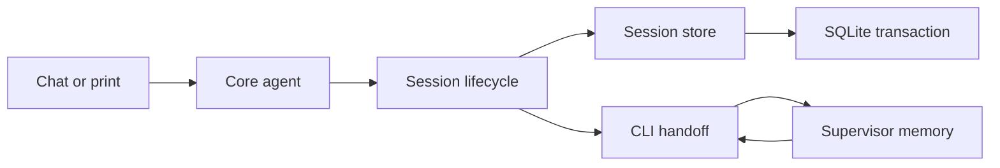

# Save sessions after the first prompt

Status: lifecycle agreed; code-level plan proposed. Exit-output mockup awaits approval before implementation.

## Requirement

A new session must not be saved until the user submits a prompt. Opening Tau, using `/new`, or closing an unused chat must not leave a session row.

## Current path

| Step | Code | Behavior |
| --- | --- | --- |
| Open a new chat | `src/core/Agent.ts`, `Agent.open` | Calls `Sessions.create` immediately. |
| Create a session | `src/session/Sessions.ts`, `create` | Inserts the session row before any prompt. |
| Start its runner | `src/core/internal/runner/runner.ts`, `makeRunner` | Reads the saved session and starts background work. |
| Run a prompt | `runPrompt` in the same file | Appends the user entry separately. |

## Agreed lifecycle

| State | Storage | Transition |
| --- | --- | --- |
| Draft | Session identity and pre-prompt choices in memory | First submitted prompt saves the session and user entry atomically. |
| Saved | Session and entries in SQLite | Further prompts append normally. |
| Closed draft | No session row | Discard in-memory state. |

Use an explicit draft/saved lifecycle across the agent, runner and session store. Keep the database invariant at the transaction boundary rather than hiding empty rows in the picker or deleting them on exit. Exit cleanup leaves rows behind after a crash.

Closing a draft discards its pre-prompt reference choices. Reload and restart must preserve draft identity and choices without inserting a session row. Forks containing existing user entries should remain saved sessions.

## Implementation boundaries

Use a draft/saved state machine in core, an atomic first-prompt operation in the session store, and the existing supervisor handoff for restart. No new service or dependency is needed. A store-wide map of drafts would retain discarded chats and mix memory ownership with database storage.



| Action | Owner | Result |
| --- | --- | --- |
| Allocate identity | Session store | Construct session metadata without inserting a row. |
| Open draft | Core agent and runner | Own metadata and reference choices in the open-session scope. |
| Submit first prompt | Core runner → session store | Insert metadata, first user entry and reference choices in one transaction. |
| Read draft history | Core runner | Return no saved runs or saved model; do not start background memory work. |
| Attach references | Core runner | Update draft choices and publish the existing reference event; saved sessions append normally. |
| Restart draft | CLI → supervisor → CLI | Transfer metadata, choices and unsent input through IPC. |
| Close draft | Core and CLI | Discard draft state; print no resumable session ID. |


```text
open → draft → first-prompt transaction → saved → append
         ├─ references → draft
         ├─ restart → in-memory handoff → draft
         └─ close → discarded
```

## Code shape


```text
src/session/Sessions.ts                 identity allocation and atomic first save
src/core/Agent.ts                       open saved sessions or scoped drafts
src/core/internal/runner/               draft/saved lifecycle and deferred background work
src/core/internal/references/           inject attachment writes through the lifecycle
src/tui/Tui.ts                         return restart state for the chat shown last
src/cli/internal/                      restore draft handoffs and print saved IDs only
src/supervisor/                        carry a tagged resume target through IPC and restart
tests/session/, tests/core/, tests/tui/ lifecycle, transaction and terminal coverage
tests/supervisor/                      draft handoff and crash/restart coverage
```

Boundary signatures (proposed; error channels follow the existing store and agent):

```ts
type SessionState =
  | { readonly kind: "draft"; readonly session: Session; readonly references: readonly string[] }
  | { readonly kind: "saved"; readonly session: Session };

// Session store: replace eager create; reuse appendWithin inside the first-save transaction.
allocate(directory: string): Effect.Effect<Session>;
start(session: Session, prompt: string, references: readonly string[]): Effect.Effect<void, SessionStoreError>;

// Open session: snapshot current state for reload and final output.
snapshot: Effect.Effect<SessionState>;
```

The CLI converts domain metadata to the supervisor’s schema: a saved ID or draft ID, directory, creation time and references. The supervisor imports no core or session types. It passes draft metadata in IPC rather than pretending it is a saved `--session` ID. Ready, persistence and reference updates refresh its resume target so a crash after the first save resumes from SQLite.

Serialize first-save and reference writes with `effect/Semaphore.make` and `withPermit`; hold lifecycle state with `effect/Ref.make`, `get` and `set`. Reuse `Database.writeTransaction` for commit/rollback and interruption safety. Publish the saved transition only after commit, without an interruptible gap between commit and the in-memory state update.

Background work starts immediately for saved sessions and once after a draft is saved. Existing commit planning can read an empty entry list without causing persistence. Unknown saved IDs must still fail, not silently become drafts.

## Tests and documentation

Use the existing agent harness and test terminal: production and tests use the same session lifecycle, with the harness replacing models, home and platform services. Store tests cover the transaction independently.

| Case | Assertion |
| --- | --- |
| Open, close, or repeatedly use /new without a prompt | No session or entry rows. |
| Choose references before a prompt | References appear in the chat state; no session row. |
| First prompt | One saved session and one user entry; selected references reach the model. |
| Later prompts | Append to the same session; no second insertion. |
| Cancel or fail after first prompt is saved | Session remains resumable. |
| First transaction fails or is interrupted | No partial session or entries; retry does not duplicate data. |
| Reload or manual restart before first prompt | Identity, references and unsent input survive without a session row. |
| Resume, fork and print mode | Existing history and model choices still work. |
| Quit an unused chat | No session ID is printed. |

Update the chat, references, print-mode and restart guide sections with persistence and draft limits. No database migration is required.

## One-time cleanup

Deleted 11 sessions with no entries from `~/.tau/sessions.db`; 56 sessions remained, all with user prompts. SQLite foreign-key verification passed. A database backup was saved to `~/.tau/sessions.db.backup-empty-cleanup-20261015-034545`.
