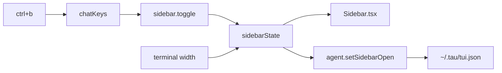

# The sidebar

Status: rounds 1 and 2 built 2026-10-15 (Context, Cost, Processes, Compaction). The docked slide waits for the user's try on a long transcript.

**What the user gets:** a panel on the right of the chat with session state (context use, cost, running process sessions, compaction), opened and closed with one key. This is slice 6b in [tui.md](tui.md).

## Today

```text
App.tsx (src/tui/internal)
  place "app"            one column, full width
    place "chat"         transcript, grows
    input block          run panel, status strip, editor, footer
```

- No sidebar is built. [sdk-catalog.md](../sdk-catalog.md#named-ui-places) names the places `sidebar.left` (empty by default, takes no space) and `sidebar.right` (Tau's panels), and says "below a width set in settings, sidebars hide and a key toggles them".
- Keys go through `@opentui/keymap` ([keys.md](keys.md)); the toggle is one binding in the chat layer.

## Can OpenTUI animate it?

Yes. OpenTUI 0.6.1 has `Timeline` (`createTimeline` in `@opentui/core`, `useTimeline` in `@opentui/solid`). It tweens numeric properties over a duration with named easings (`outQuad`, `outExpo`, `inOutSine`, `outCirc` and others; no custom curves, no springs). The renderer draws every frame while a timeline plays and goes idle after. Source: `docs/reference/copies/@opentui/core/0.6.1/.../application-apis/animation.mdx`.

Limits that shape the design:

| Limit | Effect |
| --- | --- |
| Movement is in whole cells | A 40-column panel slides in at most 40 steps; at 150–200 ms that still reads as smooth |
| Only top-level numeric properties | Animate `width` or `translateX` (both numbers on a renderable), not colors |
| Animating `width` re-lays-out the chat each frame | Long Markdown transcripts re-wrap every frame; may stutter |
| Animating `translateX` moves pixels only | No layout work, but the panel then floats over the chat |

OpenCode (`packages/tui/src/component/session-frame.tsx`) does not animate: the sidebar snaps in. On terminals wider than 120 columns it pushes the chat aside; narrower, it floats over a dimmed chat. Its toggle is `<leader>b` (leader is Ctrl-X).

## Docked or drawer: picked by width, live (agreed 2026-10-14)

The sidebar is **docked** (a column beside the chat that narrows it) when the chat would keep enough room, and a **drawer** (floats over the chat from the right edge) when it would not. The choice is re-made on every terminal resize, both ways: narrowing turns a docked panel into a drawer, widening turns a drawer back into a docked panel.

```text
mode = terminal width − sidebar width ≥ minimum chat width ? docked : drawer
```

- Width comes from `useTerminalDimensions()` in `@opentui/solid`, a signal that updates on resize; `mode` is a Solid memo over it.
- The rule reads only the terminal width, never the laid-out chat, so docking cannot change its own input and the mode cannot flicker.
- A mode change during a resize snaps; only the key toggle animates.

```text
docked, wide                         drawer, narrow
┌──────────────────────┬─────────┐   ┌──────────────────┬─────────┐
│ chat                 │ sidebar │   │ chat (dimmed)    │ sidebar │
│                      │         │   │          under → │ on top  │
├──────────────────────┤         │   ├──────────────────┴─────────┤
│ input                │         │   │ input                      │
└──────────────────────┴─────────┘   └────────────────────────────┘
```

Shape sketch only; the real mockup comes before the build.

## Animation choices

| Mode | Toggle animates | Cost |
| --- | --- | --- |
| Drawer | `translateX` slide | Cheap: no layout work per frame |
| Docked | `width` grows, or snap | Chat re-wraps every frame; test with a long transcript before choosing |

## Decisions (agreed 2026-10-15)

| Topic | Decision |
| --- | --- |
| Toggle key | Ctrl-B, command `sidebar.toggle` in the chat layer (`chatKeys`, `App.tsx`). It takes Ctrl-B from the input, where OpenTUI's default moves the cursor left; the Left arrow still does that. In tmux, Ctrl-B is the prefix, so tmux users press it twice. |
| Animation | Yes. 150 ms, `outQuad`. Drawer slides with `translateX`; docked grows `width`, tested on a long transcript first, snap if it stutters. |
| Default and memory | Open by default when docked. Tau remembers the last open or closed choice in `~/.tau/tui.json`. A drawer always starts closed. |
| First contents | Context use, cost, process sessions, compaction state. Refine after seeing it. Process sessions and compaction need new core events. |
| Widths | Fixed for now: sidebar 42 columns (OpenCode's), minimum chat 80 columns, so docked from 122 terminal columns. A setting comes when someone asks. |
| Resize while open | Docked becoming a drawer closes it; widening again reopens it docked if the remembered choice is open. |
| Footer | Shows only the model and thinking level, such as `gpt-6 (medium)`. Context use and cost move to the sidebar. |

## Mockup (agreed 2026-10-15)

Closed, any width: today's screen, unchanged.

```text
 ┌ transcript ─────────────────────────────────────────────────────────────────┐
 │ › Write the notes.                                                           │
 │ Done. notes.txt has three sections.                                          │
 └──────────────────────────────────────────────────────────────────────────────┘
 ┌──────────────────────────────────────────────────────────────────────────────┐
 │Type a prompt                                                                 │
 └──────────────────────────────────────────────────────────────────────────────┘
 gpt-6 (medium)                           enter send · shift+enter new line · ctrl+d quit
```

Docked, 122 columns or more: the sidebar takes the right 42 columns from top to bottom; the transcript, input and footer narrow.

```text
 › Write the notes.                                  ┌ Session ───────────────────────────────┐
 Done. notes.txt has three sections.                 │ Context                                │
                                                     │ 43k / 128k  ███████░░░░░░░░░░░░░  34%  │
                                                     │                                        │
                                                     │ Cost                                   │
                                                     │ $0.04                                  │
                                                     │                                        │
                                                     │ Processes                              │
                                                     │ ● bun test --watch         running     │
                                                     │ ○ mise run docs            exited 0    │
                                                     │                                        │
 ┌───────────────────────────────────────────────┐   │ Compaction                             │
 │Type a prompt                                  │   │ Notes cover entries 1–86               │
 └───────────────────────────────────────────────┘   │                                        │
 gpt-6 (medium)                      ctrl+b sidebar  └────────────────────────────────────────┘
```

Drawer, under 122 columns: the same panel over the right of the screen; the chat under it is dimmed and does not move. Esc or Ctrl-B closes it.

```text
 › Write the notes.                    ┌ Session ───────────────────────────────┐
 Done. notes.txt has th░░░░░░░░░░░░░░░░│ Context                                │
 ░░░░░░░░░░░░░░░░░░░░░░░░░░░░░░░░░░░░░░│ 43k / 128k  ███████░░░░░░░░░░░░░  34%  │
          (dimmed chat)                │ ...same sections...                    │
 ┌─────────────────────────────────────│                                        │
 │Type a prompt                        │                                        │
 └─────────────────────────────────────│                                        │
 gpt-6 (medium)                        └────────────────────────────────────────┘
```

Empty states, each section on its own:

```text
 Context      No model call yet
 Cost         No price for this model
 Processes    None running
 Compaction   Not compacted yet
```

Footer: the hints add `ctrl+b sidebar` before the quit key when the line has room for it.

## Code plan, round 1: the panel (agreed and built 2026-10-15)

Round 1 builds the panel with the data the chat already has: Context and Cost. Processes and Compaction need new core events, so they come in round 2. Round 1 leaves those two sections out rather than show "None running" when that may be false.

```text
src/tui/internal/
  App.tsx            changed: row of chat column + <Sidebar>; chatKeys gets sidebar.toggle (ctrl+b)
  sidebar-state.ts   new: mode (docked | drawer) from terminal width, open flag, resize rule, memory
  Sidebar.tsx        new: the "Session" panel, its slide, the drawer's backdrop and its Esc layer
  SidebarSections.tsx new: Context (bar) and Cost sections with their empty states
  InputFooter.tsx    changed: model and thinking level only; usageText moves to SidebarSections
  keymap.ts          changed: PRIORITY.drawer for the drawer's Esc
src/core/TuiMemory.ts   new: service { read, setSidebar } for ~/.tau/tui.json (as FavoriteModels.ts)
src/core/Agent.ts       changed: tuiMemory and setSidebarOpen on the agent
src/host/TuiMemory.ts   new: layer that reads and writes ~/.tau/tui.json (as host/FavoriteModels.ts)
src/cli/main.ts, src/cli/internal/supervised-chat.ts   changed: provide the layer, pass it to ChatAgent
docs/guide/chat.md      Ctrl+B row, a Sidebar section
```

The TUI may import only `core` (`.fallowrc.jsonc` boundaries), so the file service is declared in core and built in host, the same way as `FavoriteModels`.

### Types

```ts
// core/TuiMemory.ts
type TuiMemory = { readonly sidebar: "open" | "closed" };          // ~/.tau/tui.json
class TuiMemory extends Context.Service<{
  read: Effect<TuiMemory>;                                         // default { sidebar: "open" } when missing or damaged
  setSidebar: (choice: "open" | "closed") => Effect<void, TuiMemoryError>;
}>

// tui/internal/sidebar-state.ts
const SIDEBAR_COLUMNS = 42, MIN_CHAT_COLUMNS = 80;
type SidebarMode = "docked" | "drawer";
type SidebarState = {
  mode: Accessor<SidebarMode>;
  isOpen: Accessor<boolean>;
  toggle: () => void;
  close: () => void;
};
sidebarState(width: Accessor<number>, remembered: "open" | "closed", save: (choice) => void): SidebarState
```

### Logic

```text
mode = width ≥ SIDEBAR_COLUMNS + MIN_CHAT_COLUMNS ? docked : drawer       (memo on useTerminalDimensions)
start:      open = mode is docked and remembered is open
toggle:     open = not open; when docked, save the choice
close:      open = false                                                   (drawer Esc; never saves)
on mode change (resize, snaps, no animation):
  docked → drawer: open = false
  drawer → docked: open = remembered is open

slide (Sidebar.tsx), on each toggle only:
  useTimeline({ autoplay: false }) tweens a plain object { shown: 0..1 }, 150 ms, outQuad
  onUpdate → signal shown
  drawer: translateX = (1 − shown) × SIDEBAR_COLUMNS          no re-layout
  docked: width = shown × SIDEBAR_COLUMNS                     chat re-wraps each frame
  closed and shown = 0 → panel not drawn
```



Drawer keys: while the drawer is open, a layer at `PRIORITY.drawer` (above chat, below panels) binds Esc to `sidebar.close`, so Esc closes the drawer before it cancels a run. The backdrop is a full-screen box with a dimmed background under the panel.

### Tests (tests/tui/chat.test.ts)

| Case | Renderer width |
| --- | --- |
| Wide terminal starts with the panel docked, showing `43k / 128k` and `$0.04`; Ctrl-B hides it and saves `closed` | 140 |
| Narrow terminal starts closed; Ctrl-B opens the drawer; Esc closes it and a running run keeps going | 80 |
| Resize 140 → 100 closes the docked panel; 100 → 140 opens it again | resize |
| Footer shows only the model | 80 |

The existing assertion `scripted/scripted · 43k/128k · $0.04` moves to the docked case. Tests give a memory stub in place of `~/.tau/tui.json`; production gives the host layer. `startChat` waits for `ctrl+d quit`, which stays in the footer.

### Deletes

`usage` and `usageText` in `InputFooter.tsx` (they move to the sidebar).

### Risk

Docked width animation re-wraps the transcript on each frame. Build it, try a long transcript; if it stutters, docked snaps and only the drawer slides (the agreed fallback).

## Round 2 shape: Processes and Compaction (not planned yet)

| Section | Where the data is today | Event needed |
| --- | --- | --- |
| Processes | `ProcessSessions` per session, made in `core/internal/runner/runner.ts`; it has `list` but no change stream | `processes-changed` with `ProcessSummary[]` |
| Compaction | checkpoint and note entries in the session (`core/internal/context/notes/`) | a `compacted` event, and replay from entries on open |

The code plan for round 2 comes after round 1 is built and seen.

## Round 2: Processes and Compaction (built 2026-10-15)

| Part | What it does |
| --- | --- |
| `AgentEvent` `processes-changed` | The runner looks at its process sessions four times a second and publishes the whole list when it changed. Process sessions have no change stream, and a command can exit at any time. |
| `AgentEvent` `notes-written` | `ContextMethod.background` now takes the event `PubSub`; the notes worker publishes how far the notes reach after each catch-up that moves them. |
| `ContextMethod.history` | Gives a resumed chat the same `notes-written` event. The whole-history method gives none. |
| Checkpoint count | The panel counts the transcript's `checkpoint` tool calls that succeeded. No new event. |
| Panel | Processes: running first, then ended ones newest first, at most 8 lines and `and N more`. An ended command leaves the panel a minute after it first shows ended (user's choice, 2026-10-15); core keeps it so the model can still read its output. Compaction: `Notes cover entries 1–N` or `No notes yet`; `Compacted N times` or `Not compacted yet`. |

A resumed session starts with no processes, because its process sessions end with the runner.
