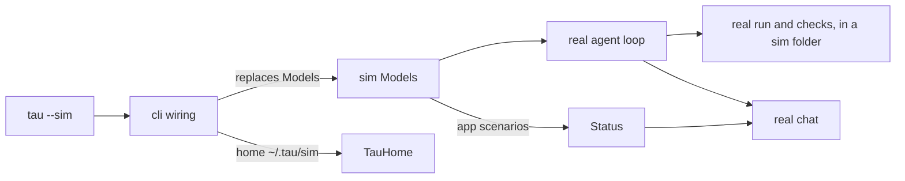

# Simulation mode

Status: paused, 2026-10-14, so Tau becomes the daily driver sooner. Round 1 (how it works for the user) is proposed and not yet discussed; the question waits in [deferred.md](../deferred.md). Agreed so far: the real core runs and only the model's replies are scripted ([features.md](../features.md#interface)).

**What the user gets:** `tau --sim` opens the real chat. Typing a scenario name, such as `fail-script`, plays that scenario: the answer streams, scripts run, checks fail, a retry waits, the strip shows a build error. Each state looks exactly as it does in a real session, and no model call is paid for. Edits to `src/tui/` restart the simulated chat into the new code, as the real chat does.

## Today

| Piece | What it does | Where |
| --- | --- | --- |
| `Models` service | Gives a `LanguageModel` (chat) and a `DecisionModel` for a route and model; the only door to providers | `src/ai/Models.ts` |
| Scripted model | `LanguageModel.make` with `streamText` returning the next scripted reply, and canned background notes from `generateText` | `tests/support/agent-harness.ts` |
| `Status` service | The conditions the strip shows; anyone in the chat process can set and clear them | `src/core/Status.ts` |
| Supervisor | Restarts the chat child into new code with the same arguments and session | `src/supervisor/`, `src/cli/internal/supervised-chat.ts` |
| `TauHome` | Where sessions, logs and settings live; `~/.tau` | `src/database/TauHome.ts` |

## Where it plugs in

Only `cli` changes what it provides. The core, the TUI and the supervisor do not know they run in a simulation.

## Round 1: decisions (proposed)

| # | Decision | Recommendation | Alternative and its cost |
| --- | --- | --- | --- |
| 1 | How it starts | `tau --sim`; `mise run sim` runs it from source | `--model sim/demo`: needs a fake route in the route table and the catalog, and the model picker would list it |
| 2 | Who gets it | Ships in every build; extension authors need it at step 7 to see their UI | Source only: smaller binary surface, but extension authors would pay for real calls |
| 3 | Where the fake sits | In process: a `Models` layer built with `LanguageModel.make`, moved from the test harness into `src/` | The HTTP fake provider ([deferred.md](../deferred.md)): also covers wire protocols and real rate-limit headers, but is a larger build; it can replace the in-process fake later without changing scenarios |
| 4 | How a scenario is chosen | The prompt's first word names it; any other prompt lists the scenarios | Scenario files in `.tau/sim/`: custom scenarios, but a format to design now for no second user yet |
| 5 | Where scripts run | A sim folder under `~/.tau/sim/work/`, seeded with a few files; never the user's project | The current folder: real output, but a scenario's edit changes real files |
| 6 | Where sessions live | `~/.tau/sim/` as Tau's home, so sim sessions never mix with real ones and survive restarts | A temporary home: lost when the supervisor restarts the chat child |
| 7 | States the model does not cause | App scenarios: `build-error`, `fallback`, `no-model` set conditions in `Status` directly | A separate key or command: one more thing to learn |
| 8 | Streaming speed | Realistic: text arrives in small pieces with short delays, so streaming and cancel can be seen | Instant: faster, but hides how streaming looks |

## First scenarios (proposed)

| Name | Shows |
| --- | --- |
| `answer` | A long Markdown answer with a code block, streamed |
| `script` | A `run` call that reads files, then an answer |
| `fail-script` | A `run` call that fails, a script edit that fixes it |
| `checks` | Fixers run, `checks` fails, the agent fixes it |
| `retry` | A rate limit, a retry countdown, then an answer |
| `plan-limit` | A plan limit that ends the run with its reset time |
| `run-failed` | The run fails with an error |
| `process` | A process session left running |
| `checkpoint` | Context stages, then a checkpoint |
| `build-error`, `fallback`, `no-model` | Conditions in the strip, no model call |

Later scenarios come with the work that needs them: usage and cost for 6b, cache misses with their warning.
