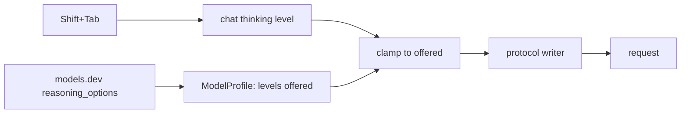

# Thinking levels

Status: built; checks pass. Waiting for a live check in a real chat. Comes before [commit.md](commit.md), whose model call runs at high thinking.

The user picks how hard the model thinks. The level shows in parentheses after the model below the input, and Shift+Tab steps through the levels the model has.

## What exists

| Where | What it has |
| --- | --- |
| `ai/ModelProfile.ts` | `supports.reasoning` is a yes or no. No levels. |
| `~/.tau/catalog.json` (models.dev) | Each model has `reasoning_options`: `toggle`, `effort` with its own values (Haiku 5.5: `low medium high xhigh max`; GPT-6 Luna: `none low medium high xhigh max`; DeepSeek V4.1 Flash: `low high max`), or `budget_tokens` with a minimum (Haiku 4.5). Tau drops this today. |
| `ai/Models.ts` | Builds each call. No call sets thinking. |
| `tui/internal/InputFooter.tsx` | `anthropic/claude-sonnet-5-5 · 42k/200k · $0.84` on the left, keys on the right. |
| Input keys | Tab queues during a run. Shift+Tab is free. |

## How others do it

| | Pi (`pi/packages/ai/src/models.ts`) | OpenCode (`opencode/packages/core/src/variant.ts`) |
| --- | --- | --- |
| Levels | One fixed ladder for every model: `off minimal low medium high xhigh max` | Each model's own list, read from models.dev `reasoning_options` |
| Per model | `thinkingLevelMap`: level → provider value, `null` when not offered | "Variants": each level is a settings overlay written per protocol (`reasoningEffort`, `thinking.budgetTokens`, adaptive thinking, `chat_template_kwargs`) |
| Switching model | `clampThinkingLevel`: the nearest offered level, up first, then down | The variant is kept per model |
| Budget models | Mapped to token budgets | Two variants: `high` (half the output limit) and `max` |
| Key | Shift+Tab cycles | `model.variant.cycle` cycles |

## Proposed shape

Pi's ladder for what the user sees and saves, OpenCode's per-protocol writers for what the request sends.



| Piece | Change |
| --- | --- |
| `ai/ModelProfile.ts` | `thinking: readonly Level[]` replaces `supports.reasoning`, from `reasoning_options`; `settings.json` can correct it. |
| `ai` protocols | One writer each: Anthropic (effort, or a token budget for older models), OpenAI Responses and OpenRouter (`reasoning.effort`), OpenAI-compatible (`reasoning_effort` or a toggle). |
| `core` | The run options carry the level; the session saves it with the model. |
| `tui` | Shift+Tab cycles; the footer shows the level. |

## Built

- `ai/ModelProfile.ts`: the ladder, `Thinking` (`effort` words, a token `budget`, or a `toggle`), `thinkingLevels` and `clampThinking`. models.dev `reasoning_options` fill it; a budget wins over effort words; `none` is `off`, `minimal` is `low` when there is no `low`. Settings cannot change it yet.
- `ai/internal/protocols/thinking.ts`: the fields per protocol, merged into each request body. Anthropic: adaptive thinking with `output_config.effort`, or `thinking.budget_tokens` with `max_tokens` at the output limit. OpenAI Responses and OpenRouter: `reasoning.effort` (OpenRouter budgets: `reasoning.max_tokens`). OpenAI-compatible: `reasoning_effort`, or `thinking.type` for a toggle. Budgets: low 4096, medium 10240, high 24576, max 65536, capped at half the output limit.
- `Models.languageModel` takes an optional level; notes and memory pass none, so the provider decides.
- `RunOptions.thinking` carries the chosen level; the reply's saved model has `thinking`. `ListedModel.thinking` gives the TUI each model's levels.
- TUI: `thinking-choice.ts` keeps the chosen level and shows the clamped one; Shift+Tab in `Input.tsx`; the footer in `InputFooter.tsx`.

## Agreed

| Decision | Answer |
| --- | --- |
| Levels | One fixed ladder, `off low medium high xhigh max`, as Pi does. Each model maps the levels it offers; a missing level moves to the nearest offered one, up first. |
| Default | `medium` for a new chat. |
| Saved | With the chat's model in the session; a reopened session keeps its level. |
| Footer | The level in muted parentheses after the model; mockup below approved. A model with no thinking shows no level. |
| Shift+Tab | Steps up a level and wraps from the top to `off`. Only when idle: during a run it does nothing, so no call runs at a level passed while cycling. |

## Footer (approved)

Today the line is the same without the level and the `shift+tab thinking` hint.

Idle:

```
anthropic/claude-sonnet-5-5 (high) · 42k/200k · $0.84   enter send · shift+enter new line · shift+tab thinking · ctrl+d quit
```

Idle, after Shift+Tab:

```
anthropic/claude-sonnet-5-5 (xhigh) · 42k/200k · $0.84  enter send · shift+enter new line · shift+tab thinking · ctrl+d quit
```

Running: no Shift+Tab hint, and Shift+Tab does nothing.

```
anthropic/claude-sonnet-5-5 (xhigh) · 42k/200k · $0.84             enter steer · tab queue · esc cancel · ctrl+d quit
```

A model with no thinking:

```
openrouter/some/no-thinking-model · 3k/128k                       enter send · shift+enter new line · ctrl+d quit
```

A level the new model lacks, after `/model`: Sonnet at `xhigh` → DeepSeek V4.1 Flash (`low high max`) shows `(max)`.
