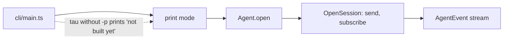
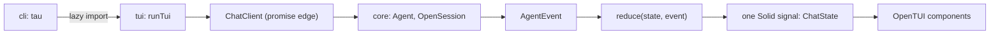

# Step 6: the TUI

Status: architecture proposed, awaiting answers (see [questions.md](../questions.md)), 2026-10-14. Evidence: `spikes/opentui/NOTES.md` (OpenTUI 0.6.1 with Solid renders streaming markdown, input and a sidebar, from source and as a compiled binary, on macOS and Linux arm64).

**What the user gets:** running `tau` with no `-p` opens a chat in the terminal on the real agent: the user types a prompt, sees the answer stream in, sees each tool call start and finish, cancels a run, and resumes an old session. Tau can then be developed from Tau.

## Slices

| Slice | Adds | Why this order |
| --- | --- | --- |
| 6a, daily driver | Chat pane, input, cancel, queued prompts, resume with past messages, one status line | The smallest thing that replaces Pi for development |
| 6b, sidebar | Context use, running process sessions, compaction state, cost | Needs new core events (usage, process state, notes) |
| 6c, commands | `/model`, session picker, `/compact`, `/settings`, login | Needs core to list sessions and models for a client |

Extension slots wait for step 7. 6a stays small on purpose: no slash commands, no sidebar.

## Today



| Piece | State |
| --- | --- |
| `OpenSession` | `send(prompt or cancel)`, `subscribe` to `AgentEvent`; prompts queue in the runner |
| `AgentEvent` | `text`, `tool-started`, `tool-ended`, `prompts-returned`, `retrying`, `checks-started/ended`, `run-ended` |
| Missing for a chat | the accepted user prompt as an event, past messages for a resumed session, context tokens, process and note events |
| `tui` layer | named in architecture and in the Fallow zones (`src/tui/*.ts`, may import `core` and `sdk` only); no code, no `.tsx` zone |
| OpenTUI | a spike only; not in `package.json`, not in the reference docs |

## Architecture



- **Events through a pure reducer into a Solid store.** Every `AgentEvent` goes through `reduce(chat, event): ChatState`, a plain function with no OpenTUI import. Its result is written into a Solid store with `reconcile`, so only the changed message redraws; a new signal value per event would rebuild the streaming `<markdown>` on every delta. OpenCode also keeps a Solid store fed by one event switch (`client/src/solid/data.ts`). The reducer also builds the resumed history, because past messages arrive as the same events.
- **One promise edge.** `ChatClient` is the only place that turns Effects into promises and callbacks (architecture: "Promises appear only at the edges"). Production wraps `Agent.open`; tests supply a scripted one.
- **In process.** The TUI and core share one process; RPC stays a later thin layer ([architecture.md](../architecture.md#core-ideas)).
- **Named places from the start.** The layout is built from the places in [sdk-catalog.md](../sdk-catalog.md#named-ui-places), each with an error boundary, and tool calls render through `chat.function.<name>` with a plain default. Tau's own panels are placed the way an extension would place them, so step 7 does not rewrite them.
- **Reload.** How Tau restarts into new code is in [reload.md](../reload.md).
- **Lazy load.** `cli` imports `tui` only when `-p` is absent, so print mode never loads the native renderer.

## Code plan for 6a

```text
src/tui/
  Tui.ts                  new: runTui(options), the one public function
  internal/
    chat-state.ts         new: ChatItem, ChatState, reduce
    chat-client.ts        new: ChatClient and its Agent-backed version (the promise edge)
    App.tsx               new: layout, keys, wires the signal
    Chat.tsx, Input.tsx, StatusLine.tsx   new: the components
src/core/Client.ts        changed: `prompt-accepted` event
src/core/internal/runner/runner.ts  changed: `OpenSession.history`, publishes `prompt-accepted`
src/cli/internal/run-options.ts     new: model and timeout resolution moved out of print.ts
src/cli/internal/print.ts           changed: imports run-options; no-`-p` path starts the TUI
tests/tui/                          new: reducer table, headless frame test
```

```ts
// core: the event and the replay that a chat needs
type AgentEvent = … | { type: "prompt-accepted"; text: string };   // tool-started also gains `name`
type OpenSession = { …; history: Effect<readonly AgentEvent[]> };   // saved entries as events

// tui/internal
type ChatItem =
  | { kind: "user"; text: string; queued: boolean }
  | { kind: "assistant"; text: string; streaming: boolean }
  | { kind: "tool"; callId: string; name: string; summary: string; status: "running" | "ok" | "failed" }
  | { kind: "notice"; text: string };                // retrying, checks, how a run ended
type ChatState = { items: readonly ChatItem[]; run: "idle" | "running" | "retrying"; returned: string };
type ChatClient = {
  history: readonly AgentEvent[];
  send: (text: string) => void;
  cancel: () => void;
  subscribe: (listener: (event: AgentEvent) => void) => () => void;   // returns unsubscribe
};
```

```text
reduce(state, event)
  prompt-accepted   add user item (queued if a run is going), run = running
  text              append to the last assistant item, or start one after a tool or user item
  tool-started      close the streaming assistant item, add tool item running
  tool-ended        tool item = ok or failed
  retrying          notice "retrying in N s: message", drop text of the failed call, run = retrying
  checks-*          notice listing the checks
  prompts-returned  returned = the prompts joined, for the editor
  run-ended         close streaming, add a notice unless "answered", run = idle
```

Keys: Enter sends; Escape cancels the run; Ctrl-C cancels a running run, otherwise exits; Ctrl-D exits. Prompts typed during a run queue in core and show as queued.

Tests: `reduce` gets one table test per event kind (a pure function with many inputs, allowed as a unit test). One headless `testRender` test drives `App` with a scripted `ChatClient` and checks a frame, as the spike did. A PTY test of the real binary comes with the compiled TUI build.

## Prep steps (listed apart)

| Step | Reason |
| --- | --- |
| Move run-option resolution out of `print.ts` | The TUI needs the same model and timeout rules; copying them would duplicate |
| Add OpenTUI, Solid and their reference docs | `AGENTS.md`: read a dependency's reference entry before using it. OpenTUI is not in `docs/reference/copies/index.md` yet |
| Tool settings for `.tsx` | `tsconfig.json` needs `jsx` and `jsxImportSource`; Fallow's `tui` zone must match `.tsx`; oxlint's `tau/no-effect-run` must be off for the adapter file; `bunfig.toml` needs Solid's preload to run from source |

These change check configuration, so they wait for the user's permission.

## Deletes or replaces

- The "interactive mode is not built yet" message in `print.ts`.
- `spikes/opentui/` stays as a record; its `app.tsx` is the starting point, not code to copy: the spike's fake streaming and `session` signal are replaced by the reducer.
