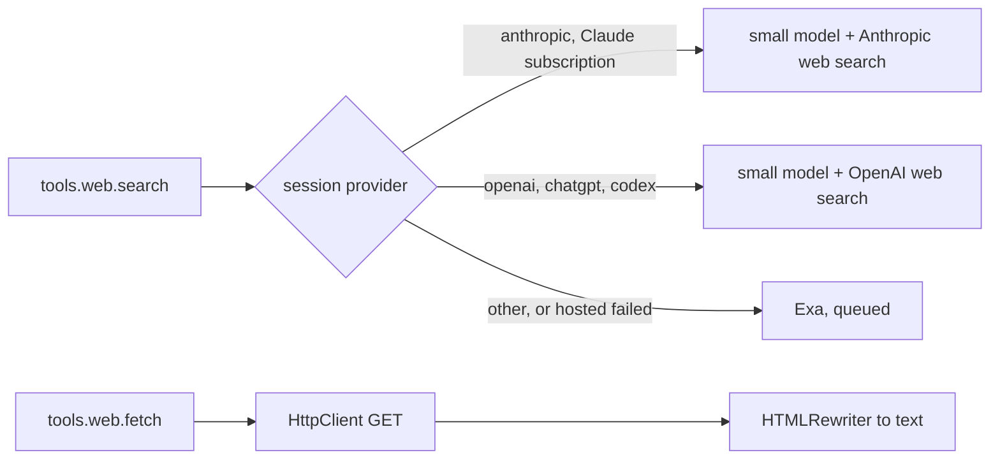
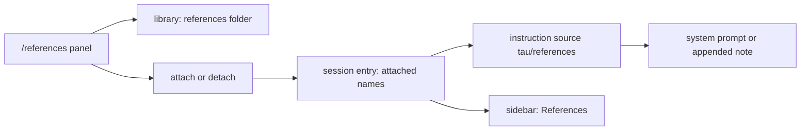

# Web search, web fetch and references

Status: round 1 agreed 2026-10-15. Round 2 (the references design and mockups) proposed; its open decisions are in [questions.md](../questions.md). Next: the web code-level plan.

Two pieces of work, web first. **Web**: the model can search the web and read a page from a `run` script. **References**: the user keeps a library of reference repositories (read-only git clones of other projects) and attaches some of them to a session, so the model knows where they are. Both are built-ins from `main` that [features.md](../features.md) lists for step 7; like `/commit`, they are built in core now and move onto the extension SDK in step 7.

## What exists

| Where | What it has |
| --- | --- |
| `main`, `packages/agent/extensions/web/` | `websearch` and `webfetch`, reachable only from code mode scripts, plus a system prompt section telling the model to use them from scripts. |
| `main`, `web/search.ts`, `hosted-search.ts`, `exa.ts` | Search runs a quick model of the session's provider with the provider's own search tool (OpenAI Codex, Anthropic, xAI), and falls back to Exa's hosted MCP endpoint (no key needed, optional `EXA_API_KEY`). Exa calls start at least 2 s apart. |
| `main`, `web/webfetch.ts` | `fetch` with a browser user agent, a 5 MB cap, Cloudflare challenge retry, HTML to Markdown with turndown, binary refused. |
| `main`, `packages/agent/extensions/reference/` | `/reference`: a picker over `~/.local/share/tau-agent/references/` whose Enter writes "Reference repositories: … Request:" into the input. Runs git for every repository before it shows; slow to open. |
| Here, `core/internal/run-tool/run-tool.ts` | The `run` description lists every function with its signature, groups included (`tools.process.start`). Only `skills` is left out and found with codemode's `search`. |
| Here, `ai/Models.ts` | `smallModel(ref)`: the cheap model of a provider, used by notes, memory and `/commit`. |
| Here, `@effect/ai-anthropic`, `@effect/ai-openai` | `AnthropicTool.WebSearch_20250305` and `OpenAiTool.WebSearch`, search tools run on the provider's side. Not yet used through Tau's routes. |
| Here, instruction sources (`core/internal/instructions/sources.ts`) | Keyed values read before each model call. Values present at the last compaction are in the system prompt; a later change is appended once as a note. |
| Here, sidebar (`work/sidebar.md`) | Context, Cost, Processes, Compaction sections. |

## Web (agreed 2026-10-15)

| # | Decision |
| --- | --- |
| 1 | Listed in `run`'s description as `tools.web.search` and `tools.web.fetch`, always present on every route, so the description never changes in a session. Their descriptions replace `main`'s system prompt section. |
| 2 | Search covers Anthropic, OpenAI and Exa in the first build. Exa queues calls made at the same time, starting each at least 2 s after the one before. |
| 3 | Hosted search runs on `Models.smallModel` of the session's model. |
| 4 | Fetch turns HTML into text with Bun's `HTMLRewriter`: only agents read it. No new dependency. |



- **Why a model runs search.** Anthropic and OpenAI have no plain search endpoint. Web search is a tool attached to a normal model request: the model writes the queries, the provider runs them, and the model answers with cited sources. So each hosted search is one small-model call.
- A function's result goes to the script, not the model, so `fetch` returns the whole page (up to 5 MB) and the script prints what it needs. `main`'s temporary output store is not rebuilt.
- Network calls use Effect's `HttpClient`, as `ai/` does, so tests inject replies.
- Risk: provider search through the Claude subscription and Codex routes is untested. The first build step proves each route live; a route that fails uses Exa.

## References (round 2, proposed)

The library and the session are separate, as with favorite models. The library is every clone in the references folder; `/references` adds, updates and removes clones. Attaching a reference to a session is a separate toggle in the same panel. Attached references show in the sidebar, and the model learns their names and folder from an instruction source, not from the prompt.



- **Cache stable.** Attached before the first message, the list is part of the system prompt. Attached later, it arrives as one appended note, and folds into the system prompt at the next compaction, as instruction files do.
- **What the model reads:**

  ```text
  Reference repositories are read-only git clones in ~/.tau/references/<name>.
  When the user names one, read it there. Never change them.
  Attached: opencode, opentui
  ```

- **Where the attached list lives.** A new session entry, `{ type: "references", names }`, appended on each change; the newest wins. Forks keep it. A name whose folder is gone is dropped from the source.
- **No lag.** The panel lists folder names at once and reads each branch from `.git/HEAD` as a file, with no git process. Git runs only for actions.
- **Folder.** `~/.tau/references/`, next to Tau's other files (`settings.json`, `sessions.db`, `skills/`). Tau does not move `main`'s clones; `mv ~/.local/share/tau-agent/references ~/.tau/references` does.

### Mockup

`>` marks the cursor row. Parentheses are drawn muted. Attached references sit above the divider, as favorites do in `/model`.

1. Two attached, no filter.

```
┌References──────────────────────────────────────────────────────────┐
│Type to filter                                                      │
│                                                                    │
│opencode (dev)                                                      │ >
│opentui (main)                                                      │
│────────────────────────────────────────────────────────────────────│
│effect (main)                                                       │
│mastra (main)                                                       │
│pi (main)                                                           │
└enter attach · ^n new · ^r branch · ^u update · ^o open · ^x delete─┘
```

2. Enter on a row moves it across the divider (attach or detach), as Ctrl+F does in `/model`. Typing filters both sections; nothing matching leaves only the input.

3. Ctrl+N: the input asks for a URL. Enter starts the clone and returns to the list, where the new row shows progress, then its branch.

```
│Git URL: https://github.com/anomalyco/opencode                     │
...
│codex (↓ 37%)                                                       │
```

4. Ctrl+U updates every clone (`git pull --ff-only`); each row shows `(…)`, then `(✓)` or `(! not fast-forward)`. The panel stays usable.

5. Ctrl+R: the list becomes the cursor row's branches, filtered by typing; Enter switches, Esc goes back.

```
┌Branch of opencode──────────────────────────────────────────────────┐
│Type to filter                                                      │
│                                                                    │
│dev (current)                                                       │ >
│main                                                                │
└enter switch · esc back─────────────────────────────────────────────┘
```

6. Ctrl+X: the hint line asks `Delete opencode from disk? y / n`. Deleting an attached reference detaches it.

7. Ctrl+O opens the folder in `$VISUAL`, else `$EDITOR`, else `code`.

8. Empty library: `No references. ^n adds one from a git URL.`

9. A failed clone, pull or branch switch: the row shows `(! <first line of git's error>)` until the next action on it.

Sidebar, below Processes:

```
│ References                             │
│ opencode                               │
│ opentui                                │
```

Empty: `References   None attached`.
